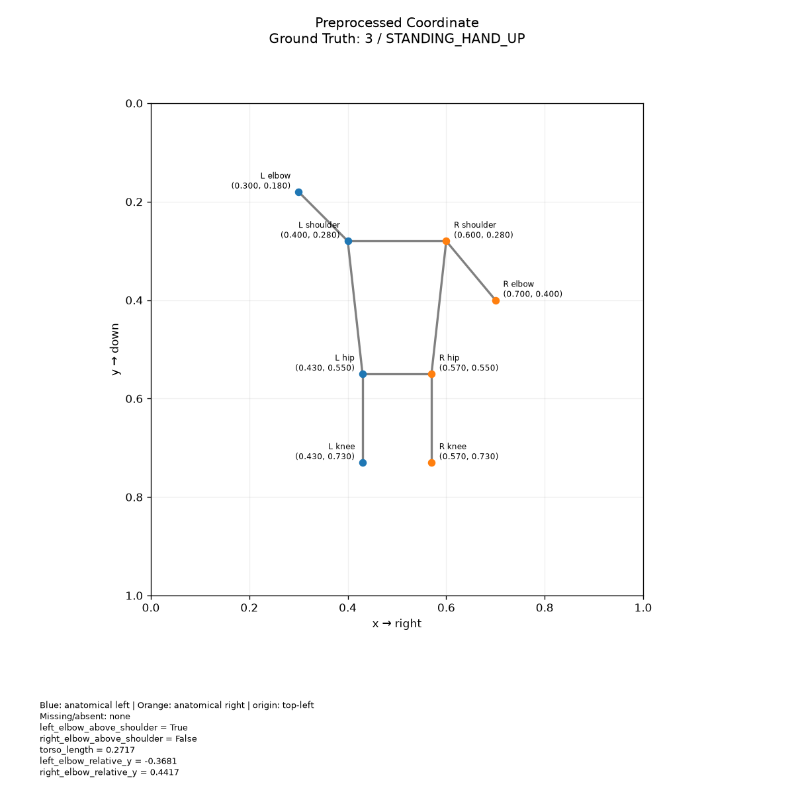

# 8개 관절 데이터 형식

`data/sample/`의 데이터는 코드 검증을 위한 **합성 예시**입니다. 실제 pose estimator 출력 검증을 대신하지 않습니다.

```json
{
  "id": "example",
  "coordinate_space": "normalized",
  "label": 2,
  "keypoints": {
    "left_shoulder": [0.4, 0.28],
    "right_shoulder": {"x": 0.6, "y": 0.28, "confidence": 0.95},
    "left_elbow": null
  }
}
```

- JSON: 단일 객체 또는 객체 배열. JSONL: 줄당 객체 하나. CSV: `keypoints` 열에 JSON 객체를 넣습니다 (`data/sample/poses.csv` 참고).
- Python dict는 `load_sample({...})`, `plot_pose({...}, 'pose.png')`로 전달합니다.
- 입력은 좌우 shoulder, elbow, hip, knee의 8개 관절이며 영문 snake_case 이름을 사용합니다. 머리·손목·발목은 입력에 포함하지 않습니다. 순서만 있는 배열이나 estimator별 인덱스는 자동 추측하지 않습니다.
- 기본 좌표는 `[0,1]`, 좌상단 원점, x 오른쪽/y 아래쪽입니다. pixel 입력은 `coordinate_space: "pixel"`, 양수 `image_width`, `image_height`가 필요합니다.
- 누락 좌표는 `null`; `(0,0)`은 유효한 좌표입니다. `presence=0`은 사용하지 않으며 `--min-confidence` 미만 관절도 전처리에서 제외합니다.
- NaN/Infinity, 범위 초과, 알 수 없는 관절명, 일부만 있는 x/y는 오류입니다. crop 밖 좌표를 자동으로 잘라내지 않습니다.
- label/prediction은 0~3 정수 또는 아래 이름입니다. 좌우는 사람의 **해부학적 좌우**이며 자동 교환하지 않습니다.

첨부 문서의 나열 순서로 아래 매핑을 정했습니다. 실제 데이터셋 매핑이 다르면 먼저 변환해야 합니다.

| ID | 클래스 |
|---|---|
| 0 | SITTING_HAND_DOWN |
| 1 | SITTING_HAND_UP |
| 2 | STANDING_HAND_DOWN |
| 3 | STANDING_HAND_UP |

기존 클래스명 HAND_UP은 유지하되, 어느 한쪽 팔꿈치라도 같은 쪽 어깨보다 위에 있는 것을 팔 올림의 대리 기준으로 사용합니다. 손목이 없으므로 실제 손 높이는 알 수 없으며, 팔꿈치를 내린 채 손만 올린 자세는 구분할 수 없습니다. 앉기/서기 판단은 LLM에 맡기며 검증된 규칙 기반 분류기는 포함하지 않습니다.

## 관절 이름

| 부위 | 왼쪽 | 오른쪽 |
|---|---|---|
| 어깨 | `left_shoulder` | `right_shoulder` |
| 팔꿈치 | `left_elbow` | `right_elbow` |
| 골반 | `left_hip` | `right_hip` |
| 무릎 | `left_knee` | `right_knee` |

스키마가 허용하는 이름은 8개입니다. 샘플에 일부 관절이 없거나 null인 경우도 처리하며,
유효한 좌표가 최소 하나는 있어야 합니다. 8개 외의 이름은 오류로 처리합니다.

## 8개 관절 시각화 예시


