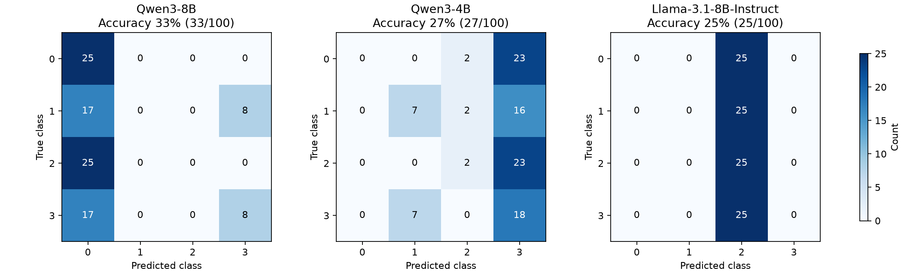

# 이전 평가 결과 · 사용자 지정 프롬프트

2026-11-03에 사용자 지정 프롬프트 전문으로 교체한 뒤, 동일한 **v4 측면 합성 데이터 100개(클래스별 25개)**를 Qwen3-8B, Qwen3-4B, Llama 3.1-8B-Instruct를 모델별로 전부 재평가했습니다.

## 설치 상태

- **Qwen3-8B**: 설치 확인 및 실제 로딩·추론 완료. BF16 가중치 5개 shard, 양자화 없음.
- **Qwen3-4B**: 기존 설치 확인 및 재평가 완료.
- **Llama 3.1-8B-Instruct**: 최초에는 미설치 상태였습니다. 사용자 요청으로 NousResearch 공개 배포본을 설치하고 SHA256을 검증한 뒤 100개 전체를 평가했습니다. [배포 저장소](https://huggingface.co/NousResearch/Meta-Llama-3.1-8B-Instruct)를 사용했으며 공식 Meta 저장소는 현재 계정에서 401 접근 오류가 발생했습니다.

## 모델별 결과

| 모델 | 정답 / 전체 | 정확도 | 호출·파싱 실패 | 평균 요청 지연 |
|---|---:|---:|---:|---:|
| Qwen/Qwen3-8B | 33 / 100 | 33.0% | 0 | 46.88 ms |
| Qwen/Qwen3-4B | 27 / 100 | 27.0% | 0 | 32.37 ms |
| NousResearch/Meta-Llama-3.1-8B-Instruct | 25 / 100 | 25.0% | 0 | 39.62 ms |

단일 실행의 평균 순차 HTTP 지연이며 모델 준비 시간은 제외합니다. RTX 5090을 기존 작업과 공유했습니다.

## 이전 프롬프트와 비교

Qwen3-4B 정확도는 기존 18%에서 27%로 **9%p 상승**했습니다. Qwen3-8B는 이번에 처음 평가해 33%를 기록했습니다. Qwen3-8B는 클래스 0을 84번, 클래스 3을 16번 예측했고 1·2는 한 번도 예측하지 않았습니다. Qwen3-4B도 클래스 0을 전혀 예측하지 않아 일부 클래스에 대한 쏠림이 남아 있습니다. Llama는 100개 모두 클래스 2(STANDING_HAND_DOWN)로 예측해, 균등 클래스 구성에서 25% 정확도를 기록했습니다.

[직전 v4 평가](experiment-results-v4-original-prompt.md)의 Qwen3-4B는 18/100 정답(18%), 실패 0건, 평균 41.87 ms였습니다. 이번에도 같은 v4 데이터 SHA256을 사용했습니다. 사용자 요청에 따라 system 프롬프트만 교체했고, 정규화 좌표와 기존 Feature를 담는 user JSON 구조는 유지했습니다. few-shot 예시는 없습니다.

합성 도식 100개에 대한 결과이므로 실제 사람 자세에 대한 성능으로 일반화할 수 없습니다. HAND_UP 판단에는 손목 대신 어깨·팔꿈치를 사용합니다. 프롬프트의 “어깨 높이에 가까움”에는 수치 임계값을 추가하지 않았습니다.



## 혼동행렬과 클래스별 지표

### Qwen/Qwen3-8B

행은 정답, 열은 예측입니다.

| 정답 \ 예측 | 0 | 1 | 2 | 3 |
|---|---:|---:|---:|---:|
| 0 | 25 | 0 | 0 | 0 |
| 1 | 17 | 0 | 0 | 8 |
| 2 | 25 | 0 | 0 | 0 |
| 3 | 17 | 0 | 0 | 8 |

| 클래스 | Precision | Recall (유효 응답) | F1 (유효 응답) | 표본 |
|---|---:|---:|---:|---:|
| SITTING_HAND_DOWN | 0.2976 | 1.0000 | 0.4587 | 25 |
| SITTING_HAND_UP | 0.0000 | 0.0000 | 0.0000 | 25 |
| STANDING_HAND_DOWN | 0.0000 | 0.0000 | 0.0000 | 25 |
| STANDING_HAND_UP | 0.5000 | 0.3200 | 0.3902 | 25 |

앉기/서기 일치: **50/100**. 팔 올림/내림 일치: **66/100**.

### Qwen/Qwen3-4B

행은 정답, 열은 예측입니다.

| 정답 \ 예측 | 0 | 1 | 2 | 3 |
|---|---:|---:|---:|---:|
| 0 | 0 | 0 | 2 | 23 |
| 1 | 0 | 7 | 2 | 16 |
| 2 | 0 | 0 | 2 | 23 |
| 3 | 0 | 7 | 0 | 18 |

| 클래스 | Precision | Recall (유효 응답) | F1 (유효 응답) | 표본 |
|---|---:|---:|---:|---:|
| SITTING_HAND_DOWN | 0.0000 | 0.0000 | 0.0000 | 25 |
| SITTING_HAND_UP | 0.5000 | 0.2800 | 0.3590 | 25 |
| STANDING_HAND_DOWN | 0.3333 | 0.0800 | 0.1290 | 25 |
| STANDING_HAND_UP | 0.2250 | 0.7200 | 0.3429 | 25 |

앉기/서기 일치: **50/100**. 팔 올림/내림 일치: **52/100**.

### NousResearch/Meta-Llama-3.1-8B-Instruct

행은 정답, 열은 예측입니다.

| 정답 \ 예측 | 0 | 1 | 2 | 3 |
|---|---:|---:|---:|---:|
| 0 | 0 | 0 | 25 | 0 |
| 1 | 0 | 0 | 25 | 0 |
| 2 | 0 | 0 | 25 | 0 |
| 3 | 0 | 0 | 25 | 0 |

| 클래스 | Precision | Recall (유효 응답) | F1 (유효 응답) | 표본 |
|---|---:|---:|---:|---:|
| SITTING_HAND_DOWN | 0.0000 | 0.0000 | 0.0000 | 25 |
| SITTING_HAND_UP | 0.0000 | 0.0000 | 0.0000 | 25 |
| STANDING_HAND_DOWN | 0.2500 | 1.0000 | 0.4000 | 25 |
| STANDING_HAND_UP | 0.0000 | 0.0000 | 0.0000 | 25 |

앉기/서기 일치: **50/100**. 팔 올림/내림 일치: **50/100**.

## 실행 조건과 원본 기록 {#artifacts}

| 항목 | 값 |
|---|---|
| 입력 | v4 측면 · seed 42 · 100개 · 데이터 재생성 없음 |
| 방식 | zero-shot · temperature 0 · max_tokens 256 · thinking 비활성화 |
| 서버 | vLLM 0.33.0 · BF16 · context 4096 · max_num_seqs 2 |
| GPU 메모리 비율 | Qwen 8B/Llama 8B: 0.55 / Qwen 4B: 0.45 · 순차 로딩 |
| 실행 | eager · TRITON_ATTN · seed 0 · RTX 5090 공유 |
| 입력 누출 방지 | user payload에 label/prediction/id/합성 메타데이터 없음 |

데이터 SHA256: `c509713c7ded6b41146a4fb2166db6317b2e8b1179d26b4f91155be211e1a7cb`

프롬프트 SHA256(마지막 개행 제외): `b4afd79af2f416214d74e79ba657da47f6275ed4c16c92679b2e6d1da629f4c5`

[프롬프트 전문](assets/experiments/2026-11-03-requested-prompt/system-prompt.txt) · [실험 메타데이터와 서버 명령](assets/experiments/2026-11-03-requested-prompt/experiment.json) · [평가 입력 스냅샷](assets/experiments/2026-11-03-requested-prompt/synthetic_100.jsonl)

- Qwen3-8B: [metrics](assets/experiments/2026-11-03-requested-prompt/qwen3-8b-metrics.json) · [전체 100개 입력·프롬프트·응답·예측](assets/experiments/2026-11-03-requested-prompt/qwen3-8b-predictions.jsonl) · [서버 로그](assets/experiments/2026-11-03-requested-prompt/qwen3-8b-server.log)
- Qwen3-4B: [metrics](assets/experiments/2026-11-03-requested-prompt/qwen3-4b-metrics.json) · [전체 100개 입력·프롬프트·응답·예측](assets/experiments/2026-11-03-requested-prompt/qwen3-4b-predictions.jsonl) · [서버 로그](assets/experiments/2026-11-03-requested-prompt/qwen3-4b-server.log)
- Llama-3.1-8B-Instruct: [metrics](assets/experiments/2026-11-03-requested-prompt/llama-3.1-8b-instruct-metrics.json) · [전체 100개 입력·프롬프트·응답·예측](assets/experiments/2026-11-03-requested-prompt/llama-3.1-8b-instruct-predictions.jsonl) · [서버 로그](assets/experiments/2026-11-03-requested-prompt/llama-3.1-8b-instruct-server.log)

전체 오분류 PNG와 원본 로그는 로컬 `results/experiments/2026-11-03-requested-prompt/`에 보관합니다. 실험을 위해 시작한 서버는 종료했습니다.

## 재현 {#reproduce}

메타데이터의 각 `models[].command`로 서버를 실행합니다(프로젝트 루트에서 `source .local/model-env.sh` 적용). 준비된 서버에 다음 명령을 모델별로 실행합니다. 기존 결과와 다른 새 output-dir을 사용하세요.

```bash
.venv/bin/python scripts/evaluate_llm.py \
  --input data/sample/synthetic_100.jsonl \
  --backend remote --model Qwen/Qwen3-8B \
  --base-url http://127.0.0.1:18081/v1 --visualization-reviewed \
  --output-dir results/reproduction-qwen3-8b
```

4B는 `--model Qwen/Qwen3-4B`, Llama는 `--model NousResearch/Meta-Llama-3.1-8B-Instruct`로 바꾸고 해당 모델 서버로 평가합니다.

??? abstract "Qwen3-8B 100개별 정답과 예측"

    | ID | 정답 | 예측 | 응답 |
    |---|---:|---:|---|
    | `synthetic-0-000` | 0 | 0 | `0` |
    | `synthetic-0-001` | 0 | 0 | `0` |
    | `synthetic-0-002` | 0 | 0 | `0` |
    | `synthetic-0-003` | 0 | 0 | `0` |
    | `synthetic-0-004` | 0 | 0 | `0` |
    | `synthetic-0-005` | 0 | 0 | `0` |
    | `synthetic-0-006` | 0 | 0 | `0` |
    | `synthetic-0-007` | 0 | 0 | `0` |
    | `synthetic-0-008` | 0 | 0 | `0` |
    | `synthetic-0-009` | 0 | 0 | `0` |
    | `synthetic-0-010` | 0 | 0 | `0` |
    | `synthetic-0-011` | 0 | 0 | `0` |
    | `synthetic-0-012` | 0 | 0 | `0` |
    | `synthetic-0-013` | 0 | 0 | `0` |
    | `synthetic-0-014` | 0 | 0 | `0` |
    | `synthetic-0-015` | 0 | 0 | `0` |
    | `synthetic-0-016` | 0 | 0 | `0` |
    | `synthetic-0-017` | 0 | 0 | `0` |
    | `synthetic-0-018` | 0 | 0 | `0` |
    | `synthetic-0-019` | 0 | 0 | `0` |
    | `synthetic-0-020` | 0 | 0 | `0` |
    | `synthetic-0-021` | 0 | 0 | `0` |
    | `synthetic-0-022` | 0 | 0 | `0` |
    | `synthetic-0-023` | 0 | 0 | `0` |
    | `synthetic-0-024` | 0 | 0 | `0` |
    | `synthetic-1-000` | 1 | 0 | `0` |
    | `synthetic-1-001` | 1 | 3 | `3` |
    | `synthetic-1-002` | 1 | 0 | `0` |
    | `synthetic-1-003` | 1 | 0 | `0` |
    | `synthetic-1-004` | 1 | 3 | `3` |
    | `synthetic-1-005` | 1 | 0 | `0` |
    | `synthetic-1-006` | 1 | 0 | `0` |
    | `synthetic-1-007` | 1 | 3 | `3` |
    | `synthetic-1-008` | 1 | 0 | `0` |
    | `synthetic-1-009` | 1 | 0 | `0` |
    | `synthetic-1-010` | 1 | 3 | `3` |
    | `synthetic-1-011` | 1 | 0 | `0` |
    | `synthetic-1-012` | 1 | 0 | `0` |
    | `synthetic-1-013` | 1 | 3 | `3` |
    | `synthetic-1-014` | 1 | 0 | `0` |
    | `synthetic-1-015` | 1 | 0 | `0` |
    | `synthetic-1-016` | 1 | 3 | `3` |
    | `synthetic-1-017` | 1 | 0 | `0` |
    | `synthetic-1-018` | 1 | 0 | `0` |
    | `synthetic-1-019` | 1 | 3 | `3` |
    | `synthetic-1-020` | 1 | 0 | `0` |
    | `synthetic-1-021` | 1 | 0 | `0` |
    | `synthetic-1-022` | 1 | 3 | `3` |
    | `synthetic-1-023` | 1 | 0 | `0` |
    | `synthetic-1-024` | 1 | 0 | `0` |
    | `synthetic-2-000` | 2 | 0 | `0` |
    | `synthetic-2-001` | 2 | 0 | `0` |
    | `synthetic-2-002` | 2 | 0 | `0` |
    | `synthetic-2-003` | 2 | 0 | `0` |
    | `synthetic-2-004` | 2 | 0 | `0` |
    | `synthetic-2-005` | 2 | 0 | `0` |
    | `synthetic-2-006` | 2 | 0 | `0` |
    | `synthetic-2-007` | 2 | 0 | `0` |
    | `synthetic-2-008` | 2 | 0 | `0` |
    | `synthetic-2-009` | 2 | 0 | `0` |
    | `synthetic-2-010` | 2 | 0 | `0` |
    | `synthetic-2-011` | 2 | 0 | `0` |
    | `synthetic-2-012` | 2 | 0 | `0` |
    | `synthetic-2-013` | 2 | 0 | `0` |
    | `synthetic-2-014` | 2 | 0 | `0` |
    | `synthetic-2-015` | 2 | 0 | `0` |
    | `synthetic-2-016` | 2 | 0 | `0` |
    | `synthetic-2-017` | 2 | 0 | `0` |
    | `synthetic-2-018` | 2 | 0 | `0` |
    | `synthetic-2-019` | 2 | 0 | `0` |
    | `synthetic-2-020` | 2 | 0 | `0` |
    | `synthetic-2-021` | 2 | 0 | `0` |
    | `synthetic-2-022` | 2 | 0 | `0` |
    | `synthetic-2-023` | 2 | 0 | `0` |
    | `synthetic-2-024` | 2 | 0 | `0` |
    | `synthetic-3-000` | 3 | 0 | `0` |
    | `synthetic-3-001` | 3 | 3 | `3` |
    | `synthetic-3-002` | 3 | 0 | `0` |
    | `synthetic-3-003` | 3 | 0 | `0` |
    | `synthetic-3-004` | 3 | 3 | `3` |
    | `synthetic-3-005` | 3 | 0 | `0` |
    | `synthetic-3-006` | 3 | 0 | `0` |
    | `synthetic-3-007` | 3 | 3 | `3` |
    | `synthetic-3-008` | 3 | 0 | `0` |
    | `synthetic-3-009` | 3 | 0 | `0` |
    | `synthetic-3-010` | 3 | 3 | `3` |
    | `synthetic-3-011` | 3 | 0 | `0` |
    | `synthetic-3-012` | 3 | 0 | `0` |
    | `synthetic-3-013` | 3 | 3 | `3` |
    | `synthetic-3-014` | 3 | 0 | `0` |
    | `synthetic-3-015` | 3 | 0 | `0` |
    | `synthetic-3-016` | 3 | 3 | `3` |
    | `synthetic-3-017` | 3 | 0 | `0` |
    | `synthetic-3-018` | 3 | 0 | `0` |
    | `synthetic-3-019` | 3 | 3 | `3` |
    | `synthetic-3-020` | 3 | 0 | `0` |
    | `synthetic-3-021` | 3 | 0 | `0` |
    | `synthetic-3-022` | 3 | 3 | `3` |
    | `synthetic-3-023` | 3 | 0 | `0` |
    | `synthetic-3-024` | 3 | 0 | `0` |

??? abstract "Qwen3-4B 100개별 정답과 예측"

    | ID | 정답 | 예측 | 응답 |
    |---|---:|---:|---|
    | `synthetic-0-000` | 0 | 3 | `3` |
    | `synthetic-0-001` | 0 | 2 | `2` |
    | `synthetic-0-002` | 0 | 3 | `3` |
    | `synthetic-0-003` | 0 | 3 | `3` |
    | `synthetic-0-004` | 0 | 3 | `3` |
    | `synthetic-0-005` | 0 | 3 | `3` |
    | `synthetic-0-006` | 0 | 3 | `3` |
    | `synthetic-0-007` | 0 | 3 | `3` |
    | `synthetic-0-008` | 0 | 2 | `2` |
    | `synthetic-0-009` | 0 | 3 | `3` |
    | `synthetic-0-010` | 0 | 3 | `3` |
    | `synthetic-0-011` | 0 | 3 | `3` |
    | `synthetic-0-012` | 0 | 3 | `3` |
    | `synthetic-0-013` | 0 | 3 | `3` |
    | `synthetic-0-014` | 0 | 3 | `3` |
    | `synthetic-0-015` | 0 | 3 | `3` |
    | `synthetic-0-016` | 0 | 3 | `3` |
    | `synthetic-0-017` | 0 | 3 | `3` |
    | `synthetic-0-018` | 0 | 3 | `3` |
    | `synthetic-0-019` | 0 | 3 | `3` |
    | `synthetic-0-020` | 0 | 3 | `3` |
    | `synthetic-0-021` | 0 | 3 | `3` |
    | `synthetic-0-022` | 0 | 3 | `3` |
    | `synthetic-0-023` | 0 | 3 | `3` |
    | `synthetic-0-024` | 0 | 3 | `3` |
    | `synthetic-1-000` | 1 | 3 | `3` |
    | `synthetic-1-001` | 1 | 3 | `3` |
    | `synthetic-1-002` | 1 | 3 | `3` |
    | `synthetic-1-003` | 1 | 3 | `3` |
    | `synthetic-1-004` | 1 | 3 | `3` |
    | `synthetic-1-005` | 1 | 1 | `1` |
    | `synthetic-1-006` | 1 | 3 | `3` |
    | `synthetic-1-007` | 1 | 3 | `3` |
    | `synthetic-1-008` | 1 | 1 | `1` |
    | `synthetic-1-009` | 1 | 3 | `3` |
    | `synthetic-1-010` | 1 | 3 | `3` |
    | `synthetic-1-011` | 1 | 1 | `1` |
    | `synthetic-1-012` | 1 | 3 | `3` |
    | `synthetic-1-013` | 1 | 3 | `3` |
    | `synthetic-1-014` | 1 | 1 | `1` |
    | `synthetic-1-015` | 1 | 3 | `3` |
    | `synthetic-1-016` | 1 | 3 | `3` |
    | `synthetic-1-017` | 1 | 1 | `1` |
    | `synthetic-1-018` | 1 | 2 | `2` |
    | `synthetic-1-019` | 1 | 3 | `3` |
    | `synthetic-1-020` | 1 | 1 | `1` |
    | `synthetic-1-021` | 1 | 2 | `2` |
    | `synthetic-1-022` | 1 | 3 | `3` |
    | `synthetic-1-023` | 1 | 1 | `1` |
    | `synthetic-1-024` | 1 | 3 | `3` |
    | `synthetic-2-000` | 2 | 3 | `3` |
    | `synthetic-2-001` | 2 | 3 | `3` |
    | `synthetic-2-002` | 2 | 3 | `3` |
    | `synthetic-2-003` | 2 | 3 | `3` |
    | `synthetic-2-004` | 2 | 3 | `3` |
    | `synthetic-2-005` | 2 | 3 | `3` |
    | `synthetic-2-006` | 2 | 3 | `3` |
    | `synthetic-2-007` | 2 | 3 | `3` |
    | `synthetic-2-008` | 2 | 3 | `3` |
    | `synthetic-2-009` | 2 | 3 | `3` |
    | `synthetic-2-010` | 2 | 3 | `3` |
    | `synthetic-2-011` | 2 | 3 | `3` |
    | `synthetic-2-012` | 2 | 3 | `3` |
    | `synthetic-2-013` | 2 | 3 | `3` |
    | `synthetic-2-014` | 2 | 3 | `3` |
    | `synthetic-2-015` | 2 | 3 | `3` |
    | `synthetic-2-016` | 2 | 3 | `3` |
    | `synthetic-2-017` | 2 | 3 | `3` |
    | `synthetic-2-018` | 2 | 3 | `3` |
    | `synthetic-2-019` | 2 | 2 | `2` |
    | `synthetic-2-020` | 2 | 3 | `3` |
    | `synthetic-2-021` | 2 | 3 | `3` |
    | `synthetic-2-022` | 2 | 3 | `3` |
    | `synthetic-2-023` | 2 | 2 | `2` |
    | `synthetic-2-024` | 2 | 3 | `3` |
    | `synthetic-3-000` | 3 | 3 | `3` |
    | `synthetic-3-001` | 3 | 3 | `3` |
    | `synthetic-3-002` | 3 | 1 | `1` |
    | `synthetic-3-003` | 3 | 3 | `3` |
    | `synthetic-3-004` | 3 | 3 | `3` |
    | `synthetic-3-005` | 3 | 1 | `1` |
    | `synthetic-3-006` | 3 | 3 | `3` |
    | `synthetic-3-007` | 3 | 3 | `3` |
    | `synthetic-3-008` | 3 | 1 | `1` |
    | `synthetic-3-009` | 3 | 3 | `3` |
    | `synthetic-3-010` | 3 | 3 | `3` |
    | `synthetic-3-011` | 3 | 1 | `1` |
    | `synthetic-3-012` | 3 | 3 | `3` |
    | `synthetic-3-013` | 3 | 3 | `3` |
    | `synthetic-3-014` | 3 | 1 | `1` |
    | `synthetic-3-015` | 3 | 3 | `3` |
    | `synthetic-3-016` | 3 | 3 | `3` |
    | `synthetic-3-017` | 3 | 1 | `1` |
    | `synthetic-3-018` | 3 | 3 | `3` |
    | `synthetic-3-019` | 3 | 3 | `3` |
    | `synthetic-3-020` | 3 | 1 | `1` |
    | `synthetic-3-021` | 3 | 3 | `3` |
    | `synthetic-3-022` | 3 | 3 | `3` |
    | `synthetic-3-023` | 3 | 3 | `3` |
    | `synthetic-3-024` | 3 | 3 | `3` |

??? abstract "Llama-3.1-8B-Instruct 100개별 정답과 예측"

    | ID | 정답 | 예측 | 응답 |
    |---|---:|---:|---|
    | `synthetic-0-000` | 0 | 2 | `2` |
    | `synthetic-0-001` | 0 | 2 | `2` |
    | `synthetic-0-002` | 0 | 2 | `2` |
    | `synthetic-0-003` | 0 | 2 | `2` |
    | `synthetic-0-004` | 0 | 2 | `2` |
    | `synthetic-0-005` | 0 | 2 | `2` |
    | `synthetic-0-006` | 0 | 2 | `2` |
    | `synthetic-0-007` | 0 | 2 | `2` |
    | `synthetic-0-008` | 0 | 2 | `2` |
    | `synthetic-0-009` | 0 | 2 | `2` |
    | `synthetic-0-010` | 0 | 2 | `2` |
    | `synthetic-0-011` | 0 | 2 | `2` |
    | `synthetic-0-012` | 0 | 2 | `2` |
    | `synthetic-0-013` | 0 | 2 | `2` |
    | `synthetic-0-014` | 0 | 2 | `2` |
    | `synthetic-0-015` | 0 | 2 | `2` |
    | `synthetic-0-016` | 0 | 2 | `2` |
    | `synthetic-0-017` | 0 | 2 | `2` |
    | `synthetic-0-018` | 0 | 2 | `2` |
    | `synthetic-0-019` | 0 | 2 | `2` |
    | `synthetic-0-020` | 0 | 2 | `2` |
    | `synthetic-0-021` | 0 | 2 | `2` |
    | `synthetic-0-022` | 0 | 2 | `2` |
    | `synthetic-0-023` | 0 | 2 | `2` |
    | `synthetic-0-024` | 0 | 2 | `2` |
    | `synthetic-1-000` | 1 | 2 | `2` |
    | `synthetic-1-001` | 1 | 2 | `2` |
    | `synthetic-1-002` | 1 | 2 | `2` |
    | `synthetic-1-003` | 1 | 2 | `2` |
    | `synthetic-1-004` | 1 | 2 | `2` |
    | `synthetic-1-005` | 1 | 2 | `2` |
    | `synthetic-1-006` | 1 | 2 | `2` |
    | `synthetic-1-007` | 1 | 2 | `2` |
    | `synthetic-1-008` | 1 | 2 | `2` |
    | `synthetic-1-009` | 1 | 2 | `2` |
    | `synthetic-1-010` | 1 | 2 | `2` |
    | `synthetic-1-011` | 1 | 2 | `2` |
    | `synthetic-1-012` | 1 | 2 | `2` |
    | `synthetic-1-013` | 1 | 2 | `2` |
    | `synthetic-1-014` | 1 | 2 | `2` |
    | `synthetic-1-015` | 1 | 2 | `2` |
    | `synthetic-1-016` | 1 | 2 | `2` |
    | `synthetic-1-017` | 1 | 2 | `2` |
    | `synthetic-1-018` | 1 | 2 | `2` |
    | `synthetic-1-019` | 1 | 2 | `2` |
    | `synthetic-1-020` | 1 | 2 | `2` |
    | `synthetic-1-021` | 1 | 2 | `2` |
    | `synthetic-1-022` | 1 | 2 | `2` |
    | `synthetic-1-023` | 1 | 2 | `2` |
    | `synthetic-1-024` | 1 | 2 | `2` |
    | `synthetic-2-000` | 2 | 2 | `2` |
    | `synthetic-2-001` | 2 | 2 | `2` |
    | `synthetic-2-002` | 2 | 2 | `2` |
    | `synthetic-2-003` | 2 | 2 | `2` |
    | `synthetic-2-004` | 2 | 2 | `2` |
    | `synthetic-2-005` | 2 | 2 | `2` |
    | `synthetic-2-006` | 2 | 2 | `2` |
    | `synthetic-2-007` | 2 | 2 | `2` |
    | `synthetic-2-008` | 2 | 2 | `2` |
    | `synthetic-2-009` | 2 | 2 | `2` |
    | `synthetic-2-010` | 2 | 2 | `2` |
    | `synthetic-2-011` | 2 | 2 | `2` |
    | `synthetic-2-012` | 2 | 2 | `2` |
    | `synthetic-2-013` | 2 | 2 | `2` |
    | `synthetic-2-014` | 2 | 2 | `2` |
    | `synthetic-2-015` | 2 | 2 | `2` |
    | `synthetic-2-016` | 2 | 2 | `2` |
    | `synthetic-2-017` | 2 | 2 | `2` |
    | `synthetic-2-018` | 2 | 2 | `2` |
    | `synthetic-2-019` | 2 | 2 | `2` |
    | `synthetic-2-020` | 2 | 2 | `2` |
    | `synthetic-2-021` | 2 | 2 | `2` |
    | `synthetic-2-022` | 2 | 2 | `2` |
    | `synthetic-2-023` | 2 | 2 | `2` |
    | `synthetic-2-024` | 2 | 2 | `2` |
    | `synthetic-3-000` | 3 | 2 | `2` |
    | `synthetic-3-001` | 3 | 2 | `2` |
    | `synthetic-3-002` | 3 | 2 | `2` |
    | `synthetic-3-003` | 3 | 2 | `2` |
    | `synthetic-3-004` | 3 | 2 | `2` |
    | `synthetic-3-005` | 3 | 2 | `2` |
    | `synthetic-3-006` | 3 | 2 | `2` |
    | `synthetic-3-007` | 3 | 2 | `2` |
    | `synthetic-3-008` | 3 | 2 | `2` |
    | `synthetic-3-009` | 3 | 2 | `2` |
    | `synthetic-3-010` | 3 | 2 | `2` |
    | `synthetic-3-011` | 3 | 2 | `2` |
    | `synthetic-3-012` | 3 | 2 | `2` |
    | `synthetic-3-013` | 3 | 2 | `2` |
    | `synthetic-3-014` | 3 | 2 | `2` |
    | `synthetic-3-015` | 3 | 2 | `2` |
    | `synthetic-3-016` | 3 | 2 | `2` |
    | `synthetic-3-017` | 3 | 2 | `2` |
    | `synthetic-3-018` | 3 | 2 | `2` |
    | `synthetic-3-019` | 3 | 2 | `2` |
    | `synthetic-3-020` | 3 | 2 | `2` |
    | `synthetic-3-021` | 3 | 2 | `2` |
    | `synthetic-3-022` | 3 | 2 | `2` |
    | `synthetic-3-023` | 3 | 2 | `2` |
    | `synthetic-3-024` | 3 | 2 | `2` |


[Google Docs 결과 문서](https://docs.google.com/document/d/1Qk312hVzzQu0xHE2cM2qNIESz5ogQY2mYUT6HoHptak)
