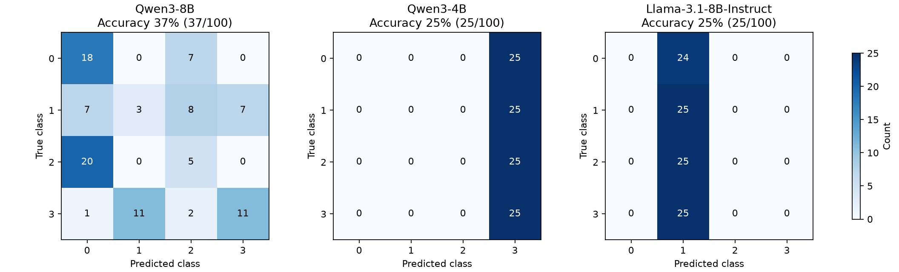

# 이전 평가 결과 · 수치 규칙 프롬프트

2026-11-04에 좌표·각도 임계값과 결측값 처리를 고정한 프롬프트로 세 모델을 각각 100개씩 재평가했습니다. **LLM의 출력은 Python 규칙 계산으로 대체하지 않았습니다.** 별도 Python 참조 계산을 함께 측정했습니다.

## 고정한 규칙

| 판단 | 수치 조건 | 결과 |
|---|---|---|
| 자세 | 몸통 하향 벡터와 허벅지 벡터의 각도 < 45° | 서기 |
| 자세 | 위 각도 ≥ 45° (골반 관절 각도 ≤ 135°) | 앉기 |
| 팔 | 하나 이상에서 팔꿈치 y − 어깨 y ≤ 몸통 길이 × 0.05 | 팔 올림 |
| 팔 | 모든 사용 가능한 팔이 위 임계값보다 아래 | 팔 내림 |

좌우의 유효한 어깨→골반 벡터 평균을 `T`, 골반→무릎 벡터 평균을 `V`로 사용합니다. 몸통 길이 `L`은 좌우 유효한 몸통 길이의 평균입니다. 각도는 정규화된 2D 좌표 평면에서 계산합니다.

```text
dot = T.x * V.x + T.y * V.y
cross = abs(T.x * V.y - T.y * V.x)
standing = 1 if dot > cross else 0
hand_up = 1 if any(elbow_y - shoulder_y <= 0.05 * L) else 0
class_id = 2 * standing + hand_up
```

몸통이 수직일 때 서기 조건은 `knee_y - hip_y > abs(knee_x - hip_x)`로 단순해집니다. 팔 위치는 영상의 y 방향을 기준으로 합니다. 경계값은 자세에서는 앉기, 팔에서는 올림에 포함합니다.

결측값은 null 그대로 두고 완전한 관절 쌍만 사용합니다. 몸통 벡터가 없거나 길이 ≤ 1e-8이면 `(0,1)`을 사용합니다. 허벅지 벡터가 없거나 길이 ≤ 1e-8이면 서기, 팔 쌍이 없으면 팔 내림을 기본값으로 둡니다. 몸통 쌍이 없으면 팔 허용 오차는 0입니다. 모든 관절이 누락된 입력은 기존 입력 검증에서 거부합니다.

[실제로 전달한 프롬프트 전문](assets/experiments/2026-11-04-numeric-rules/system-prompt.txt) · [Python 참조 계산 소스](assets/experiments/2026-11-04-numeric-rules/rule_reference.py)

## 이전 프롬프트와 비교

| 모델 / 방식 | 이전 정확도 | 수치 규칙 정확도 | 변화 | 실패 | 평균 지연 |
|---|---:|---:|---:|---:|---:|
| Qwen3-8B · LLM | 33% | 37/100 (37%) | +4%p | 0 | 47.44 ms |
| Qwen3-4B · LLM | 27% | 25/100 (25%) | -2%p | 0 | 32.69 ms |
| Llama-3.1-8B-Instruct · LLM | 25% | 25/100 (25%) | +0%p | 1 | 64.29 ms |
| Python 직접 규칙 · LLM 아님 | — | 100/100 (100%) | — | 0 | 0.0133 ms |

[11/03 사용자 지정 프롬프트 결과](experiment-results-2026-11-03-user-prompt.md)는 별도 보존했습니다. 입력·모델 revision·샘플 순서·temperature·출력 제한·서버 설정을 유지하고 system 프롬프트를 교체했습니다. user JSON에 기존 Feature는 유지되지만 프롬프트는 이를 무시하고 keypoints만 사용하도록 지정합니다. dot/cross나 정답을 LLM 입력에 추가하지 않았습니다.

## 결과 해석

Qwen3-4B는 100개 모두 클래스 3을 예측했습니다. Llama는 유효한 99개 응답 모두 클래스 1을 예측했고, 숫자 한 자리 형식을 어긴 응답 1건은 실패로 계산했습니다. 전체 정확도에는 실패를 오답으로 포함하고 혼동행렬·클래스별 지표에서는 실패를 제외합니다.

Python의 동일 규칙은 이 합성 100개에서 100%였습니다. 따라서 이 입력 집합은 지정한 기하 규칙으로 구분할 수 있습니다. LLM의 규칙 출력과의 차이는 실제 300개 응답과 별도 규칙 계산을 대조해 확인했습니다. 이것만으로 모델 내부의 오분류 원인을 단정할 수는 없습니다.

임계값 45°와 0.05는 평가 전에 고정했으며 이번 결과를 보고 재조정하지 않았습니다. 이전에도 사용한 합성 개발 데이터의 재평가이므로 독립 평가 세트나 실제 사람 자세의 일반화 성능을 뜻하지 않습니다. LLM 지연은 준비 시간을 제외한 평균 순차 HTTP 요청 시간이고, Python 지연은 로컬 함수 실행 시간입니다. 측정 경로가 다르므로 같은 서버 지연으로 비교하지 않습니다. 이번에는 다른 GPU 계산 작업이 관찰되지 않아, GPU를 공유한 이전 실행과의 지연 비교는 제한됩니다.




## 혼동행렬과 클래스별 지표

### Qwen3-8B

앉기/서기 일치 46/100 · 팔 올림/내림 일치 82/100. 행은 정답, 열은 예측입니다.

| 정답 / 예측 | 0 | 1 | 2 | 3 |
|---|---:|---:|---:|---:|
| 0 | 18 | 0 | 7 | 0 |
| 1 | 7 | 3 | 8 | 7 |
| 2 | 20 | 0 | 5 | 0 |
| 3 | 1 | 11 | 2 | 11 |

| 클래스 | Precision | Recall (유효 응답) | F1 (유효 응답) | 표본 |
|---|---:|---:|---:|---:|
| SITTING_HAND_DOWN | 0.3913 | 0.7200 | 0.5070 | 25 |
| SITTING_HAND_UP | 0.2143 | 0.1200 | 0.1538 | 25 |
| STANDING_HAND_DOWN | 0.2273 | 0.2000 | 0.2128 | 25 |
| STANDING_HAND_UP | 0.6111 | 0.4400 | 0.5116 | 25 |

### Qwen3-4B

앉기/서기 일치 50/100 · 팔 올림/내림 일치 50/100. 행은 정답, 열은 예측입니다.

| 정답 / 예측 | 0 | 1 | 2 | 3 |
|---|---:|---:|---:|---:|
| 0 | 0 | 0 | 0 | 25 |
| 1 | 0 | 0 | 0 | 25 |
| 2 | 0 | 0 | 0 | 25 |
| 3 | 0 | 0 | 0 | 25 |

| 클래스 | Precision | Recall (유효 응답) | F1 (유효 응답) | 표본 |
|---|---:|---:|---:|---:|
| SITTING_HAND_DOWN | 0.0000 | 0.0000 | 0.0000 | 25 |
| SITTING_HAND_UP | 0.0000 | 0.0000 | 0.0000 | 25 |
| STANDING_HAND_DOWN | 0.0000 | 0.0000 | 0.0000 | 25 |
| STANDING_HAND_UP | 0.2500 | 1.0000 | 0.4000 | 25 |

### Llama-3.1-8B-Instruct

앉기/서기 일치 49/100 · 팔 올림/내림 일치 50/100. 행은 정답, 열은 예측입니다.

| 정답 / 예측 | 0 | 1 | 2 | 3 |
|---|---:|---:|---:|---:|
| 0 | 0 | 24 | 0 | 0 |
| 1 | 0 | 25 | 0 | 0 |
| 2 | 0 | 25 | 0 | 0 |
| 3 | 0 | 25 | 0 | 0 |

| 클래스 | Precision | Recall (유효 응답) | F1 (유효 응답) | 표본 |
|---|---:|---:|---:|---:|
| SITTING_HAND_DOWN | 0.0000 | 0.0000 | 0.0000 | 24 |
| SITTING_HAND_UP | 0.2525 | 1.0000 | 0.4032 | 25 |
| STANDING_HAND_DOWN | 0.0000 | 0.0000 | 0.0000 | 25 |
| STANDING_HAND_UP | 0.0000 | 0.0000 | 0.0000 | 25 |

## 실행 조건과 원본 기록 {#artifacts}

| 항목 | 값 |
|---|---|
| 입력 | v4 측면 합성 100개 · seed 42 · 클래스별 25개 · 데이터 재생성 없음 |
| 모델 | Qwen3-8B / Qwen3-4B / Llama 3.1-8B-Instruct · BF16 · 양자화 없음 |
| 추론 | zero-shot · temperature 0 · max_tokens 256 · Qwen thinking 비활성화 |
| 서버 | context 4096 · max_num_seqs 2 · eager · TRITON_ATTN · seed 0 |
| GPU | RTX 5090 · 메모리 비율 8B: 0.55 / 4B: 0.45 · 순차 로딩 |
| 검증 | 42 tests passed · Ruff passed · 300개 입력·프롬프트·응답·혼동행렬 감사 |

입력 SHA256: `c509713c7ded6b41146a4fb2166db6317b2e8b1179d26b4f91155be211e1a7cb`

프롬프트 SHA256(마지막 개행 제외): `0f5e24ac87ba65cc29334067278dc34b9945a39155d47ff085322d9353588412`

[실험 메타데이터와 서버 명령](assets/experiments/2026-11-04-numeric-rules/experiment.json) · [입력 스냅샷](assets/experiments/2026-11-04-numeric-rules/synthetic_100.jsonl) · [Python 참조 지표](assets/experiments/2026-11-04-numeric-rules/reference-metrics.json) · [Python 계산 추적 100개](assets/experiments/2026-11-04-numeric-rules/reference-predictions.jsonl)

- Qwen3-8B: [metrics](assets/experiments/2026-11-04-numeric-rules/qwen3-8b-metrics.json) · [100개 프롬프트·원문 응답](assets/experiments/2026-11-04-numeric-rules/qwen3-8b-predictions.jsonl) · [LLM/Python 계산 대조](assets/experiments/2026-11-04-numeric-rules/qwen3-8b-rule-audit.jsonl) · [서버 로그](assets/experiments/2026-11-04-numeric-rules/qwen3-8b-server.log)
- Qwen3-4B: [metrics](assets/experiments/2026-11-04-numeric-rules/qwen3-4b-metrics.json) · [100개 프롬프트·원문 응답](assets/experiments/2026-11-04-numeric-rules/qwen3-4b-predictions.jsonl) · [LLM/Python 계산 대조](assets/experiments/2026-11-04-numeric-rules/qwen3-4b-rule-audit.jsonl) · [서버 로그](assets/experiments/2026-11-04-numeric-rules/qwen3-4b-server.log)
- Llama-3.1-8B-Instruct: [metrics](assets/experiments/2026-11-04-numeric-rules/llama-3.1-8b-instruct-metrics.json) · [100개 프롬프트·원문 응답](assets/experiments/2026-11-04-numeric-rules/llama-3.1-8b-instruct-predictions.jsonl) · [LLM/Python 계산 대조](assets/experiments/2026-11-04-numeric-rules/llama-3.1-8b-instruct-rule-audit.jsonl) · [서버 로그](assets/experiments/2026-11-04-numeric-rules/llama-3.1-8b-instruct-server.log)

전체 오분류 PNG와 로그는 로컬 `results/experiments/2026-11-04-numeric-rules/`에 보관합니다. 실험용 서버는 모두 종료했습니다.

## 재현 {#reproduce}

프로젝트 루트에서 `source .local/model-env.sh`를 적용한 뒤 메타데이터의 `models[].command`로 해당 모델 서버를 시작합니다. 새 출력 폴더로 평가하세요.

```bash
.venv/bin/python scripts/evaluate_llm.py --input data/sample/synthetic_100.jsonl \
  --backend remote --model Qwen/Qwen3-8B \
  --base-url http://127.0.0.1:18081/v1 --visualization-reviewed \
  --output-dir results/reproduction-numeric-rules-qwen3-8b
```

4B는 `Qwen/Qwen3-4B`, Llama는 `NousResearch/Meta-Llama-3.1-8B-Instruct`로 model 인자를 바꿉니다.

??? abstract "Qwen3-8B 100개별 정답과 예측"

    | ID | 정답 | 예측 | 응답 (긴 응답은 축약) |
    |---|---:|---:|---|
    | `synthetic-0-000` | 0 | 0 | `"0"` |
    | `synthetic-0-001` | 0 | 0 | `"0"` |
    | `synthetic-0-002` | 0 | 0 | `"0"` |
    | `synthetic-0-003` | 0 | 0 | `"0"` |
    | `synthetic-0-004` | 0 | 0 | `"0"` |
    | `synthetic-0-005` | 0 | 0 | `"0"` |
    | `synthetic-0-006` | 0 | 0 | `"0"` |
    | `synthetic-0-007` | 0 | 0 | `"0"` |
    | `synthetic-0-008` | 0 | 2 | `"2"` |
    | `synthetic-0-009` | 0 | 2 | `"2"` |
    | `synthetic-0-010` | 0 | 0 | `"0"` |
    | `synthetic-0-011` | 0 | 2 | `"2"` |
    | `synthetic-0-012` | 0 | 2 | `"2"` |
    | `synthetic-0-013` | 0 | 2 | `"2"` |
    | `synthetic-0-014` | 0 | 0 | `"0"` |
    | `synthetic-0-015` | 0 | 0 | `"0"` |
    | `synthetic-0-016` | 0 | 0 | `"0"` |
    | `synthetic-0-017` | 0 | 0 | `"0"` |
    | `synthetic-0-018` | 0 | 0 | `"0"` |
    | `synthetic-0-019` | 0 | 2 | `"2"` |
    | `synthetic-0-020` | 0 | 0 | `"0"` |
    | `synthetic-0-021` | 0 | 2 | `"2"` |
    | `synthetic-0-022` | 0 | 0 | `"0"` |
    | `synthetic-0-023` | 0 | 0 | `"0"` |
    | `synthetic-0-024` | 0 | 0 | `"0"` |
    | `synthetic-1-000` | 1 | 2 | `"2"` |
    | `synthetic-1-001` | 1 | 2 | `"2"` |
    | `synthetic-1-002` | 1 | 2 | `"2"` |
    | `synthetic-1-003` | 1 | 1 | `"1"` |
    | `synthetic-1-004` | 1 | 3 | `"3"` |
    | `synthetic-1-005` | 1 | 3 | `"3"` |
    | `synthetic-1-006` | 1 | 0 | `"0"` |
    | `synthetic-1-007` | 1 | 3 | `"3"` |
    | `synthetic-1-008` | 1 | 2 | `"2"` |
    | `synthetic-1-009` | 1 | 0 | `"0"` |
    | `synthetic-1-010` | 1 | 2 | `"2"` |
    | `synthetic-1-011` | 1 | 3 | `"3"` |
    | `synthetic-1-012` | 1 | 0 | `"0"` |
    | `synthetic-1-013` | 1 | 2 | `"2"` |
    | `synthetic-1-014` | 1 | 1 | `"1"` |
    | `synthetic-1-015` | 1 | 0 | `"0"` |
    | `synthetic-1-016` | 1 | 2 | `"2"` |
    | `synthetic-1-017` | 1 | 1 | `"1"` |
    | `synthetic-1-018` | 1 | 0 | `"0"` |
    | `synthetic-1-019` | 1 | 3 | `"3"` |
    | `synthetic-1-020` | 1 | 3 | `"3"` |
    | `synthetic-1-021` | 1 | 0 | `"0"` |
    | `synthetic-1-022` | 1 | 2 | `"2"` |
    | `synthetic-1-023` | 1 | 3 | `"3"` |
    | `synthetic-1-024` | 1 | 0 | `"0"` |
    | `synthetic-2-000` | 2 | 2 | `"2"` |
    | `synthetic-2-001` | 2 | 2 | `"2"` |
    | `synthetic-2-002` | 2 | 0 | `"0"` |
    | `synthetic-2-003` | 2 | 0 | `"0"` |
    | `synthetic-2-004` | 2 | 0 | `"0"` |
    | `synthetic-2-005` | 2 | 0 | `"0"` |
    | `synthetic-2-006` | 2 | 0 | `"0"` |
    | `synthetic-2-007` | 2 | 0 | `"0"` |
    | `synthetic-2-008` | 2 | 0 | `"0"` |
    | `synthetic-2-009` | 2 | 0 | `"0"` |
    | `synthetic-2-010` | 2 | 0 | `"0"` |
    | `synthetic-2-011` | 2 | 0 | `"0"` |
    | `synthetic-2-012` | 2 | 0 | `"0"` |
    | `synthetic-2-013` | 2 | 2 | `"2"` |
    | `synthetic-2-014` | 2 | 0 | `"0"` |
    | `synthetic-2-015` | 2 | 0 | `"0"` |
    | `synthetic-2-016` | 2 | 0 | `"0"` |
    | `synthetic-2-017` | 2 | 0 | `"0"` |
    | `synthetic-2-018` | 2 | 0 | `"0"` |
    | `synthetic-2-019` | 2 | 0 | `"0"` |
    | `synthetic-2-020` | 2 | 2 | `"2"` |
    | `synthetic-2-021` | 2 | 0 | `"0"` |
    | `synthetic-2-022` | 2 | 0 | `"0"` |
    | `synthetic-2-023` | 2 | 2 | `"2"` |
    | `synthetic-2-024` | 2 | 0 | `"0"` |
    | `synthetic-3-000` | 3 | 1 | `"1"` |
    | `synthetic-3-001` | 3 | 3 | `"3"` |
    | `synthetic-3-002` | 3 | 3 | `"3"` |
    | `synthetic-3-003` | 3 | 1 | `"1"` |
    | `synthetic-3-004` | 3 | 3 | `"3"` |
    | `synthetic-3-005` | 3 | 1 | `"1"` |
    | `synthetic-3-006` | 3 | 1 | `"1"` |
    | `synthetic-3-007` | 3 | 3 | `"3"` |
    | `synthetic-3-008` | 3 | 3 | `"3"` |
    | `synthetic-3-009` | 3 | 1 | `"1"` |
    | `synthetic-3-010` | 3 | 3 | `"3"` |
    | `synthetic-3-011` | 3 | 1 | `"1"` |
    | `synthetic-3-012` | 3 | 0 | `"0"` |
    | `synthetic-3-013` | 3 | 3 | `"3"` |
    | `synthetic-3-014` | 3 | 3 | `"3"` |
    | `synthetic-3-015` | 3 | 1 | `"1"` |
    | `synthetic-3-016` | 3 | 2 | `"2"` |
    | `synthetic-3-017` | 3 | 3 | `"3"` |
    | `synthetic-3-018` | 3 | 1 | `"1"` |
    | `synthetic-3-019` | 3 | 2 | `"2"` |
    | `synthetic-3-020` | 3 | 3 | `"3"` |
    | `synthetic-3-021` | 3 | 1 | `"1"` |
    | `synthetic-3-022` | 3 | 3 | `"3"` |
    | `synthetic-3-023` | 3 | 1 | `"1"` |
    | `synthetic-3-024` | 3 | 1 | `"1"` |

??? abstract "Qwen3-4B 100개별 정답과 예측"

    | ID | 정답 | 예측 | 응답 (긴 응답은 축약) |
    |---|---:|---:|---|
    | `synthetic-0-000` | 0 | 3 | `"3"` |
    | `synthetic-0-001` | 0 | 3 | `"3"` |
    | `synthetic-0-002` | 0 | 3 | `"3"` |
    | `synthetic-0-003` | 0 | 3 | `"3"` |
    | `synthetic-0-004` | 0 | 3 | `"3"` |
    | `synthetic-0-005` | 0 | 3 | `"3"` |
    | `synthetic-0-006` | 0 | 3 | `"3"` |
    | `synthetic-0-007` | 0 | 3 | `"3"` |
    | `synthetic-0-008` | 0 | 3 | `"3"` |
    | `synthetic-0-009` | 0 | 3 | `"3"` |
    | `synthetic-0-010` | 0 | 3 | `"3"` |
    | `synthetic-0-011` | 0 | 3 | `"3"` |
    | `synthetic-0-012` | 0 | 3 | `"3"` |
    | `synthetic-0-013` | 0 | 3 | `"3"` |
    | `synthetic-0-014` | 0 | 3 | `"3"` |
    | `synthetic-0-015` | 0 | 3 | `"3"` |
    | `synthetic-0-016` | 0 | 3 | `"3"` |
    | `synthetic-0-017` | 0 | 3 | `"3"` |
    | `synthetic-0-018` | 0 | 3 | `"3"` |
    | `synthetic-0-019` | 0 | 3 | `"3"` |
    | `synthetic-0-020` | 0 | 3 | `"3"` |
    | `synthetic-0-021` | 0 | 3 | `"3"` |
    | `synthetic-0-022` | 0 | 3 | `"3"` |
    | `synthetic-0-023` | 0 | 3 | `"3"` |
    | `synthetic-0-024` | 0 | 3 | `"3"` |
    | `synthetic-1-000` | 1 | 3 | `"3"` |
    | `synthetic-1-001` | 1 | 3 | `"3"` |
    | `synthetic-1-002` | 1 | 3 | `"3"` |
    | `synthetic-1-003` | 1 | 3 | `"3"` |
    | `synthetic-1-004` | 1 | 3 | `"3"` |
    | `synthetic-1-005` | 1 | 3 | `"3"` |
    | `synthetic-1-006` | 1 | 3 | `"3"` |
    | `synthetic-1-007` | 1 | 3 | `"3"` |
    | `synthetic-1-008` | 1 | 3 | `"3"` |
    | `synthetic-1-009` | 1 | 3 | `"3"` |
    | `synthetic-1-010` | 1 | 3 | `"3"` |
    | `synthetic-1-011` | 1 | 3 | `"3"` |
    | `synthetic-1-012` | 1 | 3 | `"3"` |
    | `synthetic-1-013` | 1 | 3 | `"3"` |
    | `synthetic-1-014` | 1 | 3 | `"3"` |
    | `synthetic-1-015` | 1 | 3 | `"3"` |
    | `synthetic-1-016` | 1 | 3 | `"3"` |
    | `synthetic-1-017` | 1 | 3 | `"3"` |
    | `synthetic-1-018` | 1 | 3 | `"3"` |
    | `synthetic-1-019` | 1 | 3 | `"3"` |
    | `synthetic-1-020` | 1 | 3 | `"3"` |
    | `synthetic-1-021` | 1 | 3 | `"3"` |
    | `synthetic-1-022` | 1 | 3 | `"3"` |
    | `synthetic-1-023` | 1 | 3 | `"3"` |
    | `synthetic-1-024` | 1 | 3 | `"3"` |
    | `synthetic-2-000` | 2 | 3 | `"3"` |
    | `synthetic-2-001` | 2 | 3 | `"3"` |
    | `synthetic-2-002` | 2 | 3 | `"3"` |
    | `synthetic-2-003` | 2 | 3 | `"3"` |
    | `synthetic-2-004` | 2 | 3 | `"3"` |
    | `synthetic-2-005` | 2 | 3 | `"3"` |
    | `synthetic-2-006` | 2 | 3 | `"3"` |
    | `synthetic-2-007` | 2 | 3 | `"3"` |
    | `synthetic-2-008` | 2 | 3 | `"3"` |
    | `synthetic-2-009` | 2 | 3 | `"3"` |
    | `synthetic-2-010` | 2 | 3 | `"3"` |
    | `synthetic-2-011` | 2 | 3 | `"3"` |
    | `synthetic-2-012` | 2 | 3 | `"3"` |
    | `synthetic-2-013` | 2 | 3 | `"3"` |
    | `synthetic-2-014` | 2 | 3 | `"3"` |
    | `synthetic-2-015` | 2 | 3 | `"3"` |
    | `synthetic-2-016` | 2 | 3 | `"3"` |
    | `synthetic-2-017` | 2 | 3 | `"3"` |
    | `synthetic-2-018` | 2 | 3 | `"3"` |
    | `synthetic-2-019` | 2 | 3 | `"3"` |
    | `synthetic-2-020` | 2 | 3 | `"3"` |
    | `synthetic-2-021` | 2 | 3 | `"3"` |
    | `synthetic-2-022` | 2 | 3 | `"3"` |
    | `synthetic-2-023` | 2 | 3 | `"3"` |
    | `synthetic-2-024` | 2 | 3 | `"3"` |
    | `synthetic-3-000` | 3 | 3 | `"3"` |
    | `synthetic-3-001` | 3 | 3 | `"3"` |
    | `synthetic-3-002` | 3 | 3 | `"3"` |
    | `synthetic-3-003` | 3 | 3 | `"3"` |
    | `synthetic-3-004` | 3 | 3 | `"3"` |
    | `synthetic-3-005` | 3 | 3 | `"3"` |
    | `synthetic-3-006` | 3 | 3 | `"3"` |
    | `synthetic-3-007` | 3 | 3 | `"3"` |
    | `synthetic-3-008` | 3 | 3 | `"3"` |
    | `synthetic-3-009` | 3 | 3 | `"3"` |
    | `synthetic-3-010` | 3 | 3 | `"3"` |
    | `synthetic-3-011` | 3 | 3 | `"3"` |
    | `synthetic-3-012` | 3 | 3 | `"3"` |
    | `synthetic-3-013` | 3 | 3 | `"3"` |
    | `synthetic-3-014` | 3 | 3 | `"3"` |
    | `synthetic-3-015` | 3 | 3 | `"3"` |
    | `synthetic-3-016` | 3 | 3 | `"3"` |
    | `synthetic-3-017` | 3 | 3 | `"3"` |
    | `synthetic-3-018` | 3 | 3 | `"3"` |
    | `synthetic-3-019` | 3 | 3 | `"3"` |
    | `synthetic-3-020` | 3 | 3 | `"3"` |
    | `synthetic-3-021` | 3 | 3 | `"3"` |
    | `synthetic-3-022` | 3 | 3 | `"3"` |
    | `synthetic-3-023` | 3 | 3 | `"3"` |
    | `synthetic-3-024` | 3 | 3 | `"3"` |

??? abstract "Llama-3.1-8B-Instruct 100개별 정답과 예측"

    | ID | 정답 | 예측 | 응답 (긴 응답은 축약) |
    |---|---:|---:|---|
    | `synthetic-0-000` | 0 | 1 | `"1"` |
    | `synthetic-0-001` | 0 | 1 | `"1"` |
    | `synthetic-0-002` | 0 | 1 | `"1"` |
    | `synthetic-0-003` | 0 | 1 | `"1"` |
    | `synthetic-0-004` | 0 | 1 | `"1"` |
    | `synthetic-0-005` | 0 | 1 | `"1"` |
    | `synthetic-0-006` | 0 | 1 | `"1"` |
    | `synthetic-0-007` | 0 | 1 | `"1"` |
    | `synthetic-0-008` | 0 | 1 | `"1"` |
    | `synthetic-0-009` | 0 | 1 | `"1"` |
    | `synthetic-0-010` | 0 | 1 | `"1"` |
    | `synthetic-0-011` | 0 | 1 | `"1"` |
    | `synthetic-0-012` | 0 | 1 | `"1"` |
    | `synthetic-0-013` | 0 | 1 | `"1"` |
    | `synthetic-0-014` | 0 | 1 | `"1"` |
    | `synthetic-0-015` | 0 | 1 | `"1"` |
    | `synthetic-0-016` | 0 | 1 | `"1"` |
    | `synthetic-0-017` | 0 | 1 | `"1"` |
    | `synthetic-0-018` | 0 | None | `"1\n2\n3\n0\n2\n3\n2\n3\n2\n3\n2\n3\n2\n3\n2\n3\n2\n3\n2\n3\n2\n3\n2\n3\n2\n3\n2\n3\n2\n3\n2\n3\n2\n...` |
    | `synthetic-0-019` | 0 | 1 | `"1"` |
    | `synthetic-0-020` | 0 | 1 | `"1"` |
    | `synthetic-0-021` | 0 | 1 | `"1"` |
    | `synthetic-0-022` | 0 | 1 | `"1"` |
    | `synthetic-0-023` | 0 | 1 | `"1"` |
    | `synthetic-0-024` | 0 | 1 | `"1"` |
    | `synthetic-1-000` | 1 | 1 | `"1"` |
    | `synthetic-1-001` | 1 | 1 | `"1"` |
    | `synthetic-1-002` | 1 | 1 | `"1"` |
    | `synthetic-1-003` | 1 | 1 | `"1"` |
    | `synthetic-1-004` | 1 | 1 | `"1"` |
    | `synthetic-1-005` | 1 | 1 | `"1"` |
    | `synthetic-1-006` | 1 | 1 | `"1"` |
    | `synthetic-1-007` | 1 | 1 | `"1"` |
    | `synthetic-1-008` | 1 | 1 | `"1"` |
    | `synthetic-1-009` | 1 | 1 | `"1"` |
    | `synthetic-1-010` | 1 | 1 | `"1"` |
    | `synthetic-1-011` | 1 | 1 | `"1"` |
    | `synthetic-1-012` | 1 | 1 | `"1"` |
    | `synthetic-1-013` | 1 | 1 | `"1"` |
    | `synthetic-1-014` | 1 | 1 | `"1"` |
    | `synthetic-1-015` | 1 | 1 | `"1"` |
    | `synthetic-1-016` | 1 | 1 | `"1"` |
    | `synthetic-1-017` | 1 | 1 | `"1"` |
    | `synthetic-1-018` | 1 | 1 | `"1"` |
    | `synthetic-1-019` | 1 | 1 | `"1"` |
    | `synthetic-1-020` | 1 | 1 | `"1"` |
    | `synthetic-1-021` | 1 | 1 | `"1"` |
    | `synthetic-1-022` | 1 | 1 | `"1"` |
    | `synthetic-1-023` | 1 | 1 | `"1"` |
    | `synthetic-1-024` | 1 | 1 | `"1"` |
    | `synthetic-2-000` | 2 | 1 | `"1"` |
    | `synthetic-2-001` | 2 | 1 | `"1"` |
    | `synthetic-2-002` | 2 | 1 | `"1"` |
    | `synthetic-2-003` | 2 | 1 | `"1"` |
    | `synthetic-2-004` | 2 | 1 | `"1"` |
    | `synthetic-2-005` | 2 | 1 | `"1"` |
    | `synthetic-2-006` | 2 | 1 | `"1"` |
    | `synthetic-2-007` | 2 | 1 | `"1"` |
    | `synthetic-2-008` | 2 | 1 | `"1"` |
    | `synthetic-2-009` | 2 | 1 | `"1"` |
    | `synthetic-2-010` | 2 | 1 | `"1"` |
    | `synthetic-2-011` | 2 | 1 | `"1"` |
    | `synthetic-2-012` | 2 | 1 | `"1"` |
    | `synthetic-2-013` | 2 | 1 | `"1"` |
    | `synthetic-2-014` | 2 | 1 | `"1"` |
    | `synthetic-2-015` | 2 | 1 | `"1"` |
    | `synthetic-2-016` | 2 | 1 | `"1"` |
    | `synthetic-2-017` | 2 | 1 | `"1"` |
    | `synthetic-2-018` | 2 | 1 | `"1"` |
    | `synthetic-2-019` | 2 | 1 | `"1"` |
    | `synthetic-2-020` | 2 | 1 | `"1"` |
    | `synthetic-2-021` | 2 | 1 | `"1"` |
    | `synthetic-2-022` | 2 | 1 | `"1"` |
    | `synthetic-2-023` | 2 | 1 | `"1"` |
    | `synthetic-2-024` | 2 | 1 | `"1"` |
    | `synthetic-3-000` | 3 | 1 | `"1"` |
    | `synthetic-3-001` | 3 | 1 | `"1"` |
    | `synthetic-3-002` | 3 | 1 | `"1"` |
    | `synthetic-3-003` | 3 | 1 | `"1"` |
    | `synthetic-3-004` | 3 | 1 | `"1"` |
    | `synthetic-3-005` | 3 | 1 | `"1"` |
    | `synthetic-3-006` | 3 | 1 | `"1"` |
    | `synthetic-3-007` | 3 | 1 | `"1"` |
    | `synthetic-3-008` | 3 | 1 | `"1"` |
    | `synthetic-3-009` | 3 | 1 | `"1"` |
    | `synthetic-3-010` | 3 | 1 | `"1"` |
    | `synthetic-3-011` | 3 | 1 | `"1"` |
    | `synthetic-3-012` | 3 | 1 | `"1"` |
    | `synthetic-3-013` | 3 | 1 | `"1"` |
    | `synthetic-3-014` | 3 | 1 | `"1"` |
    | `synthetic-3-015` | 3 | 1 | `"1"` |
    | `synthetic-3-016` | 3 | 1 | `"1"` |
    | `synthetic-3-017` | 3 | 1 | `"1"` |
    | `synthetic-3-018` | 3 | 1 | `"1"` |
    | `synthetic-3-019` | 3 | 1 | `"1"` |
    | `synthetic-3-020` | 3 | 1 | `"1"` |
    | `synthetic-3-021` | 3 | 1 | `"1"` |
    | `synthetic-3-022` | 3 | 1 | `"1"` |
    | `synthetic-3-023` | 3 | 1 | `"1"` |
    | `synthetic-3-024` | 3 | 1 | `"1"` |

[Google Docs 결과 문서 · 2026-11-04 수치 규칙 탭](https://docs.google.com/document/d/1Qk312hVzzQu0xHE2cM2qNIESz5ogQY2mYUT6HoHptak)
