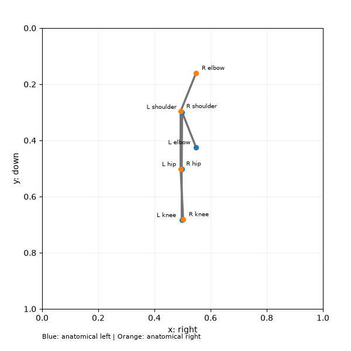
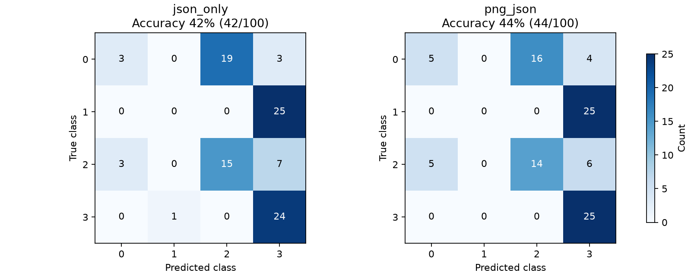

# 이전 평가 결과 · PNG + JSON

**같은 Qwen3-VL-8B-Instruct 모델에서 JSON 단독과 PNG+JSON을 비교했습니다.** 2026-11-04에 v4 측면 합성 데이터 100개를 조건별로 전부 평가했습니다.

## 입력 이미지와 모델

기존 Qwen3-4B, Qwen3-8B, Llama 3.1-8B-Instruct는 텍스트 전용입니다. 이미지 입력을 위해 공식 [Qwen3-VL-8B-Instruct](https://huggingface.co/Qwen/Qwen3-VL-8B-Instruct)를 별도 설치했고, BF16 가중치의 SHA256을 확인했습니다. 이전 텍스트 모델의 수치와 바로 비교해 이미지 효과로 해석하지 않습니다.

**기존 검토용 PNG에는 Ground Truth와 클래스명이 표시되어 있으므로 모델에 전달하지 않았습니다.** Python/Matplotlib으로 600×600 입력용 PNG 100개를 다시 생성했습니다. 관절 이름·좌우 색·좌표축만 표시하고 정답·예측·샘플 ID·합성 메타데이터는 표시하지 않습니다. 파일명도 0000.png부터 중립적인 순번을 사용하고 서버에는 파일명 없이 PNG bytes를 data URL로 전달합니다.



위 예시는 IDE에서 열어둔 synthetic-3-022에 대응하는 입력용 그림입니다. 그 ID는 모델에 전달하지 않았습니다. 네 클래스의 대표 입력을 실행 전에 점검했습니다.

## 조건별 결과

| 조건 | 정답 / 전체 | 정확도 | 실패 | 평균 요청 지연 |
|---|---:|---:|---:|---:|
| JSON 단독 | 42/100 | 42% | 0 | 47.70 ms |
| PNG + JSON | 44/100 | 44% | 0 | 76.81 ms |

PNG 추가에 따른 정확도 변화는 **+2%p**입니다. 요청 지연에는 클라이언트 전처리와 PNG 인코딩이 포함되고 모델 로딩은 제외됩니다. 두 조건의 system 프롬프트와 JSON 텍스트는 바이트 단위로 동일하며, PNG+JSON 조건에 실제 이미지 content part 하나만 추가했습니다.

| 100개 샘플별 정오 비교 | 개수 |
|---|---:|
| 두 조건 모두 정답 | 37 |
| PNG 추가로 오답 → 정답 | 7 |
| PNG 추가로 정답 → 오답 | 5 |
| 두 조건 모두 오답/실패 | 51 |

프롬프트는 직전 수치 규칙의 각도 45°·팔 허용 오차 0.05L·결측값 처리를 유지하고, 이미지가 주어지면 같은 pose의 그림과 JSON을 함께 사용하도록 수정했습니다. 정확한 좌표는 JSON을 우선하며 기존 Feature는 무시합니다. 두 조건에 같은 프롬프트를 사용했습니다.

PNG는 같은 JSON 좌표를 그린 그림으로 추가 관측 정보가 아닙니다. 이 비교는 같은 기하 정보를 이미지로도 제시했을 때의 효과를 측정합니다. 이전에 사용한 합성 개발 세트이므로 실제 사람 자세나 독립 평가 세트의 일반화 성능을 뜻하지 않습니다. 실패는 전체 정확도에서는 오답, 혼동행렬·클래스별 지표에서는 제외합니다.



## JSON 단독 혼동행렬과 클래스별 지표

| 정답 / 예측 | 0 | 1 | 2 | 3 |
|---|---:|---:|---:|---:|
| 0 | 3 | 0 | 19 | 3 |
| 1 | 0 | 0 | 0 | 25 |
| 2 | 3 | 0 | 15 | 7 |
| 3 | 0 | 1 | 0 | 24 |

| 클래스 | Precision | Recall (유효 응답) | F1 (유효 응답) | 유효 표본 |
|---|---:|---:|---:|---:|
| SITTING_HAND_DOWN | 0.5000 | 0.1200 | 0.1935 | 25 |
| SITTING_HAND_UP | 0.0000 | 0.0000 | 0.0000 | 25 |
| STANDING_HAND_DOWN | 0.4412 | 0.6000 | 0.5085 | 25 |
| STANDING_HAND_UP | 0.4068 | 0.9600 | 0.5714 | 25 |

## PNG + JSON 혼동행렬과 클래스별 지표

| 정답 / 예측 | 0 | 1 | 2 | 3 |
|---|---:|---:|---:|---:|
| 0 | 5 | 0 | 16 | 4 |
| 1 | 0 | 0 | 0 | 25 |
| 2 | 5 | 0 | 14 | 6 |
| 3 | 0 | 0 | 0 | 25 |

| 클래스 | Precision | Recall (유효 응답) | F1 (유효 응답) | 유효 표본 |
|---|---:|---:|---:|---:|
| SITTING_HAND_DOWN | 0.5000 | 0.2000 | 0.2857 | 25 |
| SITTING_HAND_UP | 0.0000 | 0.0000 | 0.0000 | 25 |
| STANDING_HAND_DOWN | 0.4667 | 0.5600 | 0.5091 | 25 |
| STANDING_HAND_UP | 0.4167 | 1.0000 | 0.5882 | 25 |

## 실행 조건과 원본 기록 {#artifacts}

| 항목 | 값 |
|---|---|
| 모델 | Qwen/Qwen3-VL-8B-Instruct · BF16 · 양자화 없음 |
| 방식 | zero-shot · temperature 0 · max_tokens 256 · 조건별 100개 |
| 서버 | context 4096 · max_num_seqs 2 · eager · TRITON_ATTN · vision TORCH_SDPA · seed 0 |
| 이미지 | Python Matplotlib PNG · 600×600 · 한 요청에 이미지 1개 |
| 이미지 처리 | min_pixels 65536 · max_pixels 401408 |
| 검증 | 44 tests / Ruff 통과 · 200개 입력과 전송 PNG SHA256 감사 |

입력 SHA256: `c509713c7ded6b41146a4fb2166db6317b2e8b1179d26b4f91155be211e1a7cb`

프롬프트 SHA256(마지막 개행 제외): `32c5fb93569fa52501d37cd567634b692066f9c20a679df7931ab28283ec6d4d`

[프롬프트 전문](assets/experiments/2026-11-04-png-json/system-prompt.txt) · [실험 메타데이터와 서버 명령](assets/experiments/2026-11-04-png-json/experiment.json) · [입력 이미지 목록과 SHA256](assets/experiments/2026-11-04-png-json/image-manifest.json) · [입력 JSON 스냅샷](assets/experiments/2026-11-04-png-json/synthetic_100.jsonl)

- json_only: [metrics](assets/experiments/2026-11-04-png-json/json_only-metrics.json) · [100개 실제 JSON/이미지 프롬프트·응답](assets/experiments/2026-11-04-png-json/json_only-predictions.jsonl)
- png_json: [metrics](assets/experiments/2026-11-04-png-json/png_json-metrics.json) · [100개 실제 JSON/이미지 프롬프트·응답](assets/experiments/2026-11-04-png-json/png_json-predictions.jsonl)

모델 준비 확인용 실제 이미지 호출은 별도 smoke 요청으로 기록했으며 100개 평가 지표에는 포함하지 않습니다. 모델 서버는 평가 후 종료했습니다. 전체 오분류 PNG와 원본 로그는 `results/experiments/2026-11-04-png-json/`에 보관합니다.

## 재현 {#reproduce}

메타데이터의 server_command로 모델 서버를 준비하고 다음 명령을 실행합니다. PNG 생성 후 클래스별 이미지의 정답 누출 여부와 좌표 일치를 확인한 다음 평가하세요. 새 출력 폴더를 사용합니다.

```bash
.venv/bin/python scripts/benchmark_vision.py --input data/sample/synthetic_100.jsonl \
  --output-dir results/reproduction-vision --prepare-only
# 생성한 입력 PNG를 검토한 다음:
.venv/bin/python scripts/benchmark_vision.py --input data/sample/synthetic_100.jsonl \
  --output-dir results/reproduction-vision --visualization-reviewed \
  --model Qwen/Qwen3-VL-8B-Instruct --base-url http://127.0.0.1:18082/v1
```

[Google Docs 결과 · 2026-11-04 PNG+JSON 탭](https://docs.google.com/document/d/1Qk312hVzzQu0xHE2cM2qNIESz5ogQY2mYUT6HoHptak)
