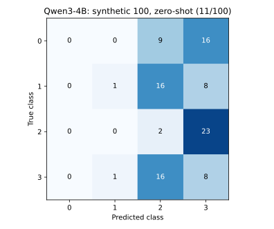

# 이전 실험 · v2 정면 데이터

이 페이지는 이전 v2 입력과 결과를 보존합니다. [최신 v4 평가 결과](experiment-results.md)와 입력 버전이 다릅니다.

2026-11-03에 [합성 데이터 100개](dataset-v2.md)로 Qwen3-4B zero-shot 평가를 실행했습니다.
**Qwen3-4B는 11/100 정답(11%), 추론·파싱 실패 0건입니다.**
이 결과는 합성 패턴과 현재 프롬프트에 대한 단일 실행 기록이며 실제 사람의 동작 분류 성능을 입증하지 않습니다.

## 모델별 실행 결과

| 모델/백엔드 | 데이터 | 정답 | 정확도 | 실패 | 평균 요청 지연 |
|---|---|---:|---:|---:|---:|
| Qwen/Qwen3-4B · remote · zero-shot | 동일 합성 100개 | 11/100 | 11% | 0 | 30.71 ms |
| mock-constant-0 · 개발용 상수 백엔드 | 동일 합성 100개 | 25/100 | 25% | 0 | 비교 대상 아님 |
| Llama 계열 | 미실행 · 실제 모델 ID 미지정 | — | — | — | — |

mock은 LLM이 아니며 입력과 관계없이 0을 반환합니다. 균등한 클래스 분포 때문에 25%입니다.
Llama의 측정값은 없으며 README 예제의 `llama-server-model`은 설치된 모델 이름이 아닙니다.
측정한 실제 LLM은 Qwen3-4B 한 개이므로 최적 LLM을 선정하지 않습니다.
지연시간은 모델 준비 시간을 제외한 순차 HTTP 요청 100개의 평균입니다.
다른 GPU 작업과 자원을 공유한 환경의 관측값이며 전용 서버 벤치마크 수치가 아닙니다.

## 혼동행렬

행은 정답, 열은 예측입니다. ID 정의는 [데이터 클래스 표](dataset-v2.md)를 따릅니다.



| 정답 \ 예측 | 0 | 1 | 2 | 3 |
|---|---:|---:|---:|---:|
| 0 | 0 | 0 | 9 | 16 |
| 1 | 0 | 1 | 16 | 8 |
| 2 | 0 | 0 | 2 | 23 |
| 3 | 0 | 1 | 16 | 8 |

## 클래스별 지표

| ID | 클래스 | Precision | Recall | F1 | 정답 수 |
|---|---|---:|---:|---:|---:|
| 0 | SITTING_HAND_DOWN | 0.0000 | 0.0000 | 0.0000 | 25 |
| 1 | SITTING_HAND_UP | 0.5000 | 0.0400 | 0.0741 | 25 |
| 2 | STANDING_HAND_DOWN | 0.0465 | 0.0800 | 0.0588 | 25 |
| 3 | STANDING_HAND_UP | 0.1455 | 0.3200 | 0.2000 | 25 |

실패가 0건이므로 여기서 Recall과 F1의 표본에는 100개 전체가 포함됩니다.
기록에서 관찰되는 사항은 다음과 같습니다.

- 클래스 0 예측은 0개입니다.
- 정답이 앉기인 50개 중 49개를 서기로 분류했습니다.
- 정답·예측의 팔 올림/내림 구분이 일치한 샘플은 29/100개입니다.

이 현상만으로 모델 내부의 오분류 원인을 단정할 수 없습니다.
프롬프트 수정이나 few-shot은 이번 결과를 본 뒤의 별도 실험으로 분리해야 하며,
다음 평가에서는 실제 관측 데이터와 별도 평가 세트를 확보해야 합니다.

## 실행 조건과 재현

| 항목 | 값 |
|---|---|
| 평가 코드 revision | `a0a6743a4673c8a6eb9cf4e59ce4e936099f36fa` |
| 모델 revision | `1cfa9a7208912126459214e8b04321603b3df60c` |
| 데이터 생성 | v2 · seed 42 · 클래스별 25개 |
| GPU | NVIDIA GeForce RTX 5090 · 약 32GB |
| 실행 환경 | Python 3.12.3 · vLLM 0.33.0 · PyTorch 2.14.0+cu130 · CUDA runtime 13.0 |
| 추론 방식 | zero-shot · temperature 0 · max_tokens 256 · thinking 비활성화 · seed 0 |
| 서버 | context 4096 · max_num_seqs 2 · GPU 메모리 비율 0.45 · eager · TRITON_ATTN |
| 샘플러 | `VLLM_USE_FLASHINFER_SAMPLER=0` · 시스템 CUDA 컴파일러 설치 없이 실행 |
| 전처리 | min_confidence 0 · 정규화 좌표와 feature 전달 |
| 라벨 누출 확인 | 질의 payload에 label/prediction/id/synthetic 메타데이터 미포함 |

클래스별 합성 갤러리를 확인한 뒤 사용자 요청으로 실행했습니다.
실제 관측 pose 데이터에 대한 사람의 검토나 평가를 수행했다는 뜻은 아닙니다.
모델 파일·캐시·가상환경은 로컬에만 보관하고 문서에는 평가 산출물만 포함합니다.
실험을 위해 시작한 서버는 평가 후 종료했습니다.

검토한 입력에 대해 `Qwen/Qwen3-4B`를 제공하는 로컬 서버가 준비되면:

```bash
python scripts/evaluate_llm.py --input data/sample/synthetic_100.jsonl \
  --backend remote --model Qwen/Qwen3-4B --base-url http://127.0.0.1:18080/v1 \
  --visualization-reviewed --no-error-plots --output-dir results/qwen3-4b-synthetic100
```

서버의 chat template에서 `enable_thinking=false`를 설정해야 같은 조건입니다.
전체 환경과 설정은 [실험 메타데이터](assets/experiments/2026-11-03/experiment.json)에 기록했습니다.
서버 준비는 [자동 실행 가이드](server-automation.md)를 참고하세요.

## 원본 결과 파일

- [Qwen3-4B metrics.json](assets/experiments/2026-11-03/qwen3-4b-metrics.json)
- [Qwen3-4B 100개별 입력·프롬프트·응답·예측 JSONL](assets/experiments/2026-11-03/qwen3-4b-predictions.jsonl)
- [같은 100개 mock metrics.json](assets/experiments/2026-11-03/mock-metrics.json)
- [같은 100개 mock 예측 JSONL](assets/experiments/2026-11-03/mock-predictions.jsonl)
- [이전 Qwen 기동 확인 요약](assets/experiments/2026-11-03/qwen3-4b-smoke-summary.json) · [기동 확인 응답](assets/experiments/2026-11-03/qwen3-4b-smoke-response.json)

기동 확인은 “숫자 0만 반환”하라는 요청에 대한 응답 한 건으로, pose 평가와 별개의 기록입니다.
기존 `poses.jsonl` 4개 mock 평가(1/4 정답) 역시 이번 100개 평가와 다른 실행입니다.

## 100개별 Qwen3-4B 예측

좌표와 이미지는 [전체 데이터 목록](dataset-v2.md)에서 같은 ID로 확인할 수 있습니다.

| 샘플 ID | 정답 | 예측 | 원문 응답 | 정오 |
|---|---:|---:|---|---|
| `synthetic-0-000` | 0 | 3 | `3` | 오답 |
| `synthetic-0-001` | 0 | 3 | `3` | 오답 |
| `synthetic-0-002` | 0 | 2 | `2` | 오답 |
| `synthetic-0-003` | 0 | 3 | `3` | 오답 |
| `synthetic-0-004` | 0 | 2 | `2` | 오답 |
| `synthetic-0-005` | 0 | 2 | `2` | 오답 |
| `synthetic-0-006` | 0 | 3 | `3` | 오답 |
| `synthetic-0-007` | 0 | 3 | `3` | 오답 |
| `synthetic-0-008` | 0 | 3 | `3` | 오답 |
| `synthetic-0-009` | 0 | 3 | `3` | 오답 |
| `synthetic-0-010` | 0 | 2 | `2` | 오답 |
| `synthetic-0-011` | 0 | 3 | `3` | 오답 |
| `synthetic-0-012` | 0 | 3 | `3` | 오답 |
| `synthetic-0-013` | 0 | 3 | `3` | 오답 |
| `synthetic-0-014` | 0 | 3 | `3` | 오답 |
| `synthetic-0-015` | 0 | 3 | `3` | 오답 |
| `synthetic-0-016` | 0 | 3 | `3` | 오답 |
| `synthetic-0-017` | 0 | 3 | `3` | 오답 |
| `synthetic-0-018` | 0 | 3 | `3` | 오답 |
| `synthetic-0-019` | 0 | 2 | `2` | 오답 |
| `synthetic-0-020` | 0 | 2 | `2` | 오답 |
| `synthetic-0-021` | 0 | 2 | `2` | 오답 |
| `synthetic-0-022` | 0 | 2 | `2` | 오답 |
| `synthetic-0-023` | 0 | 3 | `3` | 오답 |
| `synthetic-0-024` | 0 | 2 | `2` | 오답 |
| `synthetic-1-000` | 1 | 2 | `2` | 오답 |
| `synthetic-1-001` | 1 | 3 | `3` | 오답 |
| `synthetic-1-002` | 1 | 2 | `2` | 오답 |
| `synthetic-1-003` | 1 | 2 | `2` | 오답 |
| `synthetic-1-004` | 1 | 3 | `3` | 오답 |
| `synthetic-1-005` | 1 | 2 | `2` | 오답 |
| `synthetic-1-006` | 1 | 2 | `2` | 오답 |
| `synthetic-1-007` | 1 | 3 | `3` | 오답 |
| `synthetic-1-008` | 1 | 2 | `2` | 오답 |
| `synthetic-1-009` | 1 | 2 | `2` | 오답 |
| `synthetic-1-010` | 1 | 3 | `3` | 오답 |
| `synthetic-1-011` | 1 | 2 | `2` | 오답 |
| `synthetic-1-012` | 1 | 2 | `2` | 오답 |
| `synthetic-1-013` | 1 | 3 | `3` | 오답 |
| `synthetic-1-014` | 1 | 1 | `1` | 정답 |
| `synthetic-1-015` | 1 | 2 | `2` | 오답 |
| `synthetic-1-016` | 1 | 3 | `3` | 오답 |
| `synthetic-1-017` | 1 | 2 | `2` | 오답 |
| `synthetic-1-018` | 1 | 2 | `2` | 오답 |
| `synthetic-1-019` | 1 | 3 | `3` | 오답 |
| `synthetic-1-020` | 1 | 2 | `2` | 오답 |
| `synthetic-1-021` | 1 | 2 | `2` | 오답 |
| `synthetic-1-022` | 1 | 3 | `3` | 오답 |
| `synthetic-1-023` | 1 | 2 | `2` | 오답 |
| `synthetic-1-024` | 1 | 2 | `2` | 오답 |
| `synthetic-2-000` | 2 | 3 | `3` | 오답 |
| `synthetic-2-001` | 2 | 3 | `3` | 오답 |
| `synthetic-2-002` | 2 | 3 | `3` | 오답 |
| `synthetic-2-003` | 2 | 3 | `3` | 오답 |
| `synthetic-2-004` | 2 | 3 | `3` | 오답 |
| `synthetic-2-005` | 2 | 3 | `3` | 오답 |
| `synthetic-2-006` | 2 | 3 | `3` | 오답 |
| `synthetic-2-007` | 2 | 3 | `3` | 오답 |
| `synthetic-2-008` | 2 | 3 | `3` | 오답 |
| `synthetic-2-009` | 2 | 3 | `3` | 오답 |
| `synthetic-2-010` | 2 | 3 | `3` | 오답 |
| `synthetic-2-011` | 2 | 3 | `3` | 오답 |
| `synthetic-2-012` | 2 | 3 | `3` | 오답 |
| `synthetic-2-013` | 2 | 3 | `3` | 오답 |
| `synthetic-2-014` | 2 | 3 | `3` | 오답 |
| `synthetic-2-015` | 2 | 3 | `3` | 오답 |
| `synthetic-2-016` | 2 | 3 | `3` | 오답 |
| `synthetic-2-017` | 2 | 3 | `3` | 오답 |
| `synthetic-2-018` | 2 | 3 | `3` | 오답 |
| `synthetic-2-019` | 2 | 3 | `3` | 오답 |
| `synthetic-2-020` | 2 | 2 | `2` | 정답 |
| `synthetic-2-021` | 2 | 3 | `3` | 오답 |
| `synthetic-2-022` | 2 | 3 | `3` | 오답 |
| `synthetic-2-023` | 2 | 2 | `2` | 정답 |
| `synthetic-2-024` | 2 | 3 | `3` | 오답 |
| `synthetic-3-000` | 3 | 2 | `2` | 오답 |
| `synthetic-3-001` | 3 | 3 | `3` | 정답 |
| `synthetic-3-002` | 3 | 2 | `2` | 오답 |
| `synthetic-3-003` | 3 | 2 | `2` | 오답 |
| `synthetic-3-004` | 3 | 3 | `3` | 정답 |
| `synthetic-3-005` | 3 | 1 | `1` | 오답 |
| `synthetic-3-006` | 3 | 2 | `2` | 오답 |
| `synthetic-3-007` | 3 | 3 | `3` | 정답 |
| `synthetic-3-008` | 3 | 2 | `2` | 오답 |
| `synthetic-3-009` | 3 | 2 | `2` | 오답 |
| `synthetic-3-010` | 3 | 3 | `3` | 정답 |
| `synthetic-3-011` | 3 | 2 | `2` | 오답 |
| `synthetic-3-012` | 3 | 2 | `2` | 오답 |
| `synthetic-3-013` | 3 | 3 | `3` | 정답 |
| `synthetic-3-014` | 3 | 2 | `2` | 오답 |
| `synthetic-3-015` | 3 | 2 | `2` | 오답 |
| `synthetic-3-016` | 3 | 3 | `3` | 정답 |
| `synthetic-3-017` | 3 | 2 | `2` | 오답 |
| `synthetic-3-018` | 3 | 2 | `2` | 오답 |
| `synthetic-3-019` | 3 | 3 | `3` | 정답 |
| `synthetic-3-020` | 3 | 2 | `2` | 오답 |
| `synthetic-3-021` | 3 | 2 | `2` | 오답 |
| `synthetic-3-022` | 3 | 3 | `3` | 정답 |
| `synthetic-3-023` | 3 | 2 | `2` | 오답 |
| `synthetic-3-024` | 3 | 2 | `2` | 오답 |
