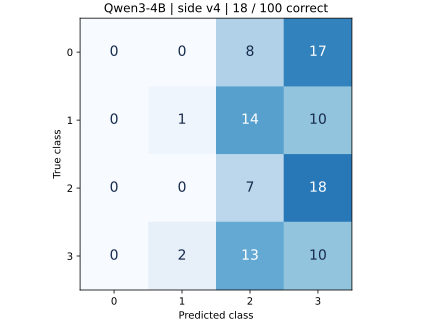
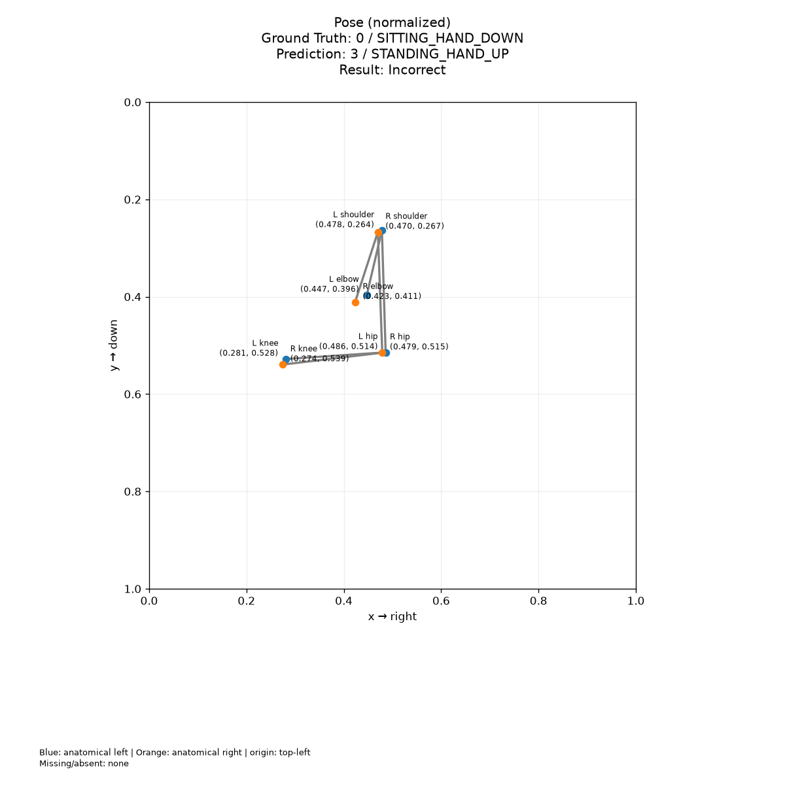
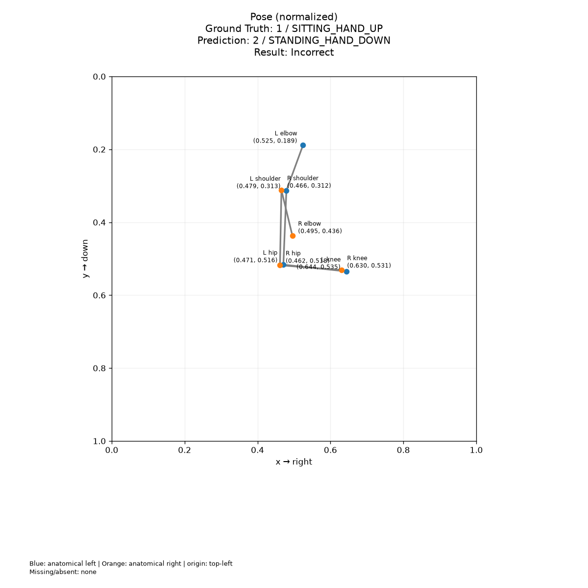
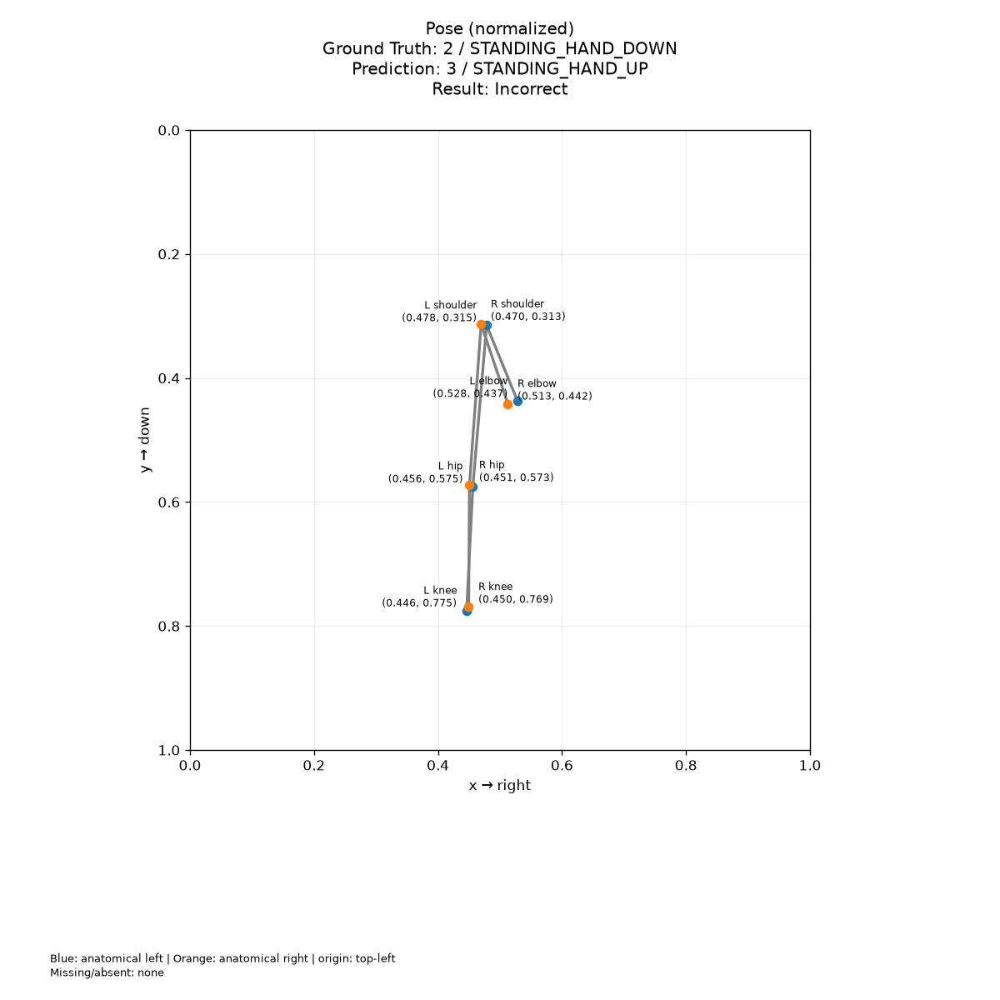
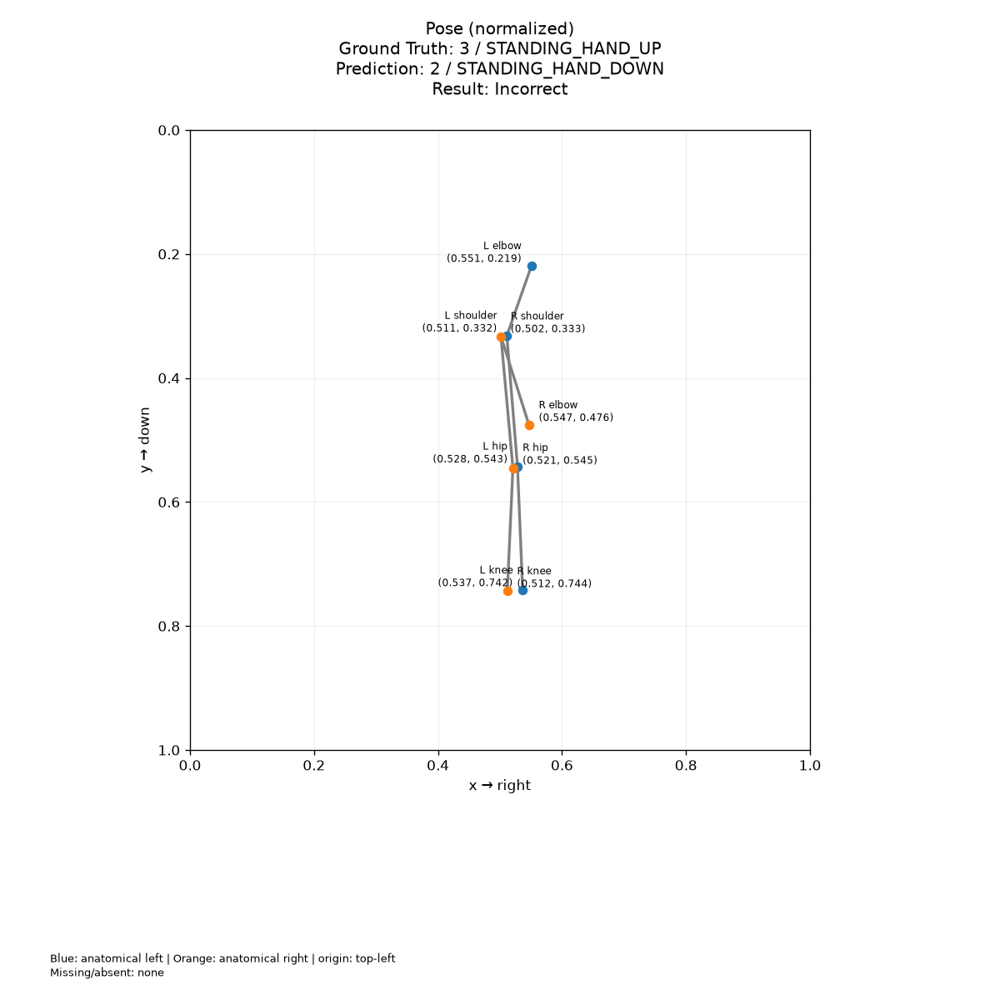

# 이전 평가 결과 · v4 측면 · 기존 프롬프트

**Qwen3-4B zero-shot 평가: 100개 중 18개 정답.** 2026-11-03에 최신 측면 v4 입력으로 다시 실행했습니다.

<div class="metric-grid" markdown>
<div class="metric"><strong>18%</strong><span>정확도 · 18 / 100</span></div>
<div class="metric"><strong>0건</strong><span>호출·응답 파싱 실패</span></div>
<div class="metric"><strong>41.87 ms</strong><span>평균 요청 지연 · 모델 준비 시간 제외</span></div>
</div>

[입력 데이터](dataset-100.md) · [클래스별 이미지](visualization.md) · [전체 처리 흐름](pipeline.md)

## 결과 해석

- 앉은 자세 50개 중 **49개를 서기로 예측**했습니다.
- 클래스 0(앉기·팔 내림)은 한 번도 예측하지 않았습니다.
- 앉기/서기만 비교하면 49/100, 팔 올림/내림만 비교하면 38/100이 일치했습니다.
- 응답 형식은 100개 모두 유효했습니다. 낮은 정확도는 이번 실행에서 호출 실패나 파싱 실패로 생긴 현상이 아닙니다.

!!! note "이 수치의 범위"
    합성 관절 도식 100개에 대한 단일 실행입니다. 실제 사람의 자세 분류 성능을 뜻하지 않습니다.
    모델 입력은 이미지가 아니라 **8개 관절 좌표와 Feature를 담은 JSON 텍스트**입니다.
    손목이 없어 팔 올림은 같은 쪽 어깨보다 높은 팔꿈치를 기준으로 합니다.

## 이전 실행과 비교

| 입력 / 백엔드 | 정답 | 정확도 | 실패 | 평균 요청 지연 |
|---|---:|---:|---:|---:|
| **v4 측면 · Qwen3-4B** | **18 / 100** | **18%** | **0** | **41.87 ms** |
| [v2 정면 · Qwen3-4B](experiment-results-v2.md) | 11 / 100 | 11% | 0 | 30.71 ms |
| v4 측면 · mock | 25 / 100 | 25% | 0 | 연결 확인용 |

같은 모델·프롬프트·서버 설정에서 입력 좌표가 바뀌었습니다. 정확도 차이는 **+7%p**이며 모델 자체의 개선으로 해석하지 않습니다.
mock은 항상 `0`을 반환하므로 균등한 클래스 구성에서 25%입니다. Llama 등 다른 실제 LLM과의 비교는 수행하지 않았습니다.
지연시간은 다른 GPU 작업과 자원을 공유한 상태에서 관찰한 값입니다.

## 혼동행렬

행은 정답, 열은 예측입니다. 클래스 0·1은 앉기, 2·3은 서기입니다.



| 정답 / 예측 | 0 | 1 | 2 | 3 |
|---|---:|---:|---:|---:|
| 0 | 0 | 0 | 8 | 17 |
| 1 | 0 | 1 | 14 | 10 |
| 2 | 0 | 0 | 7 | 18 |
| 3 | 0 | 2 | 13 | 10 |

## 클래스별 지표

| 클래스 | Precision | Recall | F1 | 정답 수 |
|---|---:|---:|---:|---:|
| 0 · 앉기 · 팔 내림 | 0.0000 | 0.0000 | 0.0000 | 25 |
| 1 · 앉기 · 팔 올림 | 0.3333 | 0.0400 | 0.0714 | 25 |
| 2 · 서기 · 팔 내림 | 0.1667 | 0.2800 | 0.2090 | 25 |
| 3 · 서기 · 팔 올림 | 0.1818 | 0.4000 | 0.2500 | 25 |

실패가 0건이므로 클래스별 지표에도 100개 전체가 포함됩니다.

## 오분류 예시

클래스별 첫 오분류 한 개씩입니다. 전체 82개 오분류 PNG는 로컬 실행 폴더의 `errors/`에 저장했습니다.

=== "앉기 · 팔 내림"

    `synthetic-0-000` · 정답 **0** → 예측 **3** · 원문 응답 `3`

    

=== "앉기 · 팔 올림"

    `synthetic-1-000` · 정답 **1** → 예측 **2** · 원문 응답 `2`

    

=== "서기 · 팔 내림"

    `synthetic-2-001` · 정답 **2** → 예측 **3** · 원문 응답 `3`

    

=== "서기 · 팔 올림"

    `synthetic-3-000` · 정답 **3** → 예측 **2** · 원문 응답 `2`

    

## 실행 조건

| 항목 | 값 |
|---|---|
| 입력 | 생성기 v4 · 측면 · seed 42 · 클래스별 25개 |
| 모델 | Qwen/Qwen3-4B · BF16 · 양자화 없음 |
| 방식 | zero-shot · few-shot 예시 0개 · 추가 학습 없음 |
| 요청 | temperature 0 · max_tokens 256 · thinking 비활성화 |
| 서버 | context 4096 · max_num_seqs 2 · GPU 메모리 비율 0.45 |
| 실행 | eager · TRITON_ATTN · seed 0 |
| GPU | RTX 5090 · 다른 작업과 공유 |
| 환경 | Python 3.12.3 · vLLM 0.33.0 · PyTorch 2.14.0+cu130 |
| 입력 점검 | 정규화 좌표 중복 0 · 누락 관절 0 · 팔 올림 라벨 불일치 0 |

평가 전 네 클래스 갤러리를 확인했고, 질의에 정답·예측·ID·합성 메타데이터가 포함되지 않았음을 검사했습니다.
모델 서버는 평가 후 종료했습니다. 코드 작업 트리에 기존 v4 변경 사항이 있어 기준 Git revision과 평가 소스의 SHA256을 함께 기록했습니다.

??? info "입력과 모델 식별 정보"

    데이터 SHA256: `c509713c7ded6b41146a4fb2166db6317b2e8b1179d26b4f91155be211e1a7cb`

    모델 revision: `1cfa9a7208912126459214e8b04321603b3df60c`

    기준 코드 revision: `f9ee48720136e4e197acb6f8e6625807bcf9b38b` (작업 트리 변경 포함)

    파일별 코드 해시는 [실험 메타데이터](assets/experiments/2026-11-03-side-v4/experiment.json)에 있습니다.

## 재현 명령 {#reproduce}

저장소 루트에서 실행합니다. 로컬 모델 파일과 `.venv-model` 환경은 이미 준비되어 있어야 합니다.
첫 번째 터미널에서 모델 서버를 띄우고 준비가 끝나면 두 번째 터미널에서 평가합니다.
새로 재평가할 때는 기존 결과를 보존하도록 `--output-dir`에 새 경로를 지정하세요.

=== "1. 모델 서버"

    ```bash
    VLLM_USE_FLASHINFER_SAMPLER=0 .venv-model/bin/vllm serve models/Qwen3-4B \
      --served-model-name Qwen/Qwen3-4B --host 127.0.0.1 --port 18080 \
      --max-model-len 4096 --max-num-seqs 2 --gpu-memory-utilization 0.45 \
      --enforce-eager --attention-backend TRITON_ATTN --seed 0 \
      --default-chat-template-kwargs '{"enable_thinking":false}'
    ```

=== "2. 준비 확인과 평가"

    ```bash
    curl --fail http://127.0.0.1:18080/v1/models
    .venv/bin/python scripts/evaluate_llm.py \
      --input data/sample/synthetic_100.jsonl \
      --backend remote --model Qwen/Qwen3-4B \
      --base-url http://127.0.0.1:18080/v1 --visualization-reviewed \
      --output-dir results/experiments/2026-11-03-qwen3-4b-side-v4
    ```

평가 완료 후 첫 번째 터미널에서 `Ctrl+C`로 실험용 서버를 종료합니다.

## 원본 파일 {#artifacts}

| 파일 | 내용 |
|---|---|
| [평가 지표](assets/experiments/2026-11-03-side-v4/qwen3-4b-metrics.json) | 정확도, 실패 수, 혼동행렬, 클래스별 지표, 지연 |
| [100개 예측 기록](assets/experiments/2026-11-03-side-v4/qwen3-4b-predictions.jsonl) | 좌표, 정답, 실제 프롬프트, 원문 응답, 예측 |
| [평가 입력](assets/experiments/2026-11-03-side-v4/synthetic_100.jsonl) | 이번 평가에 사용한 v4 입력 스냅샷 |
| [데이터 검사](assets/experiments/2026-11-03-side-v4/dataset-inspection.json) | 수량, 중복, 관절, 라벨과 입력 해시 |
| [실험 메타데이터](assets/experiments/2026-11-03-side-v4/experiment.json) | 모델 revision, 환경, 설정, 명령, 코드 해시 |
| [mock 지표](assets/experiments/2026-11-03-side-v4/mock-metrics.json) | 같은 입력으로 수행한 연결 확인 |

로컬 전체 산출물: `results/experiments/2026-11-03-qwen3-4b-side-v4/`.
이전 입력과 결과는 [v2 평가 기록](experiment-results-v2.md)에 보존합니다.

??? abstract "100개별 정답과 예측 펼치기"

    | ID | 정답 | 예측 | 결과 |
    |---|---:|---:|---|
    | `synthetic-0-000` | 0 | 3 | 오답 |
    | `synthetic-0-001` | 0 | 3 | 오답 |
    | `synthetic-0-002` | 0 | 2 | 오답 |
    | `synthetic-0-003` | 0 | 3 | 오답 |
    | `synthetic-0-004` | 0 | 3 | 오답 |
    | `synthetic-0-005` | 0 | 3 | 오답 |
    | `synthetic-0-006` | 0 | 2 | 오답 |
    | `synthetic-0-007` | 0 | 3 | 오답 |
    | `synthetic-0-008` | 0 | 2 | 오답 |
    | `synthetic-0-009` | 0 | 3 | 오답 |
    | `synthetic-0-010` | 0 | 3 | 오답 |
    | `synthetic-0-011` | 0 | 3 | 오답 |
    | `synthetic-0-012` | 0 | 3 | 오답 |
    | `synthetic-0-013` | 0 | 2 | 오답 |
    | `synthetic-0-014` | 0 | 3 | 오답 |
    | `synthetic-0-015` | 0 | 3 | 오답 |
    | `synthetic-0-016` | 0 | 2 | 오답 |
    | `synthetic-0-017` | 0 | 3 | 오답 |
    | `synthetic-0-018` | 0 | 3 | 오답 |
    | `synthetic-0-019` | 0 | 3 | 오답 |
    | `synthetic-0-020` | 0 | 2 | 오답 |
    | `synthetic-0-021` | 0 | 3 | 오답 |
    | `synthetic-0-022` | 0 | 2 | 오답 |
    | `synthetic-0-023` | 0 | 3 | 오답 |
    | `synthetic-0-024` | 0 | 2 | 오답 |
    | `synthetic-1-000` | 1 | 2 | 오답 |
    | `synthetic-1-001` | 1 | 3 | 오답 |
    | `synthetic-1-002` | 1 | 2 | 오답 |
    | `synthetic-1-003` | 1 | 2 | 오답 |
    | `synthetic-1-004` | 1 | 3 | 오답 |
    | `synthetic-1-005` | 1 | 1 | 정답 |
    | `synthetic-1-006` | 1 | 2 | 오답 |
    | `synthetic-1-007` | 1 | 3 | 오답 |
    | `synthetic-1-008` | 1 | 2 | 오답 |
    | `synthetic-1-009` | 1 | 2 | 오답 |
    | `synthetic-1-010` | 1 | 3 | 오답 |
    | `synthetic-1-011` | 1 | 3 | 오답 |
    | `synthetic-1-012` | 1 | 2 | 오답 |
    | `synthetic-1-013` | 1 | 3 | 오답 |
    | `synthetic-1-014` | 1 | 2 | 오답 |
    | `synthetic-1-015` | 1 | 2 | 오답 |
    | `synthetic-1-016` | 1 | 3 | 오답 |
    | `synthetic-1-017` | 1 | 3 | 오답 |
    | `synthetic-1-018` | 1 | 2 | 오답 |
    | `synthetic-1-019` | 1 | 3 | 오답 |
    | `synthetic-1-020` | 1 | 2 | 오답 |
    | `synthetic-1-021` | 1 | 2 | 오답 |
    | `synthetic-1-022` | 1 | 3 | 오답 |
    | `synthetic-1-023` | 1 | 2 | 오답 |
    | `synthetic-1-024` | 1 | 2 | 오답 |
    | `synthetic-2-000` | 2 | 2 | 정답 |
    | `synthetic-2-001` | 2 | 3 | 오답 |
    | `synthetic-2-002` | 2 | 3 | 오답 |
    | `synthetic-2-003` | 2 | 3 | 오답 |
    | `synthetic-2-004` | 2 | 2 | 정답 |
    | `synthetic-2-005` | 2 | 3 | 오답 |
    | `synthetic-2-006` | 2 | 2 | 정답 |
    | `synthetic-2-007` | 2 | 3 | 오답 |
    | `synthetic-2-008` | 2 | 3 | 오답 |
    | `synthetic-2-009` | 2 | 3 | 오답 |
    | `synthetic-2-010` | 2 | 3 | 오답 |
    | `synthetic-2-011` | 2 | 3 | 오답 |
    | `synthetic-2-012` | 2 | 2 | 정답 |
    | `synthetic-2-013` | 2 | 3 | 오답 |
    | `synthetic-2-014` | 2 | 2 | 정답 |
    | `synthetic-2-015` | 2 | 3 | 오답 |
    | `synthetic-2-016` | 2 | 3 | 오답 |
    | `synthetic-2-017` | 2 | 3 | 오답 |
    | `synthetic-2-018` | 2 | 3 | 오답 |
    | `synthetic-2-019` | 2 | 3 | 오답 |
    | `synthetic-2-020` | 2 | 3 | 오답 |
    | `synthetic-2-021` | 2 | 3 | 오답 |
    | `synthetic-2-022` | 2 | 2 | 정답 |
    | `synthetic-2-023` | 2 | 2 | 정답 |
    | `synthetic-2-024` | 2 | 3 | 오답 |
    | `synthetic-3-000` | 3 | 2 | 오답 |
    | `synthetic-3-001` | 3 | 3 | 정답 |
    | `synthetic-3-002` | 3 | 2 | 오답 |
    | `synthetic-3-003` | 3 | 2 | 오답 |
    | `synthetic-3-004` | 3 | 3 | 정답 |
    | `synthetic-3-005` | 3 | 2 | 오답 |
    | `synthetic-3-006` | 3 | 2 | 오답 |
    | `synthetic-3-007` | 3 | 3 | 정답 |
    | `synthetic-3-008` | 3 | 1 | 오답 |
    | `synthetic-3-009` | 3 | 2 | 오답 |
    | `synthetic-3-010` | 3 | 3 | 정답 |
    | `synthetic-3-011` | 3 | 2 | 오답 |
    | `synthetic-3-012` | 3 | 2 | 오답 |
    | `synthetic-3-013` | 3 | 3 | 정답 |
    | `synthetic-3-014` | 3 | 2 | 오답 |
    | `synthetic-3-015` | 3 | 2 | 오답 |
    | `synthetic-3-016` | 3 | 3 | 정답 |
    | `synthetic-3-017` | 3 | 2 | 오답 |
    | `synthetic-3-018` | 3 | 2 | 오답 |
    | `synthetic-3-019` | 3 | 3 | 정답 |
    | `synthetic-3-020` | 3 | 2 | 오답 |
    | `synthetic-3-021` | 3 | 3 | 정답 |
    | `synthetic-3-022` | 3 | 3 | 정답 |
    | `synthetic-3-023` | 3 | 1 | 오답 |
    | `synthetic-3-024` | 3 | 3 | 정답 |
