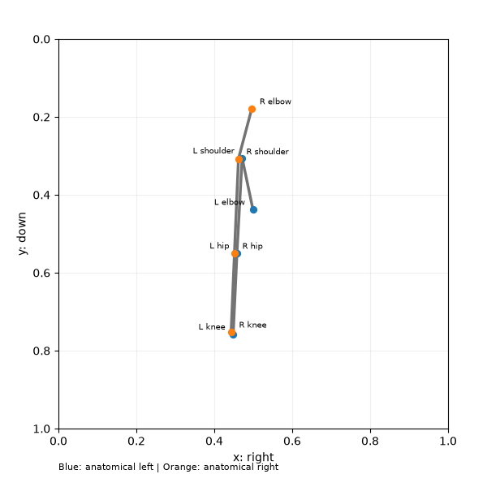
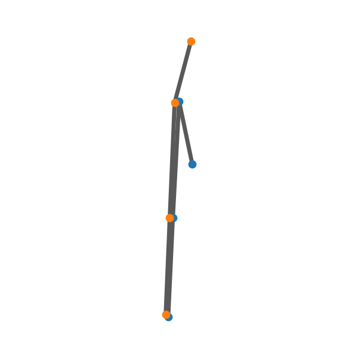

# 최신 평가 결과 · VL 모델과 골격 모양 중심 프롬프트

2026-11-04에 Qwen3-VL-8B-Instruct, InternVL3.5-8B-HF, Idefics3-8B-Llama3를 같은 합성 100개로 비교했습니다. **최종 모양 중심 지시문 v2의 내용은 모든 모델·입력 조건에 동일하게 사용했습니다.** 핵심 비교는 모델별 5조건 × 100개 = 총 1,500개 실제 응답입니다.

## 추가 실험: Qwen3-VL-4B 확대 골격

다음으로 4B 모델도 같은 조건으로 추가 평가했습니다. 전체 실험 요약은 아래와 같습니다.

| 모델 | 조건 | 정확도 |
|---|---|---:|
| Qwen3-VL-4B-Instruct | JSON only | 0.37 |
| Qwen3-VL-4B-Instruct | 확대 PNG only | 0.43 |
| Qwen3-VL-4B-Instruct | 확대 PNG + JSON | 0.55 |

4B 실험의 의미는 **확대 골격 + JSON 조합이 가장 나은 조건**이라는 점을 확인한 것입니다. 다만 `HAND_UP` 계열의 판정은 여전히 약하게 남아 있어, 프롬프트 개선이 필요한 영역입니다.

자세한 내용은 [4B 추가 실험 페이지](experiment-results-2026-11-04-vl-4b-clean.md)를 참고하세요.

## 모양 중심 프롬프트

이미지에서는 팔 가지를 잠시 제외하고 어깨→골반→무릎의 연결 모양을 먼저 봅니다. 골반에서 옆으로 꺾인 L 모양이면 앉기, 몸통과 허벅지가 길게 이어진 I 모양이면 서기로 판단합니다. 이후 어깨→팔꿈치 가지가 위/수평인지 아래인지 별도로 판단합니다. 소수 좌표의 내적·외적 계산을 요구하지 않습니다.

이미지가 있으면 골격 모양을 우선하고 JSON은 관절 식별과 불분명한 연결의 보조 정보로 사용합니다. PNG만 조건은 JSON을 전혀 전송하지 않습니다. 클래스 정의는 0=앉기·팔 내림, 1=앉기·팔 올림, 2=서기·팔 내림, 3=서기·팔 올림으로 유지합니다.

Idefics는 시스템 역할에서 마침표·설명문을 반환하는 형식 실패를 확인해, 같은 지시문 내용을 단일 사용자 메시지에 넣고 이미지를 먼저 배치하는 네이티브 형식으로 평가했습니다. 다른 두 모델은 시스템 역할을 사용합니다. Idefics의 초기 실패 기록은 별도 보존했고, 최종 비교는 숫자 한 자리만 허용하는 동일한 채점 기준입니다. InternVL에서 발견한 TensorFlow CUDA 라이브러리 경로 충돌은 서버 프로세스의 LD_LIBRARY_PATH를 모델 가상환경 라이브러리로 제한해 해결했습니다. 모델별 runs 메타데이터에 실제 환경 설정을 기록했습니다.

## 같은 골격의 두 이미지 표현

- 기존 도식: 600×600 PNG, 전체 0~1 좌표축·격자·관절 글자를 포함합니다. 정답·예측·샘플 ID는 없습니다.
- 확대 골격: 같은 관절 좌표를 균일 확대·이동하고, 축·격자·글자를 제거했습니다. 흰 배경에 굵은 연결선과 좌우 색 점만 표시합니다. 각도와 상대 길이·위아래 관계는 유지합니다.

확대 비율과 여백은 관절 위치만으로 결정합니다. 정답 라벨은 렌더링에 사용하지 않습니다. 모델에는 파일명 없이 실제 PNG 바이트를 전달했고, 전송 이미지와 저장 이미지 SHA256을 대조했습니다.

| 기존 도식 | 확대 골격 |
|---|---|
|  |  |

확대·축/글자 제거·굵은 선을 함께 적용한 조건이므로 개별 요소의 기여를 분리한 실험은 아닙니다.

## 한 줄 결론

이번 실험에서 가장 중요한 결과는 단 하나입니다. 8B급 VL 모델 중에서도 Qwen3-VL-8B-Instruct가 가장 안정적으로 높은 정확도를 기록했고, 그 핵심은 이미지와 좌표를 함께 보는 방식이었습니다.

- Qwen3-VL-8B-Instruct: 확대 골격 PNG+JSON = 90%
- InternVL3_5-8B-HF: 확대 골격 PNG+JSON = 51%
- Idefics3-8B-Llama3: 확대 골격 PNG+JSON = 36%
- 추가 4B 실험: 확대 골격 PNG+JSON = 55%

즉, 현재까지는 “이미지를 보여주고 좌표를 함께 주는 조합”이 가장 강력했고, 특히 확대된 골격 이미지는 모델이 자세의 형태를 더 잘 읽도록 도와주었습니다.

## 실험 조건이란?

각 모델마다 같은 100개 샘플을 다섯 가지 방식으로 보냈습니다.

1. JSON만
2. 기존 도식 PNG만
3. 기존 도식 PNG + JSON
4. 확대 골격 PNG만
5. 확대 골격 PNG + JSON

모든 조건은 같은 프롬프트와 같은 데이터로 비교했습니다. 따라서 차이는 입력 표현 방식 때문에 생긴 것으로 해석할 수 있습니다.

## 모델별 정확도 요약

| 모델 | JSON만 | 기존 PNG만 | 기존 PNG+JSON | 확대 PNG만 | 확대 PNG+JSON |
|---|---:|---:|---:|---:|---:|
| Qwen3-VL-8B-Instruct | 56% | 28% | 57% | 48% | 90% |
| InternVL3_5-8B-HF | 46% | 30% | 46% | 44% | 51% |
| Idefics3-8B-Llama3 | 0% | 25% | 25% | 28% | 36% |

가장 눈에 띄는 점은 Qwen의 경우입니다. JSON만으로는 56%였지만, 이미지를 함께 넣고 확대 골격을 보게 되면 90%까지 올라갔습니다. 즉, 모델은 좌표보다 “형태 자체”를 읽는 데 훨씬 잘 반응했습니다.

## 의미 해석

### 1. 이미지가 핵심이었습니다

Qwen3-VL-8B-Instruct는 JSON만으로 56%였지만, PNG+JSON에서 57%로 거의 비슷했습니다. 그런데 확대 골격 PNG+JSON에서 90%까지 급 상승했습니다. 이건 단순히 “이미지가 좋다”가 아니라, 이미지가 어떤 스타일로 보여지느냐가 매우 중요하다는 뜻입니다.

### 2. 골격을 확대하면 구조가 더 보였습니다

기존 도식은 정보가 많고 격자·축·라벨이 섞여 있어 모델이 본질적인 인물 형태를 파악하는 데 방해가 되었습니다. 반면 확대 골격은 연결선과 좌우 점만 남겨서, 몸통·허리·다리의 구조와 팔의 위치가 더 분명하게 보였습니다.

### 3. `HAND_UP` 문제는 여전히 가장 큰 약점입니다

전체적으로는 90%를 달성했지만, 실제로는 클래스별로 편차가 큽니다. 특히 손을 올린 상태를 구분하는 문제는 여전히 가장 어려운 부분이었습니다. 즉, 자세의 큰 틀인 “앉기/서기”는 잘 잡지만, 팔을 올렸는지 내렸는지는 아직 불안정합니다.

### 4. 다른 모델은 아직 약했습니다

InternVL3_5와 Idefics는 모두 Qwen보다 뒤떨어졌습니다. 특히 Idefics는 JSON만 조건에서 형식 실패가 많아서, 공식 정확도가 0%로 찍히는 경우가 있었습니다. 이는 “자세를 못 판별했다”기보다, 응답 형식 자체를 안정적으로 따르지 못했다는 해석이 더 정확합니다.

## 4B 추가 실험의 의미

Qwen3-VL-4B도 같은 조건으로 확인했습니다.

| 모델 | 조건 | 정확도 |
|---|---|---:|
| Qwen3-VL-4B-Instruct | JSON only | 37% |
| Qwen3-VL-4B-Instruct | 확대 PNG only | 43% |
| Qwen3-VL-4B-Instruct | 확대 PNG + JSON | 55% |

결론적으로 4B는 8B보다 낮지만, 같은 원리로 작동합니다. 즉, 큰 모델이 아니어도 이미지와 좌표를 같이 보면 성능이 올라가지만, 8B급에서의 구조 인식 안정성을 따라가기에는 아직 한계가 있습니다.

## Qwen 프롬프트 변경 기록

다른 모델의 공통 비교와 별도로, Qwen에서는 프롬프트 개발 단계를 따로 보존했습니다. 최종 v2는 가장 높은 점수를 낸 프롬프트이지만, 그 자체가 “모든 상황에서 최적”이라는 뜻은 아닙니다.

| Qwen 프롬프트 | JSON만 | 기존 PNG만 | 기존 PNG+JSON | 확대 PNG만 | 확대 PNG+JSON |
|---|---:|---:|---:|---:|---:|
| 이전 수치 규칙 | 42% | — | 44% | — | 37% |
| 이미지 우선 v1 | 50% | 37% | 60% | — | 56% |
| 최종 골격 모양 v2 | 56% | 28% | 57% | 48% | 90% |

중요한 건, 이 값들이 “실제 사람 세트에서의 일반화 성능”을 의미하지는 않는다는 점입니다. 현재는 합성 100개 데이터에서 모델이 어떤 입력 표현에 가장 잘 반응하는지 살펴보는 실험입니다.

이 결과는 다음으로 이어집니다.

- 더 나은 시각적 표현을 찾는 것
- `HAND_UP` 판정 로직을 더 강하게 만드는 것
- 실제 관측 pose 데이터에 대한 검증

결국 지금까지의 실험은, “이미지 기반 시각적 판단이 매우 효과적”이라는 방향성을 보여준 단계입니다.

## PNG+JSON 혼동행렬

행은 정답, 열은 예측입니다. 왼쪽은 기존 도식, 오른쪽은 확대 골격입니다. 앉기·팔 올림 등 클래스별 오류를 원본 지표와 함께 확인하세요.


## 조건별 원본 기록 {#artifacts}

[직전 Qwen 단일 모델 실험](experiment-results-2026-11-04-qwen-vl-numeric.md)은 별도로 보존했습니다.

| 항목 | 값 |
|---|---|
| 입력 | v4 측면 합성 100개 · seed 42 · 클래스별 25개 · 원본 좌표 재생성 없음 |
| 모델 | 8B급 세 모델 · BF16 · 양자화 없음 |
| 방식 | zero-shot · temperature 0 · max_tokens 256 |
| 서버 | context 8192 · max_num_seqs 1 · GPU 비율 0.85 · eager · TRITON_ATTN · vision TORCH_SDPA · seed 0 |
| 검증 | 테스트 51개와 Ruff, 전송 PNG/프롬프트/JSON/혼동행렬 대조 |

입력 SHA256: `c509713c7ded6b41146a4fb2166db6317b2e8b1179d26b4f91155be211e1a7cb`

최종 프롬프트 SHA256(마지막 개행 제외): `3a4442f2def7b09806a8dcd65590f4eed91259e2452ced1303e61d7bb3b5295e`

[최종 프롬프트 전문](assets/experiments/2026-11-04-vl-visual-prompt/system-prompt.txt) · [모든 지표·명령·모델 revision·SHA256](assets/experiments/2026-11-04-vl-visual-prompt/summary.json) · [평가 좌표 스냅샷](assets/experiments/2026-11-04-vl-visual-prompt/synthetic_100.jsonl) · [확대 이미지 해시 목록](assets/experiments/2026-11-04-vl-visual-prompt/clean-image-manifest.json)

### Qwen3-VL-8B-Instruct
- JSON만: [metrics](assets/experiments/2026-11-04-vl-visual-prompt/Qwen3-VL-8B-Instruct/json_only-metrics.json) · [100개 실제 프롬프트·응답](assets/experiments/2026-11-04-vl-visual-prompt/Qwen3-VL-8B-Instruct/json_only-predictions.jsonl)
- 기존 PNG만: [metrics](assets/experiments/2026-11-04-vl-visual-prompt/Qwen3-VL-8B-Instruct/plot_png_only-metrics.json) · [100개 실제 프롬프트·응답](assets/experiments/2026-11-04-vl-visual-prompt/Qwen3-VL-8B-Instruct/plot_png_only-predictions.jsonl)
- 기존 PNG+JSON: [metrics](assets/experiments/2026-11-04-vl-visual-prompt/Qwen3-VL-8B-Instruct/plot_png_json-metrics.json) · [100개 실제 프롬프트·응답](assets/experiments/2026-11-04-vl-visual-prompt/Qwen3-VL-8B-Instruct/plot_png_json-predictions.jsonl)
- 확대 골격 PNG만: [metrics](assets/experiments/2026-11-04-vl-visual-prompt/Qwen3-VL-8B-Instruct/clean_png_only-metrics.json) · [100개 실제 프롬프트·응답](assets/experiments/2026-11-04-vl-visual-prompt/Qwen3-VL-8B-Instruct/clean_png_only-predictions.jsonl)
- 확대 골격 PNG+JSON: [metrics](assets/experiments/2026-11-04-vl-visual-prompt/Qwen3-VL-8B-Instruct/clean_png_json-metrics.json) · [100개 실제 프롬프트·응답](assets/experiments/2026-11-04-vl-visual-prompt/Qwen3-VL-8B-Instruct/clean_png_json-predictions.jsonl)

### InternVL3_5-8B-HF
- JSON만: [metrics](assets/experiments/2026-11-04-vl-visual-prompt/InternVL3_5-8B-HF/json_only-metrics.json) · [100개 실제 프롬프트·응답](assets/experiments/2026-11-04-vl-visual-prompt/InternVL3_5-8B-HF/json_only-predictions.jsonl)
- 기존 PNG만: [metrics](assets/experiments/2026-11-04-vl-visual-prompt/InternVL3_5-8B-HF/plot_png_only-metrics.json) · [100개 실제 프롬프트·응답](assets/experiments/2026-11-04-vl-visual-prompt/InternVL3_5-8B-HF/plot_png_only-predictions.jsonl)
- 기존 PNG+JSON: [metrics](assets/experiments/2026-11-04-vl-visual-prompt/InternVL3_5-8B-HF/plot_png_json-metrics.json) · [100개 실제 프롬프트·응답](assets/experiments/2026-11-04-vl-visual-prompt/InternVL3_5-8B-HF/plot_png_json-predictions.jsonl)
- 확대 골격 PNG만: [metrics](assets/experiments/2026-11-04-vl-visual-prompt/InternVL3_5-8B-HF/clean_png_only-metrics.json) · [100개 실제 프롬프트·응답](assets/experiments/2026-11-04-vl-visual-prompt/InternVL3_5-8B-HF/clean_png_only-predictions.jsonl)
- 확대 골격 PNG+JSON: [metrics](assets/experiments/2026-11-04-vl-visual-prompt/InternVL3_5-8B-HF/clean_png_json-metrics.json) · [100개 실제 프롬프트·응답](assets/experiments/2026-11-04-vl-visual-prompt/InternVL3_5-8B-HF/clean_png_json-predictions.jsonl)

### Idefics3-8B-Llama3
- JSON만: [metrics](assets/experiments/2026-11-04-vl-visual-prompt/Idefics3-8B-Llama3/json_only-metrics.json) · [100개 실제 프롬프트·응답](assets/experiments/2026-11-04-vl-visual-prompt/Idefics3-8B-Llama3/json_only-predictions.jsonl)
- 기존 PNG만: [metrics](assets/experiments/2026-11-04-vl-visual-prompt/Idefics3-8B-Llama3/plot_png_only-metrics.json) · [100개 실제 프롬프트·응답](assets/experiments/2026-11-04-vl-visual-prompt/Idefics3-8B-Llama3/plot_png_only-predictions.jsonl)
- 기존 PNG+JSON: [metrics](assets/experiments/2026-11-04-vl-visual-prompt/Idefics3-8B-Llama3/plot_png_json-metrics.json) · [100개 실제 프롬프트·응답](assets/experiments/2026-11-04-vl-visual-prompt/Idefics3-8B-Llama3/plot_png_json-predictions.jsonl)
- 확대 골격 PNG만: [metrics](assets/experiments/2026-11-04-vl-visual-prompt/Idefics3-8B-Llama3/clean_png_only-metrics.json) · [100개 실제 프롬프트·응답](assets/experiments/2026-11-04-vl-visual-prompt/Idefics3-8B-Llama3/clean_png_only-predictions.jsonl)
- 확대 골격 PNG+JSON: [metrics](assets/experiments/2026-11-04-vl-visual-prompt/Idefics3-8B-Llama3/clean_png_json-metrics.json) · [100개 실제 프롬프트·응답](assets/experiments/2026-11-04-vl-visual-prompt/Idefics3-8B-Llama3/clean_png_json-predictions.jsonl)

모델별 실제 요청 준비 확인은 별도 smoke 호출로 기록했으며 100개 평가 지표에는 포함하지 않습니다. 실험용 서버는 종료했습니다. 전체 오분류 PNG와 서버 로그는 `results/experiments/2026-11-04-vl-visual-prompt/`에 보관합니다.

## 재현 {#reproduce}

summary.json의 각 모델 runs 항목에 기록한 server_command로 모델을 준비한 후 새 출력 폴더로 실행합니다. 이미지 스타일은 같은 출력 폴더에서 섞어 쓸 수 없습니다.

```bash
.venv/bin/python scripts/benchmark_vision.py --input data/sample/synthetic_100.jsonl \
  --output-dir results/reproduction-clean --image-style clean --prepare-only
# 입력 이미지를 점검한 후:
.venv/bin/python scripts/benchmark_vision.py --input data/sample/synthetic_100.jsonl \
  --output-dir results/reproduction-clean --image-style clean --visualization-reviewed \
  --model Qwen/Qwen3-VL-8B-Instruct --base-url http://127.0.0.1:18083/v1 \
  --modes png_only png_json
```

기존 도식은 `--image-style plot`로 새 출력 폴더를 지정하고 `--modes json_only png_only png_json`으로 실행합니다. 모델 ID는 해당 모델의 서버 이름으로 바꿉니다. Idefics에는 `--instruction-role user --image-first`를 추가하고, 서버에는 `--chat-template-content-format openai`를 적용합니다. 각 runs의 server_environment_overrides도 적용해야 TensorFlow 라이브러리 충돌을 피할 수 있습니다.

??? abstract "100개별 확대 골격 PNG+JSON 예측 펼치기"

    | 입력 이미지 / ID | 정답 | Qwen3-VL | InternVL3.5 | Idefics3 |
    |---|---:|---:|---:|---:|
    | [synthetic-0-000](assets/experiments/2026-11-04-vl-visual-prompt/images/clean/0000.png) | 0 | 0 | 0 | 2 |
    | [synthetic-0-001](assets/experiments/2026-11-04-vl-visual-prompt/images/clean/0001.png) | 0 | 0 | 0 | 2 |
    | [synthetic-0-002](assets/experiments/2026-11-04-vl-visual-prompt/images/clean/0002.png) | 0 | 0 | 0 | 2 |
    | [synthetic-0-003](assets/experiments/2026-11-04-vl-visual-prompt/images/clean/0003.png) | 0 | 0 | 0 | 2 |
    | [synthetic-0-004](assets/experiments/2026-11-04-vl-visual-prompt/images/clean/0004.png) | 0 | 0 | 0 | 2 |
    | [synthetic-0-005](assets/experiments/2026-11-04-vl-visual-prompt/images/clean/0005.png) | 0 | 0 | 0 | 2 |
    | [synthetic-0-006](assets/experiments/2026-11-04-vl-visual-prompt/images/clean/0006.png) | 0 | 0 | 0 | 2 |
    | [synthetic-0-007](assets/experiments/2026-11-04-vl-visual-prompt/images/clean/0007.png) | 0 | 0 | 0 | 2 |
    | [synthetic-0-008](assets/experiments/2026-11-04-vl-visual-prompt/images/clean/0008.png) | 0 | 0 | 0 | 2 |
    | [synthetic-0-009](assets/experiments/2026-11-04-vl-visual-prompt/images/clean/0009.png) | 0 | 0 | 0 | 2 |
    | [synthetic-0-010](assets/experiments/2026-11-04-vl-visual-prompt/images/clean/0010.png) | 0 | 0 | 0 | 2 |
    | [synthetic-0-011](assets/experiments/2026-11-04-vl-visual-prompt/images/clean/0011.png) | 0 | 0 | 0 | 2 |
    | [synthetic-0-012](assets/experiments/2026-11-04-vl-visual-prompt/images/clean/0012.png) | 0 | 0 | 0 | 2 |
    | [synthetic-0-013](assets/experiments/2026-11-04-vl-visual-prompt/images/clean/0013.png) | 0 | 0 | 0 | 2 |
    | [synthetic-0-014](assets/experiments/2026-11-04-vl-visual-prompt/images/clean/0014.png) | 0 | 0 | 0 | 2 |
    | [synthetic-0-015](assets/experiments/2026-11-04-vl-visual-prompt/images/clean/0015.png) | 0 | 0 | 0 | 2 |
    | [synthetic-0-016](assets/experiments/2026-11-04-vl-visual-prompt/images/clean/0016.png) | 0 | 0 | 0 | 2 |
    | [synthetic-0-017](assets/experiments/2026-11-04-vl-visual-prompt/images/clean/0017.png) | 0 | 0 | 0 | 2 |
    | [synthetic-0-018](assets/experiments/2026-11-04-vl-visual-prompt/images/clean/0018.png) | 0 | 0 | 0 | 2 |
    | [synthetic-0-019](assets/experiments/2026-11-04-vl-visual-prompt/images/clean/0019.png) | 0 | 0 | 0 | 2 |
    | [synthetic-0-020](assets/experiments/2026-11-04-vl-visual-prompt/images/clean/0020.png) | 0 | 0 | 0 | 2 |
    | [synthetic-0-021](assets/experiments/2026-11-04-vl-visual-prompt/images/clean/0021.png) | 0 | 0 | 0 | 2 |
    | [synthetic-0-022](assets/experiments/2026-11-04-vl-visual-prompt/images/clean/0022.png) | 0 | 0 | 0 | 2 |
    | [synthetic-0-023](assets/experiments/2026-11-04-vl-visual-prompt/images/clean/0023.png) | 0 | 0 | 0 | 2 |
    | [synthetic-0-024](assets/experiments/2026-11-04-vl-visual-prompt/images/clean/0024.png) | 0 | 0 | 0 | 2 |
    | [synthetic-1-000](assets/experiments/2026-11-04-vl-visual-prompt/images/clean/0025.png) | 1 | 0 | 1 | 2 |
    | [synthetic-1-001](assets/experiments/2026-11-04-vl-visual-prompt/images/clean/0026.png) | 1 | 1 | 1 | 1 |
    | [synthetic-1-002](assets/experiments/2026-11-04-vl-visual-prompt/images/clean/0027.png) | 1 | 1 | 1 | 1 |
    | [synthetic-1-003](assets/experiments/2026-11-04-vl-visual-prompt/images/clean/0028.png) | 1 | 3 | 1 | 1 |
    | [synthetic-1-004](assets/experiments/2026-11-04-vl-visual-prompt/images/clean/0029.png) | 1 | 3 | 1 | 2 |
    | [synthetic-1-005](assets/experiments/2026-11-04-vl-visual-prompt/images/clean/0030.png) | 1 | 1 | 1 | 1 |
    | [synthetic-1-006](assets/experiments/2026-11-04-vl-visual-prompt/images/clean/0031.png) | 1 | 1 | 1 | 2 |
    | [synthetic-1-007](assets/experiments/2026-11-04-vl-visual-prompt/images/clean/0032.png) | 1 | 3 | 3 | 1 |
    | [synthetic-1-008](assets/experiments/2026-11-04-vl-visual-prompt/images/clean/0033.png) | 1 | 1 | 1 | 1 |
    | [synthetic-1-009](assets/experiments/2026-11-04-vl-visual-prompt/images/clean/0034.png) | 1 | 0 | 1 | 2 |
    | [synthetic-1-010](assets/experiments/2026-11-04-vl-visual-prompt/images/clean/0035.png) | 1 | 1 | 1 | 2 |
    | [synthetic-1-011](assets/experiments/2026-11-04-vl-visual-prompt/images/clean/0036.png) | 1 | 3 | 1 | 1 |
    | [synthetic-1-012](assets/experiments/2026-11-04-vl-visual-prompt/images/clean/0037.png) | 1 | 1 | 1 | 2 |
    | [synthetic-1-013](assets/experiments/2026-11-04-vl-visual-prompt/images/clean/0038.png) | 1 | 3 | 1 | 1 |
    | [synthetic-1-014](assets/experiments/2026-11-04-vl-visual-prompt/images/clean/0039.png) | 1 | 1 | 1 | 1 |
    | [synthetic-1-015](assets/experiments/2026-11-04-vl-visual-prompt/images/clean/0040.png) | 1 | 1 | 1 | 2 |
    | [synthetic-1-016](assets/experiments/2026-11-04-vl-visual-prompt/images/clean/0041.png) | 1 | 3 | 3 | 2 |
    | [synthetic-1-017](assets/experiments/2026-11-04-vl-visual-prompt/images/clean/0042.png) | 1 | 1 | 1 | 2 |
    | [synthetic-1-018](assets/experiments/2026-11-04-vl-visual-prompt/images/clean/0043.png) | 1 | 1 | 1 | 2 |
    | [synthetic-1-019](assets/experiments/2026-11-04-vl-visual-prompt/images/clean/0044.png) | 1 | 3 | 3 | 1 |
    | [synthetic-1-020](assets/experiments/2026-11-04-vl-visual-prompt/images/clean/0045.png) | 1 | 1 | 1 | 2 |
    | [synthetic-1-021](assets/experiments/2026-11-04-vl-visual-prompt/images/clean/0046.png) | 1 | 1 | 1 | 2 |
    | [synthetic-1-022](assets/experiments/2026-11-04-vl-visual-prompt/images/clean/0047.png) | 1 | 1 | 1 | 2 |
    | [synthetic-1-023](assets/experiments/2026-11-04-vl-visual-prompt/images/clean/0048.png) | 1 | 1 | 3 | 1 |
    | [synthetic-1-024](assets/experiments/2026-11-04-vl-visual-prompt/images/clean/0049.png) | 1 | 1 | 1 | 2 |
    | [synthetic-2-000](assets/experiments/2026-11-04-vl-visual-prompt/images/clean/0050.png) | 2 | 2 | 0 | 2 |
    | [synthetic-2-001](assets/experiments/2026-11-04-vl-visual-prompt/images/clean/0051.png) | 2 | 2 | 0 | 2 |
    | [synthetic-2-002](assets/experiments/2026-11-04-vl-visual-prompt/images/clean/0052.png) | 2 | 2 | 0 | 2 |
    | [synthetic-2-003](assets/experiments/2026-11-04-vl-visual-prompt/images/clean/0053.png) | 2 | 2 | 0 | 2 |
    | [synthetic-2-004](assets/experiments/2026-11-04-vl-visual-prompt/images/clean/0054.png) | 2 | 2 | 0 | 2 |
    | [synthetic-2-005](assets/experiments/2026-11-04-vl-visual-prompt/images/clean/0055.png) | 2 | 2 | 0 | 2 |
    | [synthetic-2-006](assets/experiments/2026-11-04-vl-visual-prompt/images/clean/0056.png) | 2 | 2 | 0 | 2 |
    | [synthetic-2-007](assets/experiments/2026-11-04-vl-visual-prompt/images/clean/0057.png) | 2 | 2 | 0 | 2 |
    | [synthetic-2-008](assets/experiments/2026-11-04-vl-visual-prompt/images/clean/0058.png) | 2 | 2 | 0 | 2 |
    | [synthetic-2-009](assets/experiments/2026-11-04-vl-visual-prompt/images/clean/0059.png) | 2 | 2 | 0 | 2 |
    | [synthetic-2-010](assets/experiments/2026-11-04-vl-visual-prompt/images/clean/0060.png) | 2 | 2 | 0 | 2 |
    | [synthetic-2-011](assets/experiments/2026-11-04-vl-visual-prompt/images/clean/0061.png) | 2 | 2 | 0 | 2 |
    | [synthetic-2-012](assets/experiments/2026-11-04-vl-visual-prompt/images/clean/0062.png) | 2 | 2 | 0 | 2 |
    | [synthetic-2-013](assets/experiments/2026-11-04-vl-visual-prompt/images/clean/0063.png) | 2 | 2 | 0 | 2 |
    | [synthetic-2-014](assets/experiments/2026-11-04-vl-visual-prompt/images/clean/0064.png) | 2 | 2 | 0 | 2 |
    | [synthetic-2-015](assets/experiments/2026-11-04-vl-visual-prompt/images/clean/0065.png) | 2 | 2 | 0 | 2 |
    | [synthetic-2-016](assets/experiments/2026-11-04-vl-visual-prompt/images/clean/0066.png) | 2 | 2 | 0 | 2 |
    | [synthetic-2-017](assets/experiments/2026-11-04-vl-visual-prompt/images/clean/0067.png) | 2 | 2 | 0 | 2 |
    | [synthetic-2-018](assets/experiments/2026-11-04-vl-visual-prompt/images/clean/0068.png) | 2 | 2 | 0 | 2 |
    | [synthetic-2-019](assets/experiments/2026-11-04-vl-visual-prompt/images/clean/0069.png) | 2 | 2 | 0 | 2 |
    | [synthetic-2-020](assets/experiments/2026-11-04-vl-visual-prompt/images/clean/0070.png) | 2 | 2 | 0 | 2 |
    | [synthetic-2-021](assets/experiments/2026-11-04-vl-visual-prompt/images/clean/0071.png) | 2 | 2 | 0 | 2 |
    | [synthetic-2-022](assets/experiments/2026-11-04-vl-visual-prompt/images/clean/0072.png) | 2 | 2 | 0 | 2 |
    | [synthetic-2-023](assets/experiments/2026-11-04-vl-visual-prompt/images/clean/0073.png) | 2 | 2 | 0 | 2 |
    | [synthetic-2-024](assets/experiments/2026-11-04-vl-visual-prompt/images/clean/0074.png) | 2 | 2 | 0 | 2 |
    | [synthetic-3-000](assets/experiments/2026-11-04-vl-visual-prompt/images/clean/0075.png) | 3 | 3 | 1 | 2 |
    | [synthetic-3-001](assets/experiments/2026-11-04-vl-visual-prompt/images/clean/0076.png) | 3 | 3 | 1 | 2 |
    | [synthetic-3-002](assets/experiments/2026-11-04-vl-visual-prompt/images/clean/0077.png) | 3 | 3 | 1 | 2 |
    | [synthetic-3-003](assets/experiments/2026-11-04-vl-visual-prompt/images/clean/0078.png) | 3 | 3 | 1 | 2 |
    | [synthetic-3-004](assets/experiments/2026-11-04-vl-visual-prompt/images/clean/0079.png) | 3 | 3 | 3 | 1 |
    | [synthetic-3-005](assets/experiments/2026-11-04-vl-visual-prompt/images/clean/0080.png) | 3 | 3 | 1 | 1 |
    | [synthetic-3-006](assets/experiments/2026-11-04-vl-visual-prompt/images/clean/0081.png) | 3 | 3 | 0 | 2 |
    | [synthetic-3-007](assets/experiments/2026-11-04-vl-visual-prompt/images/clean/0082.png) | 3 | 3 | 1 | 1 |
    | [synthetic-3-008](assets/experiments/2026-11-04-vl-visual-prompt/images/clean/0083.png) | 3 | 3 | 1 | 1 |
    | [synthetic-3-009](assets/experiments/2026-11-04-vl-visual-prompt/images/clean/0084.png) | 3 | 2 | 1 | 2 |
    | [synthetic-3-010](assets/experiments/2026-11-04-vl-visual-prompt/images/clean/0085.png) | 3 | 3 | 1 | 2 |
    | [synthetic-3-011](assets/experiments/2026-11-04-vl-visual-prompt/images/clean/0086.png) | 3 | 3 | 3 | 1 |
    | [synthetic-3-012](assets/experiments/2026-11-04-vl-visual-prompt/images/clean/0087.png) | 3 | 3 | 0 | 2 |
    | [synthetic-3-013](assets/experiments/2026-11-04-vl-visual-prompt/images/clean/0088.png) | 3 | 3 | 1 | 2 |
    | [synthetic-3-014](assets/experiments/2026-11-04-vl-visual-prompt/images/clean/0089.png) | 3 | 3 | 3 | 1 |
    | [synthetic-3-015](assets/experiments/2026-11-04-vl-visual-prompt/images/clean/0090.png) | 3 | 3 | 0 | 2 |
    | [synthetic-3-016](assets/experiments/2026-11-04-vl-visual-prompt/images/clean/0091.png) | 3 | 3 | 1 | 2 |
    | [synthetic-3-017](assets/experiments/2026-11-04-vl-visual-prompt/images/clean/0092.png) | 3 | 3 | 1 | 2 |
    | [synthetic-3-018](assets/experiments/2026-11-04-vl-visual-prompt/images/clean/0093.png) | 3 | 3 | 1 | 2 |
    | [synthetic-3-019](assets/experiments/2026-11-04-vl-visual-prompt/images/clean/0094.png) | 3 | 3 | 3 | 1 |
    | [synthetic-3-020](assets/experiments/2026-11-04-vl-visual-prompt/images/clean/0095.png) | 3 | 3 | 3 | 1 |
    | [synthetic-3-021](assets/experiments/2026-11-04-vl-visual-prompt/images/clean/0096.png) | 3 | 3 | 1 | 2 |
    | [synthetic-3-022](assets/experiments/2026-11-04-vl-visual-prompt/images/clean/0097.png) | 3 | 3 | 1 | 2 |
    | [synthetic-3-023](assets/experiments/2026-11-04-vl-visual-prompt/images/clean/0098.png) | 3 | 3 | 1 | 1 |
    | [synthetic-3-024](assets/experiments/2026-11-04-vl-visual-prompt/images/clean/0099.png) | 3 | 3 | 1 | 2 |
