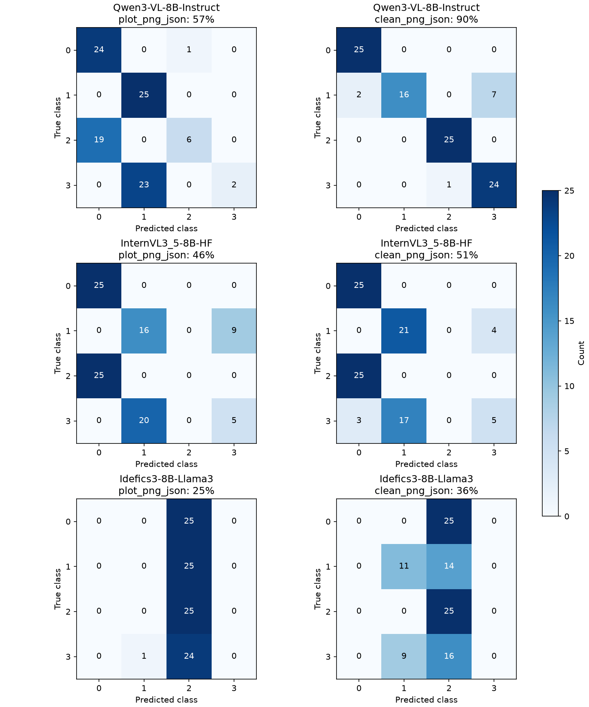

# 최신 평가 결과 · VL 모델과 골격 모양 중심 프롬프트

2026-11-04에 수행한 실험은 같은 합성 100개 데이터와 같은 프롬프트를 기준으로, 모델과 입력 표현만 바꿔가며 비교한 결과입니다. 핵심은 “좌표만 주는지, 확대 골격 이미지를 함께 주는지”가 성능 차이를 결정했다는 점입니다.

## 한눈에 보는 결과

아래 표는 최신 VL 모델과 기존 LLM 모델을 같은 기준으로 정리한 요약입니다. 모델명 옆 링크를 누르면 Hugging Face로 이동할 수 있습니다.

| 모델 | 유형 | Hugging Face | 최신 결과 | 한 줄 요약 |
|---|---|---|---:|---|
| [Qwen3-VL-8B-Instruct](https://huggingface.co/Qwen/Qwen3-VL-8B-Instruct) | VL | [Qwen/Qwen3-VL-8B-Instruct](https://huggingface.co/Qwen/Qwen3-VL-8B-Instruct) | 90% | 가장 높은 정확도. 확대 골격 구조 인식이 가장 강함 |
| [Qwen3-VL-4B-Instruct](https://huggingface.co/Qwen/Qwen3-VL-4B-Instruct) | VL | [Qwen/Qwen3-VL-4B-Instruct](https://huggingface.co/Qwen/Qwen3-VL-4B-Instruct) | 55% | 8B보다 낮지만 같은 패턴을 보임 |
| [InternVL3_5-8B-HF](https://huggingface.co/OpenGVLab/InternVL3_5-8B-HF) | VL | [OpenGVLab/InternVL3_5-8B-HF](https://huggingface.co/OpenGVLab/InternVL3_5-8B-HF) | 51% | 중간 수준. 구조 이해는 가능하지만 약함 |
| [Idefics3-8B-Llama3](https://huggingface.co/HuggingFaceM4/Idefics3-8B-Llama3) | VL | [HuggingFaceM4/Idefics3-8B-Llama3](https://huggingface.co/HuggingFaceM4/Idefics3-8B-Llama3) | 36% | 가장 낮은 VL 성능 |
| [Qwen3-8B](https://huggingface.co/Qwen/Qwen3-8B) | LLM | [Qwen/Qwen3-8B](https://huggingface.co/Qwen/Qwen3-8B) | 37% | 기존 LLM 중 가장 강함 |
| [Qwen3-4B](https://huggingface.co/Qwen/Qwen3-4B) | LLM | [Qwen/Qwen3-4B](https://huggingface.co/Qwen/Qwen3-4B) | 25~27% | 텍스트 기반으로는 중하위권 |
| [Llama-3.1-8B-Instruct](https://huggingface.co/NousResearch/Meta-Llama-3.1-8B-Instruct) | LLM | [NousResearch/Meta-Llama-3.1-8B-Instruct](https://huggingface.co/NousResearch/Meta-Llama-3.1-8B-Instruct) | 25% | 규칙 기반에서도 제한적 |

### 핵심 결론

- 가장 좋은 조합은 **확대 골격 PNG + JSON**입니다.
- 가장 좋은 모델은 **Qwen3-VL-8B-Instruct**입니다.
- 기존 LLM은 전반적으로 낮았고, 특히 `HAND_UP` 판정이 가장 약했습니다.
- 4B와 8B를 같은 입력으로 비교하면, **형태 정보를 그림으로 함께 주는 쪽이 훨씬 효율적**입니다.

## 같은 입력 조건 비교: 4B vs 8B

아래 표는 같은 조건으로 재사용한 결과만 정리한 것입니다. 기준은 모두 **확대 골격 이미지 + JSON**, 같은 100개 합성 데이터, 같은 프롬프트입니다.

| 모델 | JSON만 | 확대 PNG만 | 확대 PNG+JSON |
|---|---:|---:|---:|
| Qwen3-VL-8B-Instruct | 56% | 48% | 90% |
| Qwen3-VL-4B-Instruct | 37% | 43% | 55% |

이 표가 가장 중요합니다. 두 모델 모두 “이미지 + JSON”이 가장 좋지만, 8B는 그 효과가 훨씬 크고 전체적으로 더 안정적입니다. 4B는 낮지만 방향성은 같고, **입력 표현이 성능을 크게 바꾸는 구조**는 공통으로 확인되었습니다.

## 추가 실험: Qwen3-VL-4B 확대 골격

다음으로 4B 모델도 같은 조건으로 다시 평가했습니다.

| 모델 | 조건 | 정확도 |
|---|---|---:|
| Qwen3-VL-4B-Instruct | JSON only | 37% |
| Qwen3-VL-4B-Instruct | 확대 PNG only | 43% |
| Qwen3-VL-4B-Instruct | 확대 PNG + JSON | 55% |

결과적으로 4B 역시 **확대 골격 + JSON 조합이 가장 유리**했습니다. 다만 `HAND_UP` 판정은 여전히 약하며, 프롬프트와 판단 기준을 더 정교하게 다듬어야 합니다.

자세한 내용은 [4B 추가 실험 페이지](experiment-results-2026-11-04-vl-4b-clean.md)를 참고하세요.

## 실험 조건과 해석

- 기존 도식: 축, 격자, 라벨이 많은 PNG
- 확대 골격: 연결선과 관절만 남긴 PNG, 형태가 더 분명함
- 조건 비교: JSON만 / PNG만 / PNG+JSON / 확대 PNG만 / 확대 PNG+JSON
- 모든 비교는 같은 데이터와 같은 프롬프트를 사용했기 때문에 차이는 입력 표현 방식에 기인합니다.

### 왜 구조가 중요했나

Qwen3-VL-8B-Instruct는 JSON만으로 56%였지만, 확대 골격 이미지와 JSON을 함께 주면 90%까지 올라갔습니다. 이는 단순히 “이미지가 많다”가 아니라, 이미지가 어떤 방식으로 보이느냐가 핵심이라는 뜻입니다. 특히 앉기/서기 큰 구조는 비교적 잘 잡히고, **손을 올린 상태 구분**은 여전히 가장 어려운 문제로 남아 있습니다.

## 다음 단계

- `HAND_UP` 판정 기준을 더 명확히 만드는 실험
- 실제 사람 pose 데이터로의 외부 검증
- 4B와 8B의 입력 표현 차이를 더 정교하게 분석

이 결과는 [4B 추가 실험 페이지](experiment-results-2026-11-04-vl-4b-clean.md)와 함께 보면 가장 이해하기 쉽습니다.

## 모델별 정확도

| 모델 | JSON만 | 기존 PNG만 | 기존 PNG+JSON | 확대 PNG만 | 확대 PNG+JSON |
|---|---:|---:|---:|---:|---:|
| Qwen3-VL-8B-Instruct | 56% | 28% | 57% | 48% | 90% |
| InternVL3_5-8B-HF | 46% | 30% | 46% | 44% | 51% |
| Idefics3-8B-Llama3 | 0% | 25% | 25% | 28% | 36% |

### 해석

- 8B는 이미지 표현을 바꾸는 것만으로도 성능이 크게 바뀌었습니다.
- 4B는 낮은 절대 점수이지만, 같은 흐름을 보였습니다.
- 가장 중요한 의의는, **모든 모델에서 확대 골격 조건이 JSON만보다 나은 경향**이 있다는 점입니다.

## 결론

현재까지의 실험 결과는 다음과 같이 요약할 수 있습니다.

- 8B급 모델은 확대 골격 이미지 + JSON 조합이 최적 조건입니다.
- 4B도 같은 조건에서 가장 나은 결과를 보였지만, 8B만큼의 안정성은 부족합니다.
- 따라서 4B와 8B의 비교는 “같은 입력 조건을 쓰는 표”로 정리하는 것이 가장 정확합니다.

이 비교표는 [4B 추가 실험 페이지](experiment-results-2026-11-04-vl-4b-clean.md)와 함께 보면 가장 이해하기 쉽습니다.

## 실험 조건이란?

각 모델마다 같은 100개 샘플을 다섯 가지 방식으로 보냈습니다.

1. JSON만
2. 기존 도식 PNG만
3. 기존 도식 PNG + JSON
4. 확대 골격 PNG만
5. 확대 골격 PNG + JSON

모든 조건은 같은 프롬프트와 같은 데이터로 비교했습니다. 따라서 차이는 입력 표현 방식 때문에 생긴 것으로 해석할 수 있습니다.

## 모델별 정확도 요약

| 모델 | JSON만 | 기존 PNG만 | 기존 PNG+JSON | 확대 PNG만 | 확대 PNG+JSON |
|---|---:|---:|---:|---:|---:|
| Qwen3-VL-8B-Instruct | 56% | 28% | 57% | 48% | 90% |
| InternVL3_5-8B-HF | 46% | 30% | 46% | 44% | 51% |
| Idefics3-8B-Llama3 | 0% | 25% | 25% | 28% | 36% |

가장 눈에 띄는 점은 Qwen의 경우입니다. JSON만으로는 56%였지만, 이미지를 함께 넣고 확대 골격을 보게 되면 90%까지 올라갔습니다. 즉, 모델은 좌표보다 “형태 자체”를 읽는 데 훨씬 잘 반응했습니다.

## 의미 해석

### 1. 이미지가 핵심이었습니다

Qwen3-VL-8B-Instruct는 JSON만으로 56%였지만, PNG+JSON에서 57%로 거의 비슷했습니다. 그런데 확대 골격 PNG+JSON에서 90%까지 급 상승했습니다. 이건 단순히 “이미지가 좋다”가 아니라, 이미지가 어떤 스타일로 보여지느냐가 매우 중요하다는 뜻입니다.

### 2. 골격을 확대하면 구조가 더 보였습니다

기존 도식은 정보가 많고 격자·축·라벨이 섞여 있어 모델이 본질적인 인물 형태를 파악하는 데 방해가 되었습니다. 반면 확대 골격은 연결선과 좌우 점만 남겨서, 몸통·허리·다리의 구조와 팔의 위치가 더 분명하게 보였습니다.

### 3. `HAND_UP` 문제는 여전히 가장 큰 약점입니다

전체적으로는 90%를 달성했지만, 실제로는 클래스별로 편차가 큽니다. 특히 손을 올린 상태를 구분하는 문제는 여전히 가장 어려운 부분이었습니다. 즉, 자세의 큰 틀인 “앉기/서기”는 잘 잡지만, 팔을 올렸는지 내렸는지는 아직 불안정합니다.

### 4. 다른 모델은 아직 약했습니다

InternVL3_5와 Idefics는 모두 Qwen보다 뒤떨어졌습니다. 특히 Idefics는 JSON만 조건에서 형식 실패가 많아서, 공식 정확도가 0%로 찍히는 경우가 있었습니다. 이는 “자세를 못 판별했다”기보다, 응답 형식 자체를 안정적으로 따르지 못했다는 해석이 더 정확합니다.

## 4B 추가 실험의 의미

Qwen3-VL-4B도 같은 조건으로 확인했습니다.

| 모델 | 조건 | 정확도 |
|---|---|---:|
| Qwen3-VL-4B-Instruct | JSON only | 37% |
| Qwen3-VL-4B-Instruct | 확대 PNG only | 43% |
| Qwen3-VL-4B-Instruct | 확대 PNG + JSON | 55% |

결론적으로 4B는 8B보다 낮지만, 같은 원리로 작동합니다. 즉, 큰 모델이 아니어도 이미지와 좌표를 같이 보면 성능이 올라가지만, 8B급에서의 구조 인식 안정성을 따라가기에는 아직 한계가 있습니다.

## Qwen 프롬프트 변경 기록

다른 모델의 공통 비교와 별도로, Qwen에서는 프롬프트 개발 단계를 따로 보존했습니다. 최종 v2는 가장 높은 점수를 낸 프롬프트이지만, 그 자체가 “모든 상황에서 최적”이라는 뜻은 아닙니다.

| Qwen 프롬프트 | JSON만 | 기존 PNG만 | 기존 PNG+JSON | 확대 PNG만 | 확대 PNG+JSON |
|---|---:|---:|---:|---:|---:|
| 이전 수치 규칙 | 42% | — | 44% | — | 37% |
| 이미지 우선 v1 | 50% | 37% | 60% | — | 56% |
| 최종 골격 모양 v2 | 56% | 28% | 57% | 48% | 90% |

중요한 건, 이 값들이 “실제 사람 세트에서의 일반화 성능”을 의미하지는 않는다는 점입니다. 현재는 합성 100개 데이터에서 모델이 어떤 입력 표현에 가장 잘 반응하는지 살펴보는 실험입니다.

이 결과는 다음으로 이어집니다.

- 더 나은 시각적 표현을 찾는 것
- `HAND_UP` 판정 로직을 더 강하게 만드는 것
- 실제 관측 pose 데이터에 대한 검증

결국 지금까지의 실험은, “이미지 기반 시각적 판단이 매우 효과적”이라는 방향성을 보여준 단계입니다.

## PNG+JSON 혼동행렬

행은 정답, 열은 예측입니다. 왼쪽은 기존 도식, 오른쪽은 확대 골격입니다. 앉기·팔 올림 등 클래스별 오류를 원본 지표와 함께 확인하세요.



## 조건별 원본 기록 {#artifacts}

[직전 Qwen 단일 모델 실험](experiment-results-2026-11-04-qwen-vl-numeric.md)은 별도로 보존했습니다.

| 항목 | 값 |
|---|---|
| 입력 | v4 측면 합성 100개 · seed 42 · 클래스별 25개 · 원본 좌표 재생성 없음 |
| 모델 | 8B급 세 모델 · BF16 · 양자화 없음 |
| 방식 | zero-shot · temperature 0 · max_tokens 256 |
| 서버 | context 8192 · max_num_seqs 1 · GPU 비율 0.85 · eager · TRITON_ATTN · vision TORCH_SDPA · seed 0 |
| 검증 | 테스트 51개와 Ruff, 전송 PNG/프롬프트/JSON/혼동행렬 대조 |

입력 SHA256: `c509713c7ded6b41146a4fb2166db6317b2e8b1179d26b4f91155be211e1a7cb`

최종 프롬프트 SHA256(마지막 개행 제외): `3a4442f2def7b09806a8dcd65590f4eed91259e2452ced1303e61d7bb3b5295e`

[최종 프롬프트 전문](assets/experiments/2026-11-04-vl-visual-prompt/system-prompt.txt) · [모든 지표·명령·모델 revision·SHA256](assets/experiments/2026-11-04-vl-visual-prompt/summary.json) · [평가 좌표 스냅샷](assets/experiments/2026-11-04-vl-visual-prompt/synthetic_100.jsonl) · [확대 이미지 해시 목록](assets/experiments/2026-11-04-vl-visual-prompt/clean-image-manifest.json)

### Qwen3-VL-8B-Instruct
- JSON만: [metrics](assets/experiments/2026-11-04-vl-visual-prompt/Qwen3-VL-8B-Instruct/json_only-metrics.json) · [100개 실제 프롬프트·응답](assets/experiments/2026-11-04-vl-visual-prompt/Qwen3-VL-8B-Instruct/json_only-predictions.jsonl)
- 기존 PNG만: [metrics](assets/experiments/2026-11-04-vl-visual-prompt/Qwen3-VL-8B-Instruct/plot_png_only-metrics.json) · [100개 실제 프롬프트·응답](assets/experiments/2026-11-04-vl-visual-prompt/Qwen3-VL-8B-Instruct/plot_png_only-predictions.jsonl)
- 기존 PNG+JSON: [metrics](assets/experiments/2026-11-04-vl-visual-prompt/Qwen3-VL-8B-Instruct/plot_png_json-metrics.json) · [100개 실제 프롬프트·응답](assets/experiments/2026-11-04-vl-visual-prompt/Qwen3-VL-8B-Instruct/plot_png_json-predictions.jsonl)
- 확대 골격 PNG만: [metrics](assets/experiments/2026-11-04-vl-visual-prompt/Qwen3-VL-8B-Instruct/clean_png_only-metrics.json) · [100개 실제 프롬프트·응답](assets/experiments/2026-11-04-vl-visual-prompt/Qwen3-VL-8B-Instruct/clean_png_only-predictions.jsonl)
- 확대 골격 PNG+JSON: [metrics](assets/experiments/2026-11-04-vl-visual-prompt/Qwen3-VL-8B-Instruct/clean_png_json-metrics.json) · [100개 실제 프롬프트·응답](assets/experiments/2026-11-04-vl-visual-prompt/Qwen3-VL-8B-Instruct/clean_png_json-predictions.jsonl)

### InternVL3_5-8B-HF
- JSON만: [metrics](assets/experiments/2026-11-04-vl-visual-prompt/InternVL3_5-8B-HF/json_only-metrics.json) · [100개 실제 프롬프트·응답](assets/experiments/2026-11-04-vl-visual-prompt/InternVL3_5-8B-HF/json_only-predictions.jsonl)
- 기존 PNG만: [metrics](assets/experiments/2026-11-04-vl-visual-prompt/InternVL3_5-8B-HF/plot_png_only-metrics.json) · [100개 실제 프롬프트·응답](assets/experiments/2026-11-04-vl-visual-prompt/InternVL3_5-8B-HF/plot_png_only-predictions.jsonl)
- 기존 PNG+JSON: [metrics](assets/experiments/2026-11-04-vl-visual-prompt/InternVL3_5-8B-HF/plot_png_json-metrics.json) · [100개 실제 프롬프트·응답](assets/experiments/2026-11-04-vl-visual-prompt/InternVL3_5-8B-HF/plot_png_json-predictions.jsonl)
- 확대 골격 PNG만: [metrics](assets/experiments/2026-11-04-vl-visual-prompt/InternVL3_5-8B-HF/clean_png_only-metrics.json) · [100개 실제 프롬프트·응답](assets/experiments/2026-11-04-vl-visual-prompt/InternVL3_5-8B-HF/clean_png_only-predictions.jsonl)
- 확대 골격 PNG+JSON: [metrics](assets/experiments/2026-11-04-vl-visual-prompt/InternVL3_5-8B-HF/clean_png_json-metrics.json) · [100개 실제 프롬프트·응답](assets/experiments/2026-11-04-vl-visual-prompt/InternVL3_5-8B-HF/clean_png_json-predictions.jsonl)

### Idefics3-8B-Llama3
- JSON만: [metrics](assets/experiments/2026-11-04-vl-visual-prompt/Idefics3-8B-Llama3/json_only-metrics.json) · [100개 실제 프롬프트·응답](assets/experiments/2026-11-04-vl-visual-prompt/Idefics3-8B-Llama3/json_only-predictions.jsonl)
- 기존 PNG만: [metrics](assets/experiments/2026-11-04-vl-visual-prompt/Idefics3-8B-Llama3/plot_png_only-metrics.json) · [100개 실제 프롬프트·응답](assets/experiments/2026-11-04-vl-visual-prompt/Idefics3-8B-Llama3/plot_png_only-predictions.jsonl)
- 기존 PNG+JSON: [metrics](assets/experiments/2026-11-04-vl-visual-prompt/Idefics3-8B-Llama3/plot_png_json-metrics.json) · [100개 실제 프롬프트·응답](assets/experiments/2026-11-04-vl-visual-prompt/Idefics3-8B-Llama3/plot_png_json-predictions.jsonl)
- 확대 골격 PNG만: [metrics](assets/experiments/2026-11-04-vl-visual-prompt/Idefics3-8B-Llama3/clean_png_only-metrics.json) · [100개 실제 프롬프트·응답](assets/experiments/2026-11-04-vl-visual-prompt/Idefics3-8B-Llama3/clean_png_only-predictions.jsonl)
- 확대 골격 PNG+JSON: [metrics](assets/experiments/2026-11-04-vl-visual-prompt/Idefics3-8B-Llama3/clean_png_json-metrics.json) · [100개 실제 프롬프트·응답](assets/experiments/2026-11-04-vl-visual-prompt/Idefics3-8B-Llama3/clean_png_json-predictions.jsonl)

모델별 실제 요청 준비 확인은 별도 smoke 호출로 기록했으며 100개 평가 지표에는 포함하지 않습니다. 실험용 서버는 종료했습니다. 전체 오분류 PNG와 서버 로그는 `results/experiments/2026-11-04-vl-visual-prompt/`에 보관합니다.

## 재현 {#reproduce}

summary.json의 각 모델 runs 항목에 기록한 server_command로 모델을 준비한 후 새 출력 폴더로 실행합니다. 이미지 스타일은 같은 출력 폴더에서 섞어 쓸 수 없습니다.

```bash
.venv/bin/python scripts/benchmark_vision.py --input data/sample/synthetic_100.jsonl \
  --output-dir results/reproduction-clean --image-style clean --prepare-only
# 입력 이미지를 점검한 후:
.venv/bin/python scripts/benchmark_vision.py --input data/sample/synthetic_100.jsonl \
  --output-dir results/reproduction-clean --image-style clean --visualization-reviewed \
  --model Qwen/Qwen3-VL-8B-Instruct --base-url http://127.0.0.1:18083/v1 \
  --modes png_only png_json
```

기존 도식은 `--image-style plot`로 새 출력 폴더를 지정하고 `--modes json_only png_only png_json`으로 실행합니다. 모델 ID는 해당 모델의 서버 이름으로 바꿉니다. Idefics에는 `--instruction-role user --image-first`를 추가하고, 서버에는 `--chat-template-content-format openai`를 적용합니다. 각 runs의 server_environment_overrides도 적용해야 TensorFlow 라이브러리 충돌을 피할 수 있습니다.

??? abstract "100개별 확대 골격 PNG+JSON 예측 펼치기"

    | 입력 이미지 / ID | 정답 | Qwen3-VL | InternVL3.5 | Idefics3 |
    |---|---:|---:|---:|---:|
    | [synthetic-0-000](assets/experiments/2026-11-04-vl-visual-prompt/images/clean/0000.png) | 0 | 0 | 0 | 2 |
    | [synthetic-0-001](assets/experiments/2026-11-04-vl-visual-prompt/images/clean/0001.png) | 0 | 0 | 0 | 2 |
    | [synthetic-0-002](assets/experiments/2026-11-04-vl-visual-prompt/images/clean/0002.png) | 0 | 0 | 0 | 2 |
    | [synthetic-0-003](assets/experiments/2026-11-04-vl-visual-prompt/images/clean/0003.png) | 0 | 0 | 0 | 2 |
    | [synthetic-0-004](assets/experiments/2026-11-04-vl-visual-prompt/images/clean/0004.png) | 0 | 0 | 0 | 2 |
    | [synthetic-0-005](assets/experiments/2026-11-04-vl-visual-prompt/images/clean/0005.png) | 0 | 0 | 0 | 2 |
    | [synthetic-0-006](assets/experiments/2026-11-04-vl-visual-prompt/images/clean/0006.png) | 0 | 0 | 0 | 2 |
    | [synthetic-0-007](assets/experiments/2026-11-04-vl-visual-prompt/images/clean/0007.png) | 0 | 0 | 0 | 2 |
    | [synthetic-0-008](assets/experiments/2026-11-04-vl-visual-prompt/images/clean/0008.png) | 0 | 0 | 0 | 2 |
    | [synthetic-0-009](assets/experiments/2026-11-04-vl-visual-prompt/images/clean/0009.png) | 0 | 0 | 0 | 2 |
    | [synthetic-0-010](assets/experiments/2026-11-04-vl-visual-prompt/images/clean/0010.png) | 0 | 0 | 0 | 2 |
    | [synthetic-0-011](assets/experiments/2026-11-04-vl-visual-prompt/images/clean/0011.png) | 0 | 0 | 0 | 2 |
    | [synthetic-0-012](assets/experiments/2026-11-04-vl-visual-prompt/images/clean/0012.png) | 0 | 0 | 0 | 2 |
    | [synthetic-0-013](assets/experiments/2026-11-04-vl-visual-prompt/images/clean/0013.png) | 0 | 0 | 0 | 2 |
    | [synthetic-0-014](assets/experiments/2026-11-04-vl-visual-prompt/images/clean/0014.png) | 0 | 0 | 0 | 2 |
    | [synthetic-0-015](assets/experiments/2026-11-04-vl-visual-prompt/images/clean/0015.png) | 0 | 0 | 0 | 2 |
    | [synthetic-0-016](assets/experiments/2026-11-04-vl-visual-prompt/images/clean/0016.png) | 0 | 0 | 0 | 2 |
    | [synthetic-0-017](assets/experiments/2026-11-04-vl-visual-prompt/images/clean/0017.png) | 0 | 0 | 0 | 2 |
    | [synthetic-0-018](assets/experiments/2026-11-04-vl-visual-prompt/images/clean/0018.png) | 0 | 0 | 0 | 2 |
    | [synthetic-0-019](assets/experiments/2026-11-04-vl-visual-prompt/images/clean/0019.png) | 0 | 0 | 0 | 2 |
    | [synthetic-0-020](assets/experiments/2026-11-04-vl-visual-prompt/images/clean/0020.png) | 0 | 0 | 0 | 2 |
    | [synthetic-0-021](assets/experiments/2026-11-04-vl-visual-prompt/images/clean/0021.png) | 0 | 0 | 0 | 2 |
    | [synthetic-0-022](assets/experiments/2026-11-04-vl-visual-prompt/images/clean/0022.png) | 0 | 0 | 0 | 2 |
    | [synthetic-0-023](assets/experiments/2026-11-04-vl-visual-prompt/images/clean/0023.png) | 0 | 0 | 0 | 2 |
    | [synthetic-0-024](assets/experiments/2026-11-04-vl-visual-prompt/images/clean/0024.png) | 0 | 0 | 0 | 2 |
    | [synthetic-1-000](assets/experiments/2026-11-04-vl-visual-prompt/images/clean/0025.png) | 1 | 0 | 1 | 2 |
    | [synthetic-1-001](assets/experiments/2026-11-04-vl-visual-prompt/images/clean/0026.png) | 1 | 1 | 1 | 1 |
    | [synthetic-1-002](assets/experiments/2026-11-04-vl-visual-prompt/images/clean/0027.png) | 1 | 1 | 1 | 1 |
    | [synthetic-1-003](assets/experiments/2026-11-04-vl-visual-prompt/images/clean/0028.png) | 1 | 3 | 1 | 1 |
    | [synthetic-1-004](assets/experiments/2026-11-04-vl-visual-prompt/images/clean/0029.png) | 1 | 3 | 1 | 2 |
    | [synthetic-1-005](assets/experiments/2026-11-04-vl-visual-prompt/images/clean/0030.png) | 1 | 1 | 1 | 1 |
    | [synthetic-1-006](assets/experiments/2026-11-04-vl-visual-prompt/images/clean/0031.png) | 1 | 1 | 1 | 2 |
    | [synthetic-1-007](assets/experiments/2026-11-04-vl-visual-prompt/images/clean/0032.png) | 1 | 3 | 3 | 1 |
    | [synthetic-1-008](assets/experiments/2026-11-04-vl-visual-prompt/images/clean/0033.png) | 1 | 1 | 1 | 1 |
    | [synthetic-1-009](assets/experiments/2026-11-04-vl-visual-prompt/images/clean/0034.png) | 1 | 0 | 1 | 2 |
    | [synthetic-1-010](assets/experiments/2026-11-04-vl-visual-prompt/images/clean/0035.png) | 1 | 1 | 1 | 2 |
    | [synthetic-1-011](assets/experiments/2026-11-04-vl-visual-prompt/images/clean/0036.png) | 1 | 3 | 1 | 1 |
    | [synthetic-1-012](assets/experiments/2026-11-04-vl-visual-prompt/images/clean/0037.png) | 1 | 1 | 1 | 2 |
    | [synthetic-1-013](assets/experiments/2026-11-04-vl-visual-prompt/images/clean/0038.png) | 1 | 3 | 1 | 1 |
    | [synthetic-1-014](assets/experiments/2026-11-04-vl-visual-prompt/images/clean/0039.png) | 1 | 1 | 1 | 1 |
    | [synthetic-1-015](assets/experiments/2026-11-04-vl-visual-prompt/images/clean/0040.png) | 1 | 1 | 1 | 2 |
    | [synthetic-1-016](assets/experiments/2026-11-04-vl-visual-prompt/images/clean/0041.png) | 1 | 3 | 3 | 2 |
    | [synthetic-1-017](assets/experiments/2026-11-04-vl-visual-prompt/images/clean/0042.png) | 1 | 1 | 1 | 2 |
    | [synthetic-1-018](assets/experiments/2026-11-04-vl-visual-prompt/images/clean/0043.png) | 1 | 1 | 1 | 2 |
    | [synthetic-1-019](assets/experiments/2026-11-04-vl-visual-prompt/images/clean/0044.png) | 1 | 3 | 3 | 1 |
    | [synthetic-1-020](assets/experiments/2026-11-04-vl-visual-prompt/images/clean/0045.png) | 1 | 1 | 1 | 2 |
    | [synthetic-1-021](assets/experiments/2026-11-04-vl-visual-prompt/images/clean/0046.png) | 1 | 1 | 1 | 2 |
    | [synthetic-1-022](assets/experiments/2026-11-04-vl-visual-prompt/images/clean/0047.png) | 1 | 1 | 1 | 2 |
    | [synthetic-1-023](assets/experiments/2026-11-04-vl-visual-prompt/images/clean/0048.png) | 1 | 1 | 3 | 1 |
    | [synthetic-1-024](assets/experiments/2026-11-04-vl-visual-prompt/images/clean/0049.png) | 1 | 1 | 1 | 2 |
    | [synthetic-2-000](assets/experiments/2026-11-04-vl-visual-prompt/images/clean/0050.png) | 2 | 2 | 0 | 2 |
    | [synthetic-2-001](assets/experiments/2026-11-04-vl-visual-prompt/images/clean/0051.png) | 2 | 2 | 0 | 2 |
    | [synthetic-2-002](assets/experiments/2026-11-04-vl-visual-prompt/images/clean/0052.png) | 2 | 2 | 0 | 2 |
    | [synthetic-2-003](assets/experiments/2026-11-04-vl-visual-prompt/images/clean/0053.png) | 2 | 2 | 0 | 2 |
    | [synthetic-2-004](assets/experiments/2026-11-04-vl-visual-prompt/images/clean/0054.png) | 2 | 2 | 0 | 2 |
    | [synthetic-2-005](assets/experiments/2026-11-04-vl-visual-prompt/images/clean/0055.png) | 2 | 2 | 0 | 2 |
    | [synthetic-2-006](assets/experiments/2026-11-04-vl-visual-prompt/images/clean/0056.png) | 2 | 2 | 0 | 2 |
    | [synthetic-2-007](assets/experiments/2026-11-04-vl-visual-prompt/images/clean/0057.png) | 2 | 2 | 0 | 2 |
    | [synthetic-2-008](assets/experiments/2026-11-04-vl-visual-prompt/images/clean/0058.png) | 2 | 2 | 0 | 2 |
    | [synthetic-2-009](assets/experiments/2026-11-04-vl-visual-prompt/images/clean/0059.png) | 2 | 2 | 0 | 2 |
    | [synthetic-2-010](assets/experiments/2026-11-04-vl-visual-prompt/images/clean/0060.png) | 2 | 2 | 0 | 2 |
    | [synthetic-2-011](assets/experiments/2026-11-04-vl-visual-prompt/images/clean/0061.png) | 2 | 2 | 0 | 2 |
    | [synthetic-2-012](assets/experiments/2026-11-04-vl-visual-prompt/images/clean/0062.png) | 2 | 2 | 0 | 2 |
    | [synthetic-2-013](assets/experiments/2026-11-04-vl-visual-prompt/images/clean/0063.png) | 2 | 2 | 0 | 2 |
    | [synthetic-2-014](assets/experiments/2026-11-04-vl-visual-prompt/images/clean/0064.png) | 2 | 2 | 0 | 2 |
    | [synthetic-2-015](assets/experiments/2026-11-04-vl-visual-prompt/images/clean/0065.png) | 2 | 2 | 0 | 2 |
    | [synthetic-2-016](assets/experiments/2026-11-04-vl-visual-prompt/images/clean/0066.png) | 2 | 2 | 0 | 2 |
    | [synthetic-2-017](assets/experiments/2026-11-04-vl-visual-prompt/images/clean/0067.png) | 2 | 2 | 0 | 2 |
    | [synthetic-2-018](assets/experiments/2026-11-04-vl-visual-prompt/images/clean/0068.png) | 2 | 2 | 0 | 2 |
    | [synthetic-2-019](assets/experiments/2026-11-04-vl-visual-prompt/images/clean/0069.png) | 2 | 2 | 0 | 2 |
    | [synthetic-2-020](assets/experiments/2026-11-04-vl-visual-prompt/images/clean/0070.png) | 2 | 2 | 0 | 2 |
    | [synthetic-2-021](assets/experiments/2026-11-04-vl-visual-prompt/images/clean/0071.png) | 2 | 2 | 0 | 2 |
    | [synthetic-2-022](assets/experiments/2026-11-04-vl-visual-prompt/images/clean/0072.png) | 2 | 2 | 0 | 2 |
    | [synthetic-2-023](assets/experiments/2026-11-04-vl-visual-prompt/images/clean/0073.png) | 2 | 2 | 0 | 2 |
    | [synthetic-2-024](assets/experiments/2026-11-04-vl-visual-prompt/images/clean/0074.png) | 2 | 2 | 0 | 2 |
    | [synthetic-3-000](assets/experiments/2026-11-04-vl-visual-prompt/images/clean/0075.png) | 3 | 3 | 1 | 2 |
    | [synthetic-3-001](assets/experiments/2026-11-04-vl-visual-prompt/images/clean/0076.png) | 3 | 3 | 1 | 2 |
    | [synthetic-3-002](assets/experiments/2026-11-04-vl-visual-prompt/images/clean/0077.png) | 3 | 3 | 1 | 2 |
    | [synthetic-3-003](assets/experiments/2026-11-04-vl-visual-prompt/images/clean/0078.png) | 3 | 3 | 1 | 2 |
    | [synthetic-3-004](assets/experiments/2026-11-04-vl-visual-prompt/images/clean/0079.png) | 3 | 3 | 3 | 1 |
    | [synthetic-3-005](assets/experiments/2026-11-04-vl-visual-prompt/images/clean/0080.png) | 3 | 3 | 1 | 1 |
    | [synthetic-3-006](assets/experiments/2026-11-04-vl-visual-prompt/images/clean/0081.png) | 3 | 3 | 0 | 2 |
    | [synthetic-3-007](assets/experiments/2026-11-04-vl-visual-prompt/images/clean/0082.png) | 3 | 3 | 1 | 1 |
    | [synthetic-3-008](assets/experiments/2026-11-04-vl-visual-prompt/images/clean/0083.png) | 3 | 3 | 1 | 1 |
    | [synthetic-3-009](assets/experiments/2026-11-04-vl-visual-prompt/images/clean/0084.png) | 3 | 2 | 1 | 2 |
    | [synthetic-3-010](assets/experiments/2026-11-04-vl-visual-prompt/images/clean/0085.png) | 3 | 3 | 1 | 2 |
    | [synthetic-3-011](assets/experiments/2026-11-04-vl-visual-prompt/images/clean/0086.png) | 3 | 3 | 3 | 1 |
    | [synthetic-3-012](assets/experiments/2026-11-04-vl-visual-prompt/images/clean/0087.png) | 3 | 3 | 0 | 2 |
    | [synthetic-3-013](assets/experiments/2026-11-04-vl-visual-prompt/images/clean/0088.png) | 3 | 3 | 1 | 2 |
    | [synthetic-3-014](assets/experiments/2026-11-04-vl-visual-prompt/images/clean/0089.png) | 3 | 3 | 3 | 1 |
    | [synthetic-3-015](assets/experiments/2026-11-04-vl-visual-prompt/images/clean/0090.png) | 3 | 3 | 0 | 2 |
    | [synthetic-3-016](assets/experiments/2026-11-04-vl-visual-prompt/images/clean/0091.png) | 3 | 3 | 1 | 2 |
    | [synthetic-3-017](assets/experiments/2026-11-04-vl-visual-prompt/images/clean/0092.png) | 3 | 3 | 1 | 2 |
    | [synthetic-3-018](assets/experiments/2026-11-04-vl-visual-prompt/images/clean/0093.png) | 3 | 3 | 1 | 2 |
    | [synthetic-3-019](assets/experiments/2026-11-04-vl-visual-prompt/images/clean/0094.png) | 3 | 3 | 3 | 1 |
    | [synthetic-3-020](assets/experiments/2026-11-04-vl-visual-prompt/images/clean/0095.png) | 3 | 3 | 3 | 1 |
    | [synthetic-3-021](assets/experiments/2026-11-04-vl-visual-prompt/images/clean/0096.png) | 3 | 3 | 1 | 2 |
    | [synthetic-3-022](assets/experiments/2026-11-04-vl-visual-prompt/images/clean/0097.png) | 3 | 3 | 1 | 2 |
    | [synthetic-3-023](assets/experiments/2026-11-04-vl-visual-prompt/images/clean/0098.png) | 3 | 3 | 1 | 1 |
    | [synthetic-3-024](assets/experiments/2026-11-04-vl-visual-prompt/images/clean/0099.png) | 3 | 3 | 1 | 2 |
