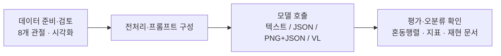

# pose2actionLLM

**8개 관절 좌표로 동작을 분류하고, 입력부터 LLM 응답까지 추적하는 실험 도구입니다.**
좌우 어깨·팔꿈치·골반·무릎만 사용해 앉기/서기와 팔 올림/내림을 구분합니다.

!!! info "현재 상태 · 2026-11-04"
    - Qwen3-VL-8B-Instruct: 확대 PNG+JSON 90%
    - InternVL3_5-8B-HF: 확대 PNG+JSON 51%
    - Idefics3-8B-Llama3: 확대 PNG+JSON 36%
    - 추가 4B 실험: 확대 골격 + PNG+JSON 55%
    
    [전체 실험 결과](experiment-results.md)와 [4B 추가 실험](experiment-results-2026-11-04-vl-4b-clean.md)을 함께 확인하세요.

## 원하는 곳부터 시작하세요

- **전체 과정 이해하기**

    데이터 생성 → 전처리 → 이미지/JSON 호출 → 평가까지 한 번에 보려면 여기를 시작하세요.

    [전체 흐름과 모델 호출 →](pipeline.md)

- **최신 결과 확인하기**

    각 모델의 정확도, 혼동행렬, 오분류, 재현 명령을 정리했습니다.

    [최신 결과 →](experiment-results.md)

- **4B 추가 실험 보기**

    4B VL 모델을 확대 골격 조건으로 다시 검증한 결과를 별도 페이지로 정리했습니다.

    [4B 실험 결과 →](experiment-results-2026-11-04-vl-4b-clean.md)

- **입력 데이터 살펴보기**

    클래스 구성, 좌표 형식, 시각화된 데이터셋 구조를 확인합니다.

    [현재 데이터셋 →](dataset-100.md)

- **직접 실행하기**

    모델 없는 연결 테스트부터, 로컬 vLLM 서버 평가까지 이어집니다.

    [설치와 빠른 시작 →](getting-started.md)

## 처리 흐름 한눈에 보기

## 현재 상태 요약

| 항목 | 현재 상태 |
|---|---|
| 데이터 | v4 측면 합성 100개 · 클래스별 25개 · seed 42 |
| 핵심 모델 | Qwen3-VL-8B, InternVL3.5-8B, Idefics3-8B, 추가 Qwen3-VL-4B |
| 실행 환경 | 로컬 RTX 5090에서 vLLM 서버로 HTTP 호출 |
| 입력 형식 | 8개 관절 JSON, 정답 없이 렌더링된 PNG, PNG+JSON 결합 |
| 최신 성과 | Qwen3-VL-8B-Instruct 90% · InternVL3.5 51% · Idefics3 36% |
| 추가 실험 | Qwen3-VL-4B 확대 골격 + PNG+JSON 55% |
| 이전 기록 | [v2 정면 데이터 평가: 11%](experiment-results-v2.md) |

합성 도식으로 기술 검증을 마쳤으며, 실제 관측 자세의 일반화 검증은 아직 남아 있습니다.
기본 `mock`은 항상 0을 반환하고, 실제 서버는 평가 후 종료하는 흐름으로 유지합니다.

## 클래스 정의

| ID | 클래스명 | 의미 |
|---|---|---|
| 0 | SITTING_HAND_DOWN | 앉기 · 팔 내림 |
| 1 | SITTING_HAND_UP | 앉기 · 팔 올림 |
| 2 | STANDING_HAND_DOWN | 서기 · 팔 내림 |
| 3 | STANDING_HAND_UP | 서기 · 팔 올림 |

`HAND_UP`은 같은 쪽 어깨보다 팔꿈치가 높은지를 기준으로 합니다. 손목이 없어 실제 손 높이는 관측할 수 없습니다.
자세한 좌표 계약은 [8개 관절 데이터 형식](data-format.md)을 참고하세요.
