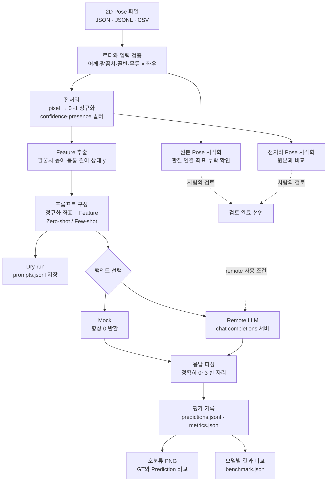
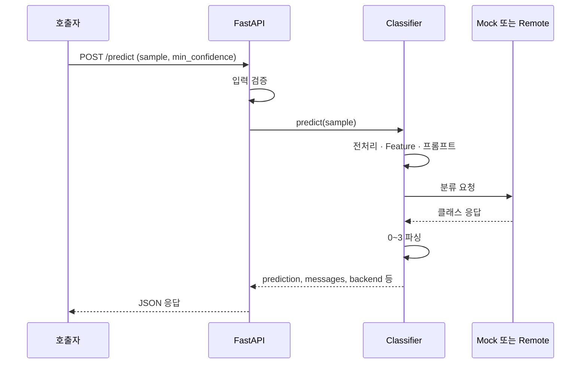

# 전체 처리 흐름

## 데이터셋 평가 경로

아래 흐름은 `scripts/evaluate_llm.py`와 `scripts/benchmark_models.py`를 중심으로 구성됩니다.
시각화와 dry-run은 별도 명령으로 실행하는 검토 단계이며, 평가 명령이 자동으로 사람의 검토를 수행하지 않습니다.

## 단계와 구현 파일

| 단계 | 모듈 / 스크립트 | 핵심 출력 |
|---|---|---|
| 입력 검증 | `data.py` | 이름이 있는 keypoint dict |
| 원본 및 전처리 시각화 | `visualization.py`, `visualize_pose.py` | PNG |
| 데이터셋 시각화 | `visualize_dataset.py` | 샘플 PNG, `selection.json` |
| 정규화 및 필터 | `preprocessing.py`, `preprocess.py` | 정규화 JSONL |
| 파생 정보 | `features.py`, `extract_features.py` | feature가 추가된 JSONL |
| 프롬프트와 분류 | `inference.py` | messages, prediction, raw_response |
| 평가 | `evaluation.py`, `evaluate_llm.py` | 지표, 샘플별 기록, 오분류 이미지 |
| 모델 비교 | `benchmark_models.py` | 모델별 결과 폴더, `benchmark.json` |

모듈은 `src/pose_llm_classifier/`, 실행 스크립트는 `scripts/` 아래에 있습니다.
전처리와 feature 추출은 추론 내부에서도 수행하므로 별도 전처리 파일을 먼저 만들 필요는 없습니다.
질의 프롬프트에는 정답·예측·샘플 ID를 넣지 않습니다. Few-shot 예시의 정답만 assistant 메시지로 전달합니다.

## API 경로

API는 단일 pose를 분류하고 응답합니다. 데이터셋 평가·PNG 저장은 CLI에서 수행합니다.

## 오류와 미실행 단계

- 잘못된 입력 좌표는 검증 오류이며 데이터셋 평가를 중단합니다.
- 평가 중 모델 호출/응답 파싱 실패는 샘플별 실패로 기록하고 전체 accuracy에서 오답으로 계산합니다.
- 실패한 예측은 혼동행렬·클래스별 지표와 오분류 PNG에서 제외합니다.
- 실제 모델 비교와 최적 모델 선정은 아직 수행하지 않았습니다. mock 지표는 연결 확인용입니다.

다음 단계는 [실제 데이터 시각화](visualization.md) 후 [원격 모델 평가](evaluation.md)입니다.
