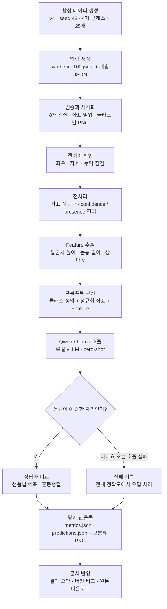
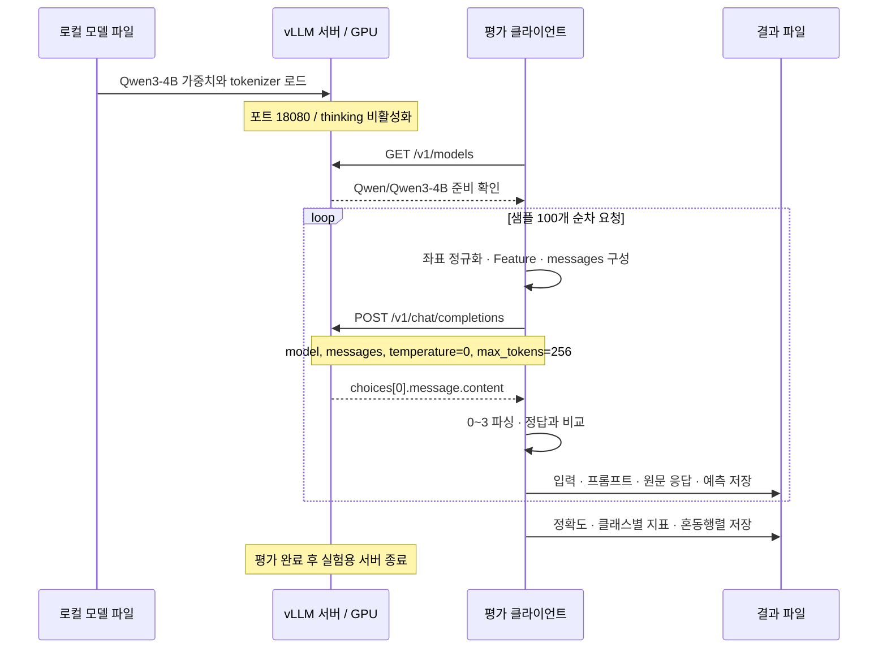
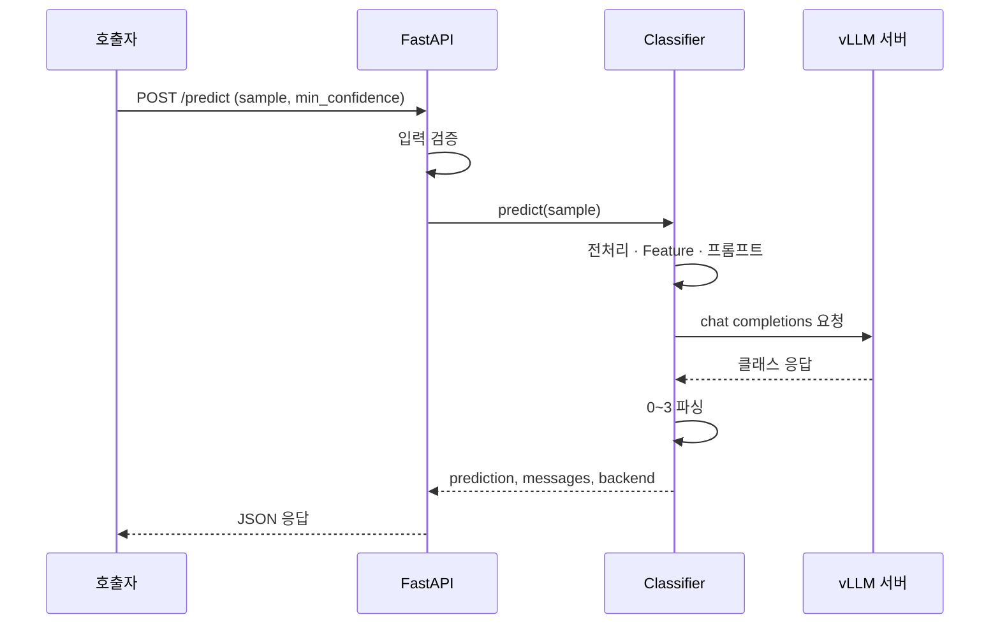

# 전체 흐름과 모델 호출

**좌표를 준비하고 → 시각화로 확인하고 → LLM에 텍스트로 전달하고 → 정답과 비교합니다.**
모델은 로컬 GPU의 vLLM 서버에서 실행합니다. 분류 클라이언트는 HTTP로 서버를 호출합니다.

작은 화면에서는 다이어그램을 좌우로 스크롤해 읽을 수 있습니다.

## 1. 데이터부터 결과까지

현재 결과는 [v4 평가 보고서](experiment-results.md), 입력은 [현재 데이터셋](dataset-100.md)에서 확인합니다.
실제 관측 pose도 입력 검증 이후에는 같은 경로를 사용합니다. 시각화 확인은 별도 단계이며 평가 명령이 대신 수행하지 않습니다.

## 2. 모델을 불러오는 방법

모델 가중치는 `models/Qwen3-4B/`, `models/Qwen3-8B/`, `models/Llama-3.1-8B-Instruct/`에 있습니다. 아래 다이어그램은 4B 호출 예시이며 최신 비교는 세 모델을 포트 18081에서 순차 로딩했습니다. `.venv-model`의 **vLLM이 가중치와 tokenizer를 읽어 GPU에 적재**하고,
클라이언트는 서버가 제공하는 `Qwen/Qwen3-4B`라는 이름으로 요청합니다.
`remote`는 HTTP 호출 백엔드의 이름이며 이번 실험의 서버 주소는 같은 컴퓨터의 `127.0.0.1`입니다.

그림의 `/models` 확인은 실행 전 준비 단계입니다. `evaluate_llm.py` 자체는 샘플별 chat 요청을 수행하며,
자동 실행기 `run_pipeline.py`는 endpoint 준비 확인도 포함합니다.

**텍스트 전용 실험은 좌표와 Feature의 JSON 텍스트를 사용합니다.** 이미지 입력 실험에서는 정답 표시를 제거한 PNG를 JSON과 함께 Qwen3-VL-8B-Instruct에 전달합니다. 두 조건은 같은 vision 모델로 JSON 단독 / PNG+JSON을 비교하며 포트 18082를 사용합니다. 기존 검토용 PNG에는 정답이 있어 모델 입력으로 사용하지 않습니다.
질의에는 정답·예측·샘플 ID·합성 메타데이터를 넣지 않습니다. 이번 실행은 few-shot 예시 없이 평가했습니다.

## 3. 실행 단계와 파일

| 단계 | 실행 파일 / 모듈 | 출력 |
|---|---|---|
| 합성 데이터 생성 | `scripts/generate_synthetic_dataset.py` | JSONL, JSON, PNG, manifest |
| 입력 검증 | `src/pose_llm_classifier/data.py` | 검증된 8개 관절 |
| 시각화 | `scripts/visualize_pose.py`, `visualize_dataset.py` | 원본/전처리 PNG |
| 전처리와 Feature | `preprocessing.py`, `features.py` | 정규화 좌표, 파생 값 |
| 프롬프트와 HTTP 호출 | `inference.py` | messages, 원문 응답, 예측 |
| 평가 | `scripts/evaluate_llm.py`, `evaluation.py` | 지표, 예측 JSONL, 오분류 PNG |
| 자동 실행 | `scripts/run_pipeline.py` | 점검, 시각화, 평가, 피드백 |

모듈 파일은 `src/pose_llm_classifier/` 아래에 있습니다.
전처리와 Feature 추출은 추론 내부에서 수행하므로 별도 전처리 파일을 먼저 만들 필요는 없습니다.
[재현 명령](experiment-results.md#reproduce) 또는 [자동 실행 가이드](server-automation.md)로 이어가세요.

??? info "Mock과 여러 모델 비교"

    기본 mock 백엔드는 입력과 관계없이 `0`을 반환하는 연결 확인 도구입니다.
    `benchmark_models.py`는 준비된 서버의 여러 모델 결과를 비교할 수 있습니다.
    현재 Qwen3-4B, Qwen3-8B, Llama 3.1-8B-Instruct를 동일한 수치 규칙 프롬프트와 v4 합성 100개로 비교했습니다. 결과와 원문 응답은 [최신 평가](experiment-results.md)에 있습니다.

## 4. 단일 Pose API

FastAPI는 단일 pose를 분류합니다. 데이터셋 평가와 결과 파일 저장은 CLI에서 수행합니다.

??? note "오류를 계산하는 방법"

    잘못된 입력 좌표는 검증 오류로 평가를 중단합니다.
    모델 호출 또는 응답 파싱 실패는 샘플별 실패로 기록하고 전체 정확도에서 오답으로 계산합니다.
    실패한 예측은 혼동행렬·클래스별 지표와 오분류 PNG에서 제외합니다.

## PNG+JSON 비교 경로

`render_model_input`으로 메타데이터 없는 PNG 100개 생성 → 이미지 점검 → `benchmark_vision.py`가 같은 모델·프롬프트·JSON에 이미지 유무만 달리해 조건별 100개 평가 → 실제 전송 이미지 SHA256과 JSON 동일성 감사 → 지표·조건별 혼동행렬 기록.
