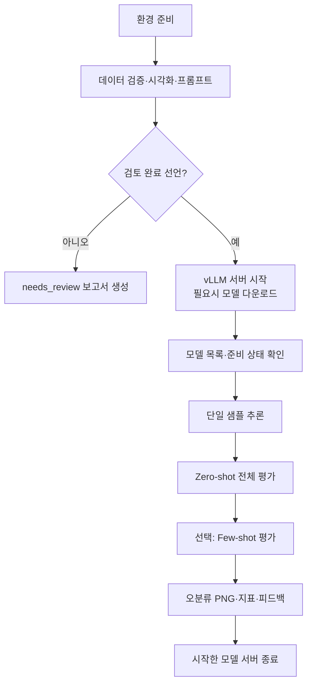

# 서버에서 자동 실행과 피드백

서버에 저장소를 받은 다음 `bash scripts/run_server.sh`를 실행합니다.
기본값은 합성 데이터 100개의 검증·시각화·전처리·프롬프트 저장이며 모델을 실행하지 않습니다.
실제 데이터 경로와 실행 모드를 지정하면 같은 스크립트로 평가까지 이어집니다.

## 처음 서버에 접속했을 때

환경이 준비되지 않았다면 [서버 최초 설치](server-setup.md) 스크립트부터 실행하세요.

```bash
git clone https://github.com/ggh-png/pose2actionLLM.git
cd pose2actionLLM
bash scripts/run_server.sh
```

Python 3.10 이상과 venv/pip, 패키지 설치용 인터넷 연결이 필요합니다.
실제 데이터는 서버의 `data/test.jsonl` 등에 따로 준비하세요.
`python3-venv`가 없는 Ubuntu 환경은 해당 시스템 패키지를 먼저 설치해야 합니다.
스크립트는 sudo나 드라이버 설치를 수행하지 않습니다.

`run_server.sh`는 `.venv-server`에 가상환경과 기본 패키지를 준비하고 Python 실행기를 호출합니다.
이미 설치된 환경을 쓰려면 `POSE_RUN_VENV=/path/to/venv`를 지정합니다.
다른 Python 실행기는 `POSE_PYTHON=python3.12`로 지정합니다.
항상 저장소 루트로 이동한 뒤 실행하므로 상대 입력 경로는 **저장소 루트 기준**입니다.

## 실제 데이터 점검

```bash
bash scripts/run_server.sh --input data/test.jsonl
```

다음 작업을 자동으로 수행합니다.

1. Python·메모리·디스크·GPU 환경을 기록합니다.
2. 전체 데이터의 좌표와 라벨, 클래스별 수량, 정규화 좌표 중복을 검사합니다.
3. confidence/presence 필터 후 누락 관절 수와 팔꿈치 높이·라벨 불일치를 집계합니다.
4. 클래스별 앞쪽 3개 sample의 원본·전처리 PNG를 저장합니다 (`--preview-per-class`로 조절).
5. 정규화 좌표·feature·zero-shot 프롬프트를 저장하고 `feedback.md`를 작성합니다.

이미지와 실제 좌표를 사람이 확인한 뒤 다음 평가 명령에 `--visualization-reviewed`를 추가합니다.
이 플래그는 검토 완료 선언이며 사람 형태·해부학적 좌우·라벨 정의를 자동 인증하지 않습니다.
정답 없이도 inspect는 가능하지만 평가에는 모든 sample의 label이 필요합니다.

## GPU 서버에서 Qwen3-4B까지 한 번에 평가

원본/전처리 이미지와 프롬프트 검토 후 다음 명령 한 번을 실행합니다.

```bash
bash scripts/run_server.sh --input data/test.jsonl --mode remote \
  --visualization-reviewed --install-vllm --start-model-server
```

`--install-vllm`은 GPU용 vLLM과 의존성을 설치하는 **셸 래퍼 전용 옵션**입니다.
모델 서버가 준비된 NVIDIA Linux 환경에서만 사용하세요.
`--start-model-server`는 아래 순서로 실행합니다.



기본 모델은 `Qwen/Qwen3-4B`, 주소는 `http://127.0.0.1:8000/v1`입니다.
서버는 loopback에만 바인딩하고, 프로세스를 직접 시작한 실행만 해당 서버를 종료합니다.
정상 종료·오류·Ctrl+C에서는 자식 프로세스 그룹을 종료합니다. SIGKILL, 시스템 전원 종료는 처리할 수 없습니다.
모델 캐시는 재실행에 사용되며 삭제하지 않습니다.

GPU 메모리·드라이버·CUDA·vLLM 호환성은 서버 환경에 따라 다릅니다. 자동 시작은 이를 해결해 주지 않습니다.
OOM은 모델 로그를 확인하고 context 길이·GPU 점유율 또는 모델 선택을 조정하세요.

```bash
bash scripts/run_server.sh --input data/test.jsonl --mode remote \
  --visualization-reviewed --start-model-server \
  --max-model-len 4096 --gpu-memory-utilization 0.8 --startup-timeout 1800
```

초기 연결 흐름은 mock과 가짜 HTTP 서버로 검증했습니다. 2026-11-03에는 별도 가상환경에서
수동 기동한 vLLM 서버와 `evaluate_llm.py`로 Qwen3-4B 합성 100개 평가를 완료했습니다.
[실험 결과와 실행 조건](experiment-results.md)을 참고하세요. 이 실행이 래퍼의 자동 GPU 기동 경로까지 검증한 것은 아닙니다.
vLLM 시작 옵션은 [공식 serve 문서](https://docs.vllm.ai/en/latest/cli/serve/)와
[thinking 비활성화 안내](https://docs.vllm.ai/en/stable/features/reasoning_outputs/)를 기준으로 작성했습니다.
선택한 모델의 chat template이 `enable_thinking=false`를 지원하는지도 확인하세요.

## 이미 모델 서버가 있을 때

```bash
bash scripts/run_server.sh --input data/test.jsonl --mode remote \
  --visualization-reviewed --models Qwen/Qwen3-4B \
  --base-url http://127.0.0.1:8000/v1
```

인증이 필요하면 실행 전에 `export POSE_API_KEY='...'`를 설정합니다.
API 키는 보고서나 실행 명령 로그에 기록하지 않습니다.
서버는 `/v1/models`와 `/v1/chat/completions`를 제공하고, 지정한 모델 ID가 목록에 있어야 합니다.
단일 sample의 응답 파싱이 실패하면 전체 평가를 시작하지 않고 원인을 보고합니다.

## Few-shot과 모델 비교

```bash
bash scripts/run_server.sh --input data/test.jsonl --mode remote \
  --visualization-reviewed --few-shot data/train_examples.jsonl \
  --models Qwen/Qwen3-4B --base-url http://127.0.0.1:8000/v1
```

zero-shot과 few-shot을 모두 평가하고 비교합니다. 예시와 평가 데이터의 정규화 좌표 중복을 확인하고,
겹치는 경우 평가 전에 중단합니다. 중복 검사는 좌표를 소수점 6자리로 반올림하고 관절 confidence는 제외합니다.
같은 사람·동영상의 유사 프레임까지 식별할 수는 없으므로 촬영 세션 단위 분리는 별도로 필요합니다.

자체 서버 시작 옵션을 사용하면 모델을 **차례대로** 시작·평가·종료합니다.

```bash
bash scripts/run_server.sh --input data/test.jsonl --mode remote \
  --visualization-reviewed --install-vllm --start-model-server \
  --models Qwen/Qwen3-4B YOUR_LLAMA_MODEL_ID
```

`YOUR_LLAMA_MODEL_ID`는 실제 사용할 모델 ID로 바꿉니다. 접근 제한 모델은 다운로드 권한과 `HF_TOKEN`이 필요합니다.
기존 endpoint를 쓸 때는 지정한 모델들을 해당 endpoint가 모두 제공해야 합니다.

## 결과와 피드백

매 실행마다 `results/runs/<UTC시각>-<고유문자열>/`에 새 폴더를 만듭니다.

```text
feedback.md                       한국어 점검 결과·혼동 유형·다음 작업
run.json                          상태·환경·데이터 집계·모델별 평가 요약
environment.json                  서버 환경 기록
preprocessed.jsonl                정규화 좌표와 feature
prompts.jsonl                     Zero-shot 검토 프롬프트
visualization/sample_*/            원본·전처리 비교 PNG
smoke_00.json                     단일 sample 요청·응답
model_00.log                      자동 시작한 vLLM의 로그
model_00/zero_shot/metrics.json    정확도·클래스별 지표·실패·지연
model_00/zero_shot/predictions.jsonl  실제 프롬프트와 응답
model_00/zero_shot/errors/         오분류 이미지
model_00/few_shot/                예시 파일을 지정한 경우 추가 평가
```

feedback은 수치와 관찰 가능한 문제에 근거한 규칙 기반 보고서입니다.
왜 오분류했는지 단정하거나 라벨·프롬프트를 자동 변경하지 않습니다.
검증된 실제 데이터가 확보되고 실패가 없는 경우에만 실행 내 정확도·평균 지연시간으로 참고 1위를 제시합니다.
합성 데이터 경고와 대표성 검토 조건도 함께 표시합니다.
API 배포·실제 부하 테스트는 이 스크립트의 실행 범위에 포함하지 않습니다.

`feedback.md`는 터미널 `cat`이나 IDE Markdown 미리보기로 볼 수 있습니다.
서버에서 만든 이미지·보고서는 결과 폴더를 로컬로 복사해 확인하세요.

## 종료 코드와 경량 연결 시험

| 코드 | 의미 |
|---|---|
| 0 | 점검 완료 또는 전체 평가 완료 |
| 1 | 오류·추론 실패 포함 |
| 2 | remote 요청이지만 시각화 검토 미선언 |
| 130 | Ctrl+C로 중단 |

검토를 선언하지 않은 remote 실행은 모델을 시작하거나 요청하지 않고 코드 2로 끝납니다.
셸의 환경 생성·패키지 설치가 실패하면 Python 보고서가 만들어지기 전에 중단될 수 있으며 터미널 오류를 확인해야 합니다.

```bash
# 모델 다운로드·GPU 사용 없이 전체 실행 경로 점검
bash scripts/run_server.sh --mode mock --preview-per-class 1 --no-error-plots

# 기존 환경에서 설치 단계를 건너뛰려면
.venv-server/bin/python scripts/run_pipeline.py --mode inspect --input data/test.jsonl

bash scripts/run_server.sh --help
```
