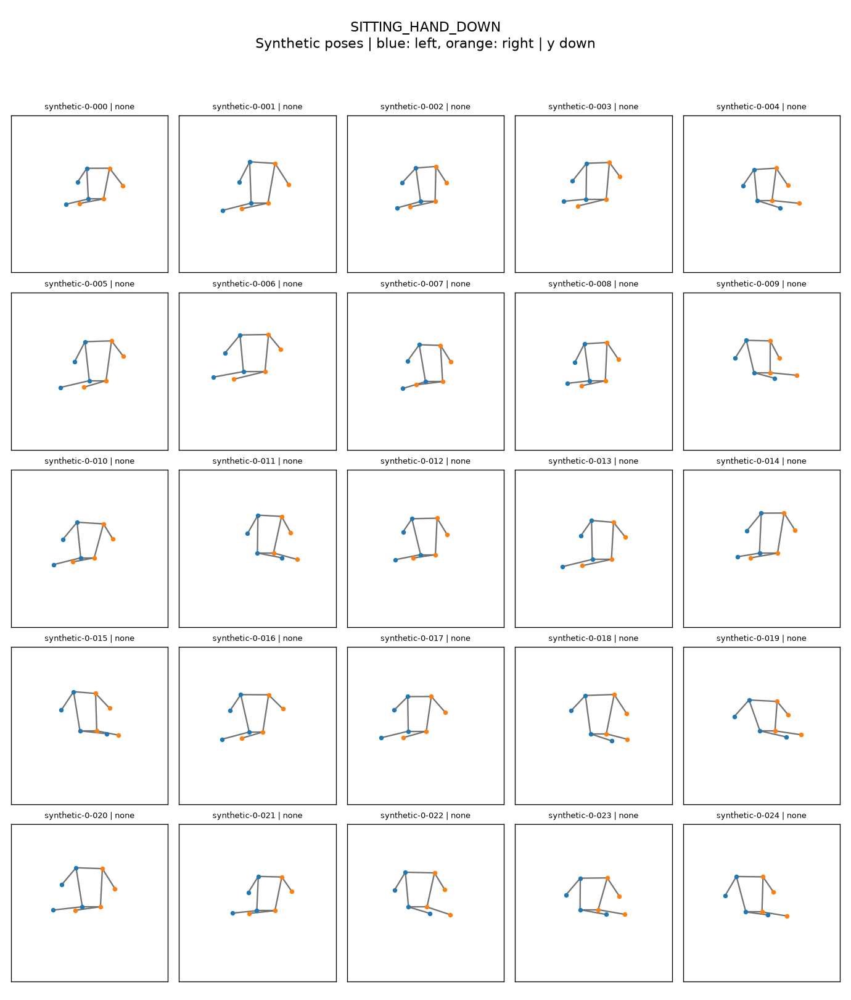
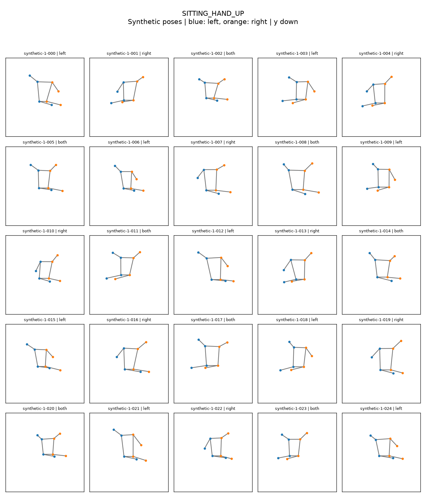
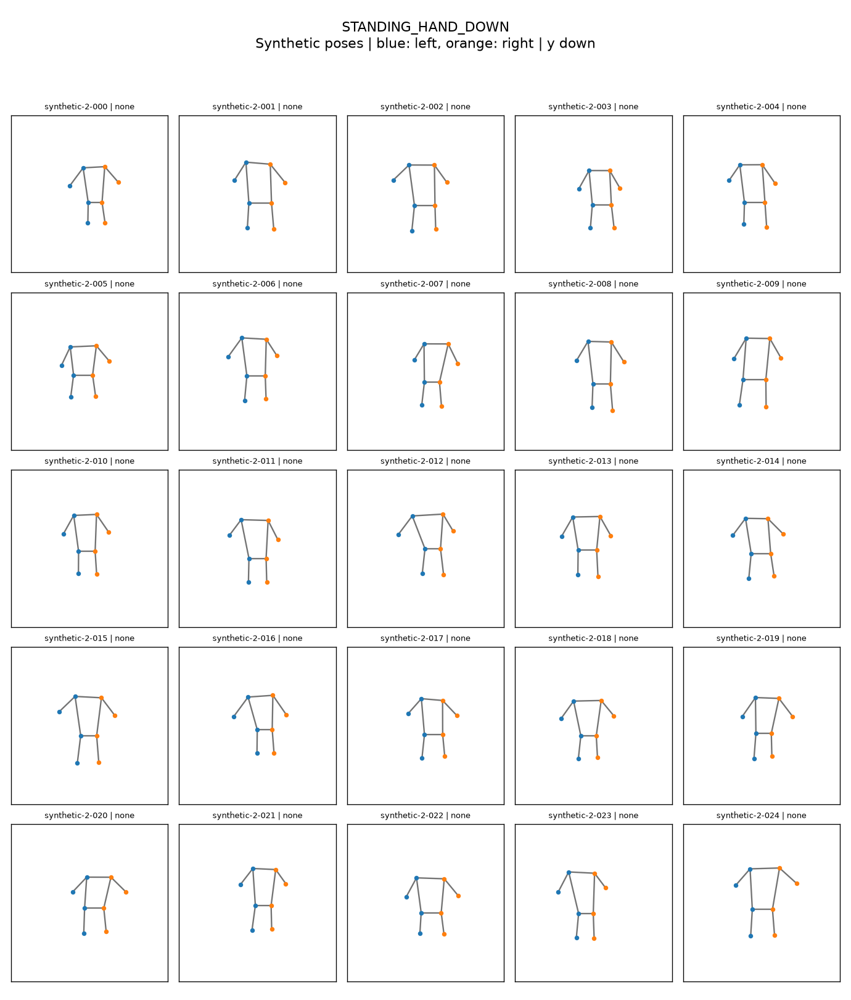
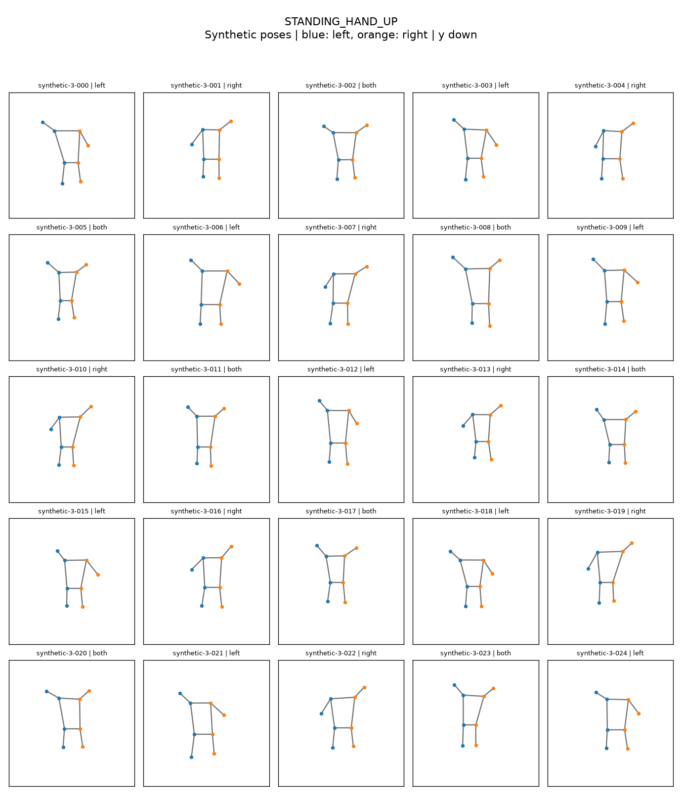

# 시각화

```bash
python scripts/visualize_pose.py --input data/sample/sample.json
python scripts/visualize_pose.py --input data/sample/pixel.json --show-preprocessed --show-features
python scripts/visualize_pose.py --input data/sample/poses.jsonl --index 2 --prediction 3
python scripts/visualize_dataset.py --input data/sample/poses.jsonl --num-samples 16
python scripts/visualize_dataset.py --input data/sample/poses.jsonl --class-id 3 --num-samples 20
```

PNG는 `results/visualize_pose/`, `results/visualize_dataset/`에 저장됩니다. `--output-dir`로 변경합니다.
전처리 비교는 `raw_pose.png`, `preprocessed_pose.png` 두 장입니다. 관절명·좌표·confidence/presence·정답·예측·정오 여부를 표시합니다.
없는 관절의 edge만 생략하고 누락 목록을 출력합니다. 파랑은 해부학적 왼쪽, 주황은 오른쪽입니다. 정규화 plot은 x/y 범위 `[0,1]`이고 y축은 뒤집혀 있습니다.
데이터셋 추출은 seed 42의 reservoir sampling으로 메모리를 제한하며 `selection.json`에 원본 인덱스를 기록합니다. 인덱스는 0부터 시작합니다.

## 클래스별 합성 데이터 100개

```bash
python scripts/generate_synthetic_dataset.py --per-class 25 --seed 42
```

`data/sample/synthetic_100.jsonl`에 4개 클래스 각각 25개를 저장하고,
`results/synthetic_100/`에 개별 PNG 100장과 클래스별 5×5 모음 PNG 4장을 생성합니다.
`manifest.json`에는 클래스별 수량과 seed가 기록됩니다. 같은 seed로 재생성할 수 있습니다.

몸의 비율·위치·크기와 팔·다리 위치를 변화시킵니다. HAND_UP에는 왼팔/오른팔/양팔을 든 경우가
포함됩니다. 앉은 자세는 허벅지가 대체로 수평인 비스듬한 측면 도식이며,
선 자세는 허벅지가 대체로 수직입니다. 어깨·팔꿈치·골반·무릎을 좌우 각각 생성하여 총 8개 관절만 포함합니다.
실제 사람의 측정값이나 카메라 투영 시뮬레이션이 아니므로 실제 모델 성능 평가에는 사용하지 마세요.

## 0: SITTING_HAND_DOWN



## 1: SITTING_HAND_UP



## 2: STANDING_HAND_DOWN



## 3: STANDING_HAND_UP


