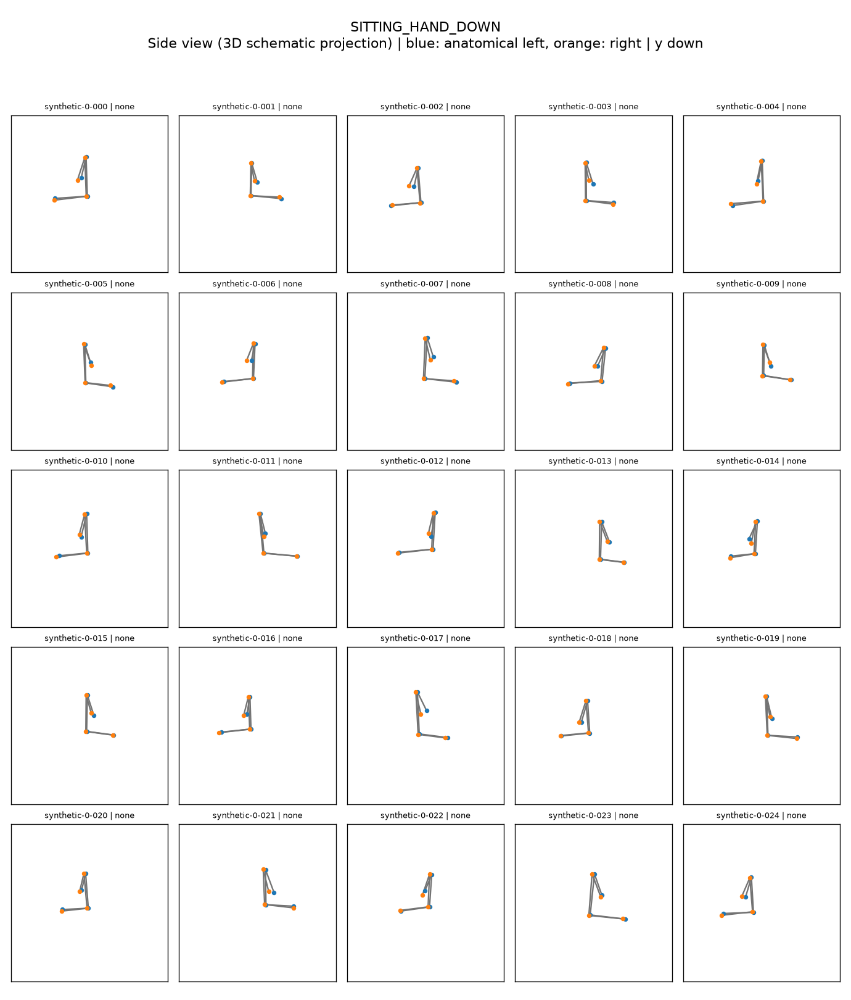
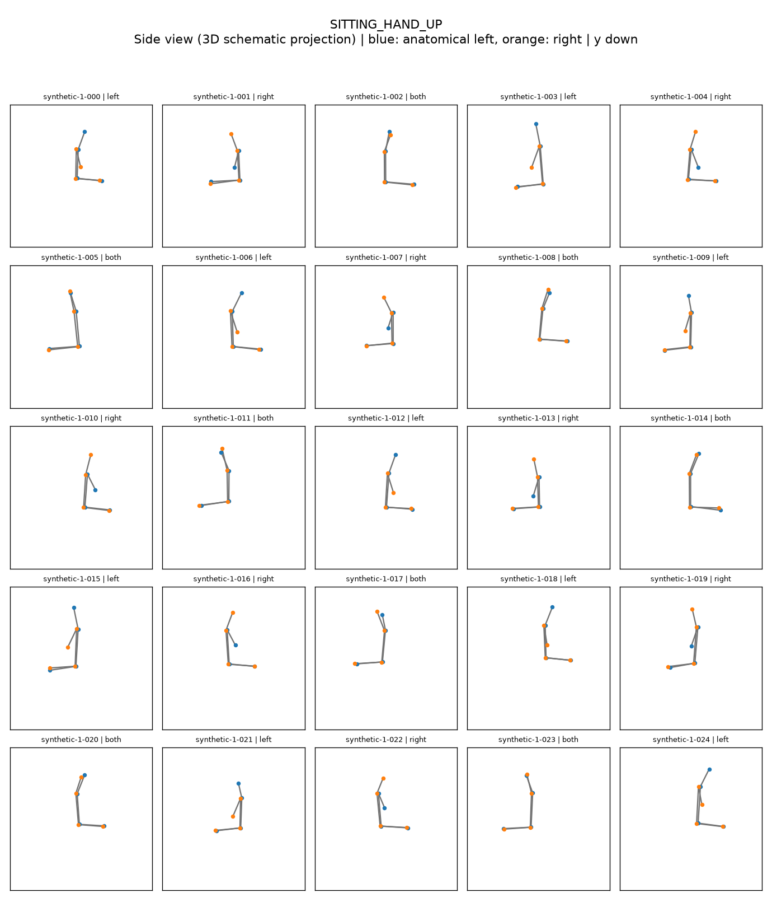
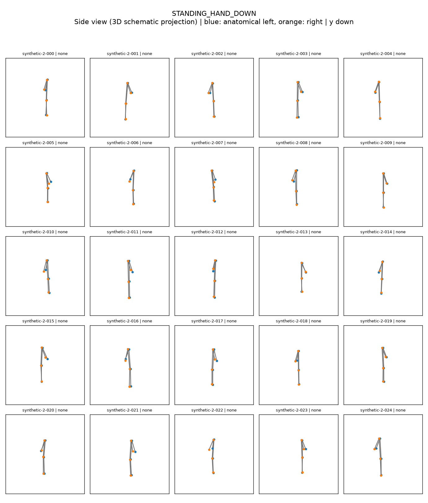
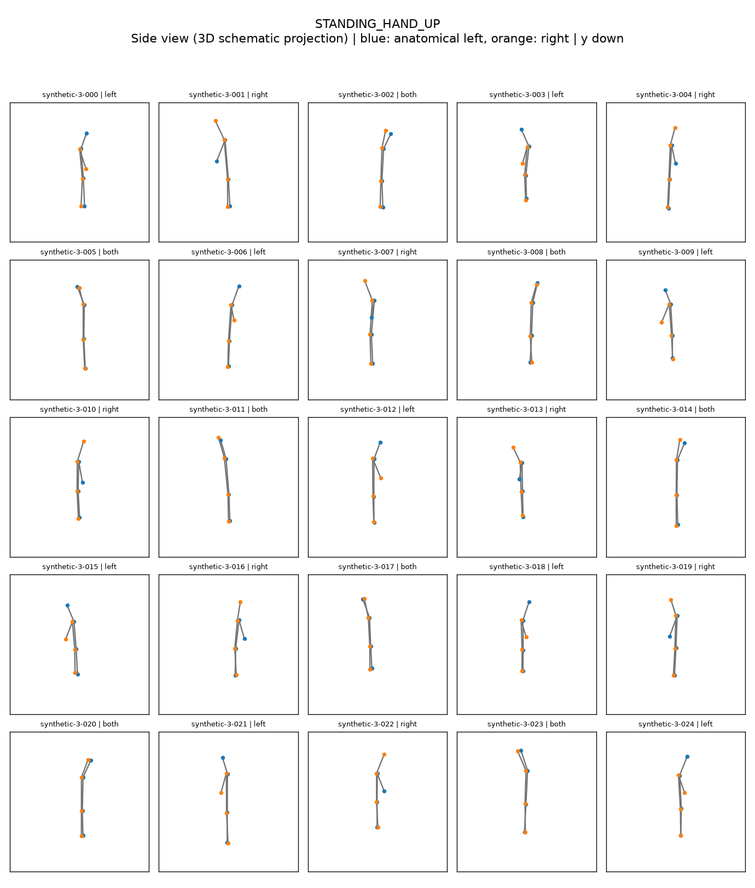

# 시각화

```bash
python scripts/visualize_pose.py --input data/sample/sample.json
python scripts/visualize_pose.py --input data/sample/pixel.json --show-preprocessed --show-features
python scripts/visualize_pose.py --input data/sample/poses.jsonl --index 2 --prediction 3
python scripts/visualize_dataset.py --input data/sample/poses.jsonl --num-samples 16
python scripts/visualize_dataset.py --input data/sample/poses.jsonl --class-id 3 --num-samples 20
```

PNG는 `results/visualize_pose/`, `results/visualize_dataset/`에 저장됩니다. `--output-dir`로 변경합니다.
전처리 비교는 `raw_pose.png`, `preprocessed_pose.png` 두 장입니다. 관절명·좌표·confidence/presence·정답·예측·정오 여부를 표시합니다.
없는 관절의 edge만 생략하고 누락 목록을 출력합니다. 파랑은 해부학적 왼쪽, 주황은 오른쪽입니다. 정규화 plot은 x/y 범위 `[0,1]`이고 y축은 뒤집혀 있습니다.
데이터셋 추출은 seed 42의 reservoir sampling으로 메모리를 제한하며 `selection.json`에 원본 인덱스를 기록합니다. 인덱스는 0부터 시작합니다.

## 클래스별 합성 데이터 100개

현재 데이터는 앉기·서기 모두 측면에서 본 **생성기 v4**입니다.
[v4 통합 JSONL](assets/datasets/side-v4/synthetic_100.jsonl)과
[v4 매니페스트](assets/datasets/side-v4/manifest.json)를 내려받을 수 있습니다.
[최신 VL 골격 모양 평가](experiment-results.md): Qwen3-VL-8B-Instruct: 확대 PNG+JSON 90% · InternVL3_5-8B-HF: 확대 PNG+JSON 51% · Idefics3-8B-Llama3: 확대 PNG+JSON 36%.
[현재 데이터 위치와 검사 기록](dataset-100.md), [이전 v2 데이터](dataset-v2.md)를 구분해서 확인할 수 있습니다.

```bash
python scripts/generate_synthetic_dataset.py --per-class 25 --seed 42
```

`data/sample/synthetic_100.jsonl`에 4개 클래스 각각 25개를 저장하고,
`data/sample/synthetic_100/`에 개별 JSON 100개·PNG 100장과 클래스별 5×5 모음 PNG 4장을 생성합니다. 이 파일들은 저장소에도 포함합니다.
`manifest.json`에는 클래스별 수량과 seed가 기록됩니다. 같은 seed로 재생성할 수 있습니다.

몸의 비율·위치·크기와 팔·다리 위치를 변화시킵니다. HAND_UP에는 왼팔/오른팔/양팔을 든 경우가
포함됩니다. 3D 관절 도식을 정면 기준 85~88도에서 정사영하므로 상체와 다리가 모두 측면으로 보입니다.
좌우 어깨·골반이 거의 겹치며 앉기의 허벅지는 앞으로, 서기의 허벅지는 아래로 향합니다.
화면 왼쪽·오른쪽 방향 각각 50개이고, 앉기·서기 각각에서도 방향별 25개입니다.
좌우는 해부학적 이름을 유지하지만 화면 x좌표 순서와 일치할 필요는 없습니다.
어깨·팔꿈치·골반·무릎의 좌우 8개 관절을 모두 기록하며 실제 카메라의 가림을 모사하지는 않습니다.
실제 사람의 측정값이나 카메라 투영 시뮬레이션이 아니므로 실제 모델 성능 평가에는 사용하지 마세요.

이미지는 **앉기·서기 모두 측면 · 8개 관절 · 생성기 v4** 기준입니다.
각 모음에는 해당 클래스의 새 샘플 25개가 표시됩니다.

## 클래스별 이미지

탭을 선택하면 해당 클래스의 25개 샘플을 볼 수 있습니다. 파랑은 해부학적 왼쪽, 주황은 오른쪽입니다.

=== "0 · 앉기 / 팔 내림"

    

=== "1 · 앉기 / 팔 올림"

    

=== "2 · 서기 / 팔 내림"

    

=== "3 · 서기 / 팔 올림"

    


## JSON과 개별 이미지 위치

[현재 데이터셋](dataset-100.md)에서 평가 입력 스냅샷과 manifest를 내려받을 수 있습니다.
로컬 `data/sample/synthetic_100/`에서는 같은 ID의 `.json`과 `.png`가 한 쌍입니다.
문서의 이미지와 평가 입력은 v4 스냅샷이며 이후 데이터 재생성과 구분해 보존합니다.

## 모델 입력용 확대 골격

`vision.py`의 `render_shape_input`은 관절 위치만으로 여백과 확대 비율을 정해 굵은 선과 색 점을 표시합니다. 축·격자·관절 글자·정답·예측·샘플 ID는 그리지 않습니다. 원래의 각도와 상대 길이를 유지하는 균일 확대·이동입니다. 모델에는 파일명이 아닌 실제 PNG 바이트를 전달합니다.
